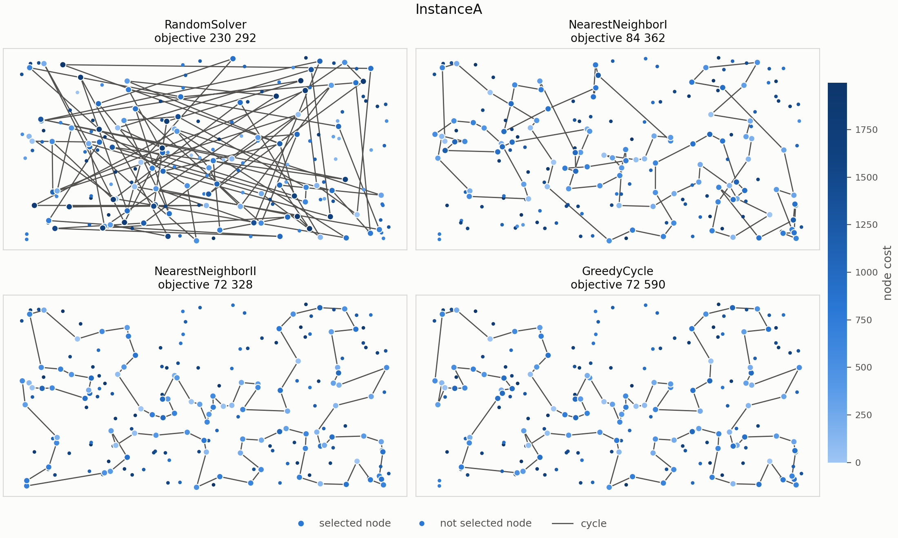
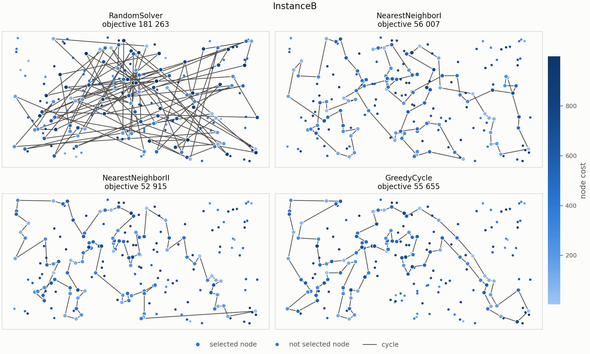

# Problem description

We are given a set of $n$ nodes. Each node has $x$ and $y$ coordinates in the
plane and a cost. The goal is to select exactly $k = \lceil n/2 \rceil$ nodes and
form a Hamiltonian cycle through them that minimizes the total length of the
cycle plus the total cost of the selected nodes:

$$
f(C) = \sum_{i=1}^{k} d\left(C_i, C_{(i \bmod k) + 1}\right) + \sum_{i=1}^{k} c(C_i),
$$

where $C = (C_1, \dots, C_k)$ is the cycle, $d$ is the distance between two
nodes and $c$ is the cost of a node.

Distances are Euclidean distances rounded mathematically to integers. The
distance matrix is computed once, right after reading an instance. The
optimization methods access only the distance matrix and the node costs, never
the coordinates, so the same code works for instances defined only by a
distance matrix with noneuclidean distances, even when the triangle inequality does not hold.

Both instances used in the experiments (A and B) have $n = 200$ nodes, so every
solution contains $k = 100$ nodes. Node costs range from 0 to 1997 in
instance A and from 3 to 999 in instance B.

# Implemented algorithms

Notation used in the pseudocode: $D$ is the distance matrix, $c$ the vector of
node costs, $s$ the starting node, and $k = \lceil n/2 \rceil$ the number of
nodes to select. Following the assignment, "nearest" is not taken literally.
Every greedy step chooses the node that causes the smallest increase of the
objective function, which includes both the added distance and the node
cost. Ties are broken in favour of the node with the lowest index.

## Random solution

```
Input:  number of nodes n, k = ⌈n/2⌉
Output: cycle C with k nodes

π ← random permutation of {0, …, n−1}
C ← first k elements of π
return C
```

## Nearest neighbor I — adding only at the end of the path

The path is extended only at its end. The edge closing the cycle (from the
last node back to the first) is not considered while building. It is added
when the solution is evaluated.

```
Input:  distance matrix D, node costs c, start node s, k = ⌈n/2⌉
Output: path P with k nodes (evaluated as a closed cycle)

P ← [s]
while |P| < k:
    last ← last node of P
    u* ← argmin over u ∉ P of ( D[last][u] + c[u] )
    append u* to the end of P
return P
```

## Nearest neighbor II — adding at any position of the path

In every step, each unselected node is evaluated at every position of the
current path: before the first node, between any two consecutive nodes, and
after the last node. As in the previous method, the closing edge is not
considered while building.

```
Input:  distance matrix D, node costs c, start node s, k = ⌈n/2⌉
Output: path P with k nodes (evaluated as a closed cycle)

P ← [s]
while |P| < k:
    m ← |P|
    for each node u ∉ P and each position p = 0, …, m:
        if p = 0:                                   ▷ new first node
            Δ(u, p) ← D[u][P[0]] + c[u]
        else if p = m:                              ▷ new last node
            Δ(u, p) ← D[P[m−1]][u] + c[u]
        else:                                       ▷ between P[p−1] and P[p]
            Δ(u, p) ← D[P[p−1]][u] + D[u][P[p]] − D[P[p−1]][P[p]] + c[u]
    (u*, p*) ← argmin Δ
    insert u* at position p* of P
return P
```

## Greedy cycle

The method starts from a cycle of two nodes and repeatedly inserts the node
whose cheapest insertion into the cycle increases the objective function the
least. The cycle is always treated as closed. The second node therefore adds
two edges ($s \to v \to s$), and an insertion between $a$ and $b$ replaces the
edge $(a, b)$.

```
Input:  distance matrix D, node costs c, start node s, k = ⌈n/2⌉
Output: cycle C with k nodes

C ← [s]
v ← argmin over u ∉ C of ( D[s][u] + D[u][s] + c[u] )     ▷ 2-node cycle s → v → s
C ← [s, v]

while |C| < k:
    for each node u ∉ C and each edge (a, b) of C:
        Δ(u, a, b) ← D[a][u] + D[u][b] − D[a][b] + c[u]
    (u*, a*, b*) ← argmin Δ
    insert u* between a* and b* in C
return C
```

# Computational experiment

Each greedy method was run 200 times per instance, once starting from each
node. The random method was also run 200 times per instance. The tables report
the minimum, maximum and average value of the objective function over these
runs, and the average running time of a single run (g++ with `-O2`; only the
time of the `solve` call is measured). The best value of each objective
statistic among the greedy methods is shown in bold.

**Instance A**

| Method                          |        Min |        Max |       Average | Time per run |
|:--------------------------------|-----------:|-----------:|--------------:|-------------:|
| Random solution                 |    230 292 |    287 316 |    260 981.78 |     0.004 ms |
| Nearest neighbor I              |     84 362 |     90 075 |     87 476.63 |     0.043 ms |
| Nearest neighbor II             | **72 328** |     77 022 |     74 306.53 |     1.230 ms |
| Greedy cycle                    |     72 590 | **75 281** | **73 739.29** |     1.004 ms |

**Instance B**

| Method                          |        Min |        Max |       Average | Time per run |
|:--------------------------------|-----------:|-----------:|--------------:|-------------:|
| Random solution                 |    181 263 |    231 186 |    206 818.09 |     0.003 ms |
| Nearest neighbor I              |     56 007 | **63 166** | **59 397.34** |     0.036 ms |
| Nearest neighbor II             | **52 915** |     66 164 |     59 476.23 |     1.211 ms |
| Greedy cycle                    |     55 655 |     63 734 |     59 650.85 |     1.001 ms |

# Visualization of the best solutions

Each panel shows the best solution found by one method. Node color encodes
the node cost (darker means more expensive). Selected nodes are drawn larger,
and the line shows the closed cycle, including the edge from the last node
back to the first.





# Best solutions

Node indices start from 0. Each list gives the order of nodes in the cycle.
The last node connects back to the first.

## Instance A

**Random solution** (objective 230 292)

```
142   9  10 110 111 171  83  27 114  45  44  31 139 101  88 113 179 181 138  32
29  86  61 178  58  41  53  51 159  72 105 165  87  20 163  60 195 173  96 120
135 188  16  64 187 149  63  90  69   2  22 137 189 180  39  38  28 156  71 169
153 141 109 157   8 102 124  24 132 172 166  48 123 134  57  62  40  49  95  56
106 107  55 126 194   0 152  97 164  36  82 117 162 151 150 133  76  98   4 158
```

**Nearest neighbor I** (objective 84 362)

```
 54   9  33  36 177  67 144  53 135  58 134 176 174 106  89 107  57 182 151  93
 50   3   1 164 178  29 136 186 184  47 159 130 153  78  88 193 170 146  75  64
150  42 113  43  85 142   8 131  84 158 192 181 114 141 180 132  76  80  48  31
 63 149 168  97 127 187  30 123 152 108  60 116  49  11 119 160  83  90  51  16
 35  87  45 140  52 179 185  28 102 156 157  71  91  38 100   4 112 139 115   5
```

**Nearest neighbor II** (objective 72 328)

```
104 129  69 127  97 168 116 149  63  11  49 160  83 123 100 152 108  60  31  48
 80  91 157  71   4  76 132 180  28 102 185  35 156  51  16  67 144 140  53 179
 52 177  36  33   9  54 131 174   8 164 186 136 163  29 101 178   1 169   3  50
147  47  93 106  42  89 113 130 159 146 170 153 193  78  88 107  64  57 182 151
150 176  72 134  84  58 158 192 181 114 135  73  45  87 141 187  30 189   2 171
```

**Greedy cycle** (objective 72 590)

```
 31 116 149 168  63  11  49  60 108 152 100  90 123  83 160  97 127  69 171   2
189  30 187 141  87  45  73 135 114 181 192 158  58  84 134  72 176 150 151 182
 57  64 107  88  78 193 153 170 146 159 130 113  89  42 106  93  47 147  50   3
169   1 178 101  29 163 136 186 164 142   8 174 131  54   9  33  36 177  52 179
 53 140 144  67  16  51 156  35 185 102  28 180 132  76   4  71 157  91  80  48
```

## Instance B

**Random solution** (objective 181 263)

```
 35  96  24 127 164  59 174  60  43  40 141  62 198  55  79 180 121 188  76  74
 39 126 186 154   0 161 151 176 185 113  29  65 179  98 117 102  46  25 116  89
122  32  19 131 196 109  49 148 162 159 194 105 193  75  99  70 171 140  36  34
 84 192 156 167  10 124  81  47  48 120 137 195  51  72 184 115 112 129 163  20
 14  11 157  41  88  77 106 110  63 155  71  15  83  95 199  18 132 125   1 153
```

**Nearest neighbor I** (objective 56 007)

```
 32  89  57  76  54 127 129  90 153  20  14   2 110 118  56 114 196  10 148 143
 78 192 162 104 185 184   3 151  69 172 133 120  96 121 198  48  72  46  86 117
160 136   8  21 154 140  47 170 125 177   6 132  29 197 175 134  45  60  40  71
155  97 115 180  65  28 149 145 158 116 147  42  50 130  30 183  38  64  85  59
167  51  87 179  82  88 171  99  67  24  34 181 152  73  98  27 135  75  79 156
```

**Nearest neighbor II** (objective 52 915)

```
110   2  14  20  74 153 182  52  90 129 127  80  54 192 162 104  76 185  57  89
 86  46  72   3 184 173 151 122 117   8 160  69 172 136 133 120 156  43  48  96
198 121 130 191  50  42 147 116  37 146  13 149  28 145  65 158 177 125  26 170
197  36 132  29   6 180 115 155  71 175 134  45 157  60  40 141  97 154 140  47
 38  21 176  30 183 189 168  64  59  85  51  73 167 152  34  24 181 179  87  82
```

**Greedy cycle** (objective 55 655)

```
174  36 197   6 180 115 170  97 140  47 155  71 175 134  45 157  60 141  40  33
 64  21 189 168  69 160 172 136 133 120   8 117  72  46  86 184   3 173 122 151
 98 111  27 135  76 185 162 192  80  52 182  20  74   2  93 110 118  14 153  90
129 127  54 104  57  89 156  43  48  96 198 121  63 130 191 183  30 176  38 154
 26 125 177 138 158 145 149 147  42 116  37 146  13  28  65 178 103  29 132   1
```

# Solution checker

the best solutions have been checked with the Solution checker.xlsx provided on ekursy and we confirmed that the values computed by checker match those computed by our algorithms.


# Conclusions

- **All greedy methods are far better than random solutions.** Their averages
  are 3 to 3.5 times lower than the random average on both instances. 
- **None of the methods reaches the optimum.** Even the best solutions found for both instances. Removing a crossing by reconnecting the two edges shortens the cycle without changing the selected nodes, so these solutions can still be improved, up to the rounding of distances. Greedy construction alone is therefore not enough. This motivates the improvement methods of the following labs, such as evolutionary algorithms, which can refine solutions like these.
- **On instance B the three greedy methods are close on average** (within
  0.5%), but they differ in spread. Nearest neighbor II found the best
  solution on both instances (72 328 and 52 915), yet
  on instance B it also has the worst maximum (66 164) and the largest range
  between best and worst run.
- **Ignoring the closing edge explains this spread.** Both nearest neighbor
  methods build an open path and choose nodes without accounting for the edge
  that later closes the cycle. Nearest neighbor II can extend the path at
  both ends, so the two ends can drift far apart. In its best instance B
  solution, the closing edge alone has length 1850 (the long
  edge across the bottom of its panel), compared with 87 and 175 in the best
  solutions of the other two greedy methods. Greedy cycle always works on a closed
  cycle, which makes it the most stable method on instance A (range 2 691).
- **The starting node matters.** For every greedy method, the difference
  between the best and the worst start is between 4% and 25% of the best
  value, so running each method from many starting nodes and keeping the best
  is worthwhile.
- **Better solutions cost more time.** Nearest neighbor I evaluates $O(n)$
  candidates per step, while nearest neighbor II and greedy cycle
  evaluate $O(n \cdot k)$ candidate–position pairs per step. They are about
  20–30 times slower, but a single run still takes only about 1 ms.


# Source code

The source code is available at <https://github.com/Kari3600/EC-Project>.

The algorithms are in `src/lab1_algos/`, the experiment is in `src/Test.cpp`,
and the figures are generated by `scripts/plot.py`.