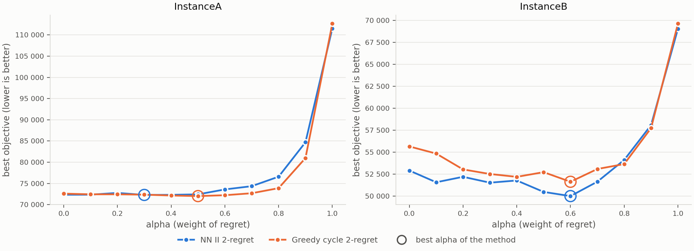
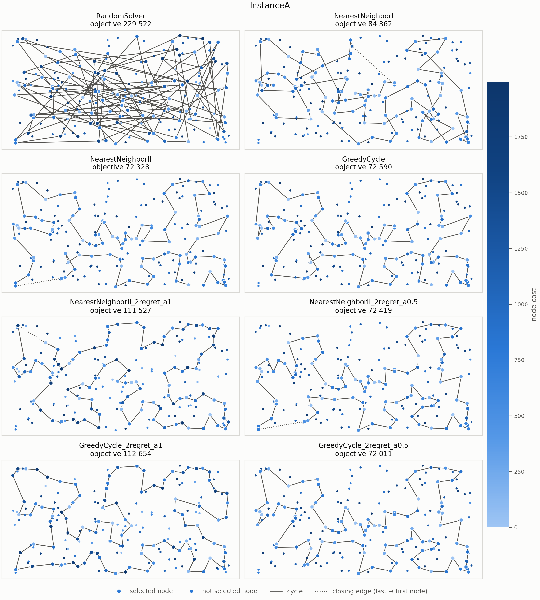
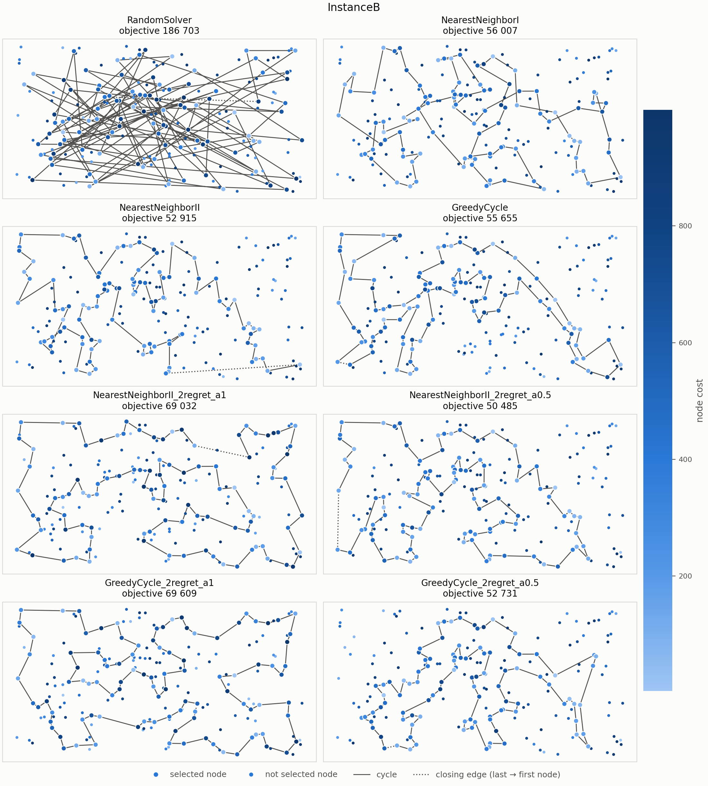

# Problem story

The problem can be read as the day of a student. There are 200 classes in one
day, held in different buildings all over the campus. To pass, the student has
to attend at least half of them, and attending more would only make the day
longer, so they attend exactly 100. Walking between buildings is tiring, and every class is tiring in itself.
The student starts and ends the day in the same place. The goal is to pass while getting as little tired as possible.

Last week, the student planned the day greedily: they always added the
class that was the least tiring to fit into the current plan at that moment.
The plan turned out to be far from the best possible one.

This week the student wants to be smarter and not **regret** their choices again.
For every class not yet in the plan, they compare the best and the second-best
way of fitting it into the day. The difference is the *regret*: how much they
would lose if they did not take that class now, in its best slot, and the slot
were gone later. 
- The pure regret student always takes the class with the
largest regret, the most "now or never" one, without looking at how tiring
that best slot is. 
- The weighted student balances both: urgency (regret) and
the effort of the best slot right now.

# Problem description (exactly the same as last week)

We are given a set of $n$ nodes. Each node has $x$ and $y$ coordinates in the
plane and a cost. The goal is to select exactly $k = \lceil n/2 \rceil$ nodes and
form a Hamiltonian cycle through them that minimizes the total length of the
cycle plus the total cost of the selected nodes:

$$
f(C) = \sum_{i=1}^{k} d\left(C_i, C_{(i \bmod k) + 1}\right) + \sum_{i=1}^{k} c(C_i),
$$

where $C = (C_1, \dots, C_k)$ is the cycle, $d$ is the distance between two
nodes and $c$ is the cost of a node.

Distances are Euclidean distances rounded mathematically to integers. The
distance matrix is computed once, right after reading an instance. The
optimization methods access only the distance matrix and the node costs, never
the coordinates, so the same code works for instances defined only by a
distance matrix, including non-Euclidean distances for which the triangle
inequality does not hold.

Both instances used in the experiments (A and B) have $n = 200$ nodes, so every
solution contains $k = 100$ nodes. Node costs range from 0 to 1997 in
instance A and from 3 to 999 in instance B.

# Implemented algorithms

Both new methods are built on the two insertion heuristics from lab 1:
nearest neighbor II (inserting into a path at any position) and greedy cycle
(inserting into a closed cycle). The methods from lab 1 (random solution,
nearest neighbor I and II, greedy cycle) are described in the lab 1 report.

Notation: $D$ is the distance matrix, $c$ the vector of node costs, $s$ the
starting node, $k = \lceil n/2 \rceil$ the number of nodes to select and
$\alpha \in [0, 1]$ the weight of the regret. For an unselected node $u$, let
$\Delta_1(u)$ and $\Delta_2(u)$ be the smallest and the second smallest change
of the objective function over all positions where $u$ can be inserted. Each
step selects the node with the largest score

$$
\text{score}(u) = \alpha \cdot \underbrace{\left(\Delta_2(u) - \Delta_1(u)\right)}_{\text{2-regret}}
\; - \; (1 - \alpha) \cdot \Delta_1(u),
$$

and inserts it at the position of $\Delta_1(u)$. Ties are broken in favour of
the node with the lowest index. Both terms are measured in the units of the
objective function, so equal weights are meaningful. The two methods required
by the assignment are special cases:

- **greedy 2-regret**: $\alpha = 1$ (only the regret counts),
- **weighted sum of 2-regret and best change of the objective**:
  $\alpha = 0.5$ (equal weights, the default).

For $\alpha = 0$ the score is $-\Delta_1(u)$, so the methods reduce to
nearest neighbor II and greedy cycle. In practice they give the same
solution for 90–99% of the starting nodes; the rest differ only by the order
in which ties are broken.

## Nearest neighbor II with weighted 2-regret

As in nearest neighbor II, the solution is built as a path, and the edge
closing the cycle is not considered while building.

```
Input:  distance matrix D, node costs c, start node s, k = ⌈n/2⌉, weight α
Output: path P with k nodes (evaluated as a closed cycle)

P ← [s]
while |P| < k:
    m ← |P|
    for each node u ∉ P:
        for each position p = 0, …, m:
            if p = 0:                                   ▷ new first node
                Δ(u, p) ← D[u][P[0]] + c[u]
            else if p = m:                              ▷ new last node
                Δ(u, p) ← D[P[m−1]][u] + c[u]
            else:                                       ▷ between P[p−1] and P[p]
                Δ(u, p) ← D[P[p−1]][u] + D[u][P[p]] − D[P[p−1]][P[p]] + c[u]
        Δ1(u), Δ2(u) ← smallest and second smallest Δ(u, ·)
        p*(u) ← position of Δ1(u)
        score(u) ← α · (Δ2(u) − Δ1(u)) − (1 − α) · Δ1(u)
    u* ← argmax over u ∉ P of score(u)
    insert u* at position p*(u*) of P
return P
```

## Greedy cycle with weighted 2-regret

The second node is chosen as in greedy cycle: with only one node in the cycle
there is a single possible position, so the regret is not defined yet.

```
Input:  distance matrix D, node costs c, start node s, k = ⌈n/2⌉, weight α
Output: cycle C with k nodes

C ← [s]
v ← argmin over u ∉ C of ( D[s][u] + D[u][s] + c[u] )     ▷ 2-node cycle s → v → s
C ← [s, v]

while |C| < k:
    for each node u ∉ C:
        for each edge (a, b) of C:
            Δ(u, a, b) ← D[a][u] + D[u][b] − D[a][b] + c[u]
        Δ1(u), Δ2(u) ← smallest and second smallest Δ(u, ·, ·)
        (a*, b*)(u) ← edge of Δ1(u)
        score(u) ← α · (Δ2(u) − Δ1(u)) − (1 − α) · Δ1(u)
    u* ← argmax over u ∉ C of score(u)
    insert u* between a*(u*) and b*(u*) in C
return C
```

# Computational experiment

Each greedy method, old and new, was run 200 times per instance, like in the lab1 experiments.

*Remark that we changed how the time is measured* — Each run is a separate execution of the `test_algo` program (g++ with `-O2`),
and only the time of the `solve` call is measured. Because every run starts in
a fresh process with cold caches, the times are about 2–2.5 times higher than
those in the lab 1 report, where all runs shared one process. The comparison
between methods is still fair. The results of the lab 1 greedy methods are
identical to the lab 1 report; the random method gives different values
because it now uses different seeds.

**Instance A**

\begin{center}
\begin{tabular}{lrrrr}
\toprule
Method & Min & Max & Average & Time per run \\
\midrule
Random solution                       & 229 522 & 286 183 & 260 175.53 & 0.007 ms \\
Nearest neighbor I                    & 84 362  & 90 075  & 87 476.63  & 0.092 ms \\
Nearest neighbor II                   & 72 328  & 77 022  & 74 306.53  & 2.823 ms \\
Greedy cycle                          & 72 590  & \textbf{75 281} & 73 739.29 & 2.435 ms \\
\midrule[1pt]
Nearest neighbor II 2-regret          & 111 527 & 133 181 & 122 860.66 & 2.902 ms \\
Nearest neighbor II weighted 2-regret & 72 419  & 78 504  & 75 561.20  & 2.863 ms \\
Greedy cycle 2-regret                 & 112 654 & 130 391 & 120 994.80 & 3.759 ms \\
Greedy cycle weighted 2-regret        & \textbf{72 011} & 75 532 & \textbf{73 353.18} & 3.933 ms \\
\bottomrule
\end{tabular}
\end{center}


**Instance B**
\begin{center}
\begin{tabular}{lrrrr}
\toprule
Method & Min & Max & Average & Time per run \\
\midrule
Random solution                       & 186 703 & 227 217 & 205 847.26 & 0.008 ms \\
Nearest neighbor I                    & 56 007  & 63 166  & 59 397.33  & 0.094 ms \\
Nearest neighbor II                   & 52 915  & 66 164  & 59 476.22  & 2.970 ms \\
Greedy cycle                          & 55 655  & 63 734  & 59 650.85  & 2.521 ms \\
\midrule[1pt]
Nearest neighbor II 2-regret          & 69 032  & 80 767  & 74 763.39  & 2.882 ms \\
Nearest neighbor II weighted 2-regret & \textbf{50 485} & \textbf{61 406} & \textbf{55 698.34} & 2.823 ms \\
Greedy cycle 2-regret                 & 69 609  & 78 175  & 73 459.29  & 3.949 ms \\
Greedy cycle weighted 2-regret        & 52 731  & 63 370  & 57 862.86  & 3.574 ms \\
\bottomrule
\end{tabular}
\end{center}


"2-regret" denotes $\alpha = 1$ and "weighted 2-regret" denotes $\alpha = 0.5$.

# Influence of the weight $\alpha$

To see how the weight changes the results, both methods were run from every
starting node for $\alpha = 0, 0.1, \dots, 1$. The figure shows the best
objective value found for each $\alpha$; the circles mark the best $\alpha$ of
each method.



To show the exact values we also present the table below

| $\alpha$ | NN II, A   | Greedy cycle, A | NN II, B   | Greedy cycle, B |
|---------:|-----------:|----------------:|-----------:|----------------:|
| 0.0      |     72 328 |          72 590 |     52 915 |          55 655 |
| 0.1      |     72 343 |          72 430 |     51 581 |          54 843 |
| 0.2      |     72 758 |          72 430 |     52 203 |          53 042 |
| 0.3      | **72 283** |          72 347 |     51 534 |          52 522 |
| 0.4      |     72 306 |          72 144 |     51 784 |          52 197 |
| 0.5      |     72 419 |      **72 011** |     50 485 |          52 731 |
| 0.6      |     73 581 |          72 217 | **50 011** |      **51 637** |
| 0.7      |     74 348 |          72 682 |     51 646 |          53 089 |
| 0.8      |     76 584 |          73 880 |     54 123 |          53 651 |
| 0.9      |     84 697 |          80 972 |     58 081 |          57 741 |
| 1.0      |    111 527 |         112 654 |     69 032 |          69 609 |

# Visualization of the best solutions

Each panel shows the best solution found by one method. Node color encodes
the node cost (darker means more expensive). Selected nodes are drawn larger,
the solid line shows the cycle, and the dotted line marks the edge from the
last node back to the first.





# Best solutions

The best solutions of the lab 1
methods are listed in the lab 1 report.

## Instance A

**Nearest neighbor II 2-regret** (objective 111 527)

```
199  82 116 119  11  49 108 152 123 160  12  97 120  92 171 166 183  10  22  98
 27  87 141  23 180  28 156  16 190  74 144 179 177  36  99  41  61 135 181  58
 84 134  65 158 111 182 105  57  64 107  88  78  26  75 170 159 130 117 113 106
150   0 176 174   8 142  85 128   3   1  59  46  86  55  17  29  19 163  24 136
186 109  34  62 154  39 175 115   5 112 139  18   4  76 132  68  44  14  38  80
```

**Nearest neighbor II weighted 2-regret** (objective 72 419)

```
171   2 189 187  30 141  87  45  73 135 114 181 192 158  58  84 134  72 176 174
150 106 113  89  42 151 138 182  57  64 107  88  78 193 153  75 170 146 159 130
 47  93  50   3 169   1  59 178 101  55  29 163 136 186 164 142   8   9  54  33
131  36 177  52 179  53 140 144  67  16  51  35 185 102  28 180 132  76   4  71
157  91  80 100 123  83 160 152 108  49  60 116 149  63 168  97 127  69 129 104
```

**Greedy cycle 2-regret** (objective 112 654)

```
133 139 112   5 175  39 154  62  34 109 186 136  24 163  19  29  17 101 155  21
147  37  47 169 164 142  85  81  93 117 130 159 170  75 193 107  64  57 124  89
106 151   0  72 134  84  58 158 192 181 118 114  25  98  70  27  10 183 166 171
 92 110 129 188  97 161  12 160 123 100 152 108  49  63  82  77 199  48 126 137
 91  71   4  76 132  68 162  23 145 180 102  35  67  45  61 140 177  52 190  51
```

**Greedy cycle weighted 2-regret** (objective 72 011)

```
 31  60 116 149  63 168  11  49 108 152 100 123  83 160  97 127 161  30 187 171
  2 189 141  87  45  73 135 114 181 192 158  58  84 134  72 176 174 150 106 113
 89  42 151 138 182  57  64 107  88  78 193 153  75 170 146 159 130  47  93  50
  3 169   1 178 101  55  29 163 136 186 164 142   8   9  54  33 131  36 177  52
179  53 140 144  67  16  51  35 185 102  28 180 132  76   4  71 157  91  80  48
```

## Instance B

**Nearest neighbor II 2-regret** (objective 69 032)

```
 57  44  89  32  43  48  58 198 121 195  50  42 116  37  13 149 145  65 178 103
132   1 108  62 175 134 157  60 141 155 113 115  19 177 125  26 161 154 140  47
 38  21 168 136   8  95 128 122 151 111   3 137  72  86   0 185 104 162  54 127
129  52 182 150  84  66  35  24  25  73  59 101 179  88 163  99 171  17  74  20
 14   2  93  23 110 118 131 148  10 196 193  61 105 169 165 199  70 190 194  12
```

**Nearest neighbor II weighted 2-regret** (objective 50 485)

```
 65 145  28 149  13 146  37 116 147  42  50 130  63 121 198  96  48 156  89  57
185  76 104 162  54 192  80 127 129  90 153  14   2  20  74  17 171  99  88 179
 87  82  51  85  59  73 167 181 152  34  24  67  66  27  98 151 122   3 184  46
 72 117   8 120 133 136 172 160  69 124  21 183  30  38  47 154 140  64  33  40
141 155  71  60 157  45 134 175  62  36 197   6 115 170 125 177  29 132 174   1
```

**Greedy cycle 2-regret** (objective 69 609)

```
 66  11  34 152 167  59 107  40 141  71  45 175  62  91  36 197   6 102 103 178
 65 145 149 146  37 116  42  50 195 121  63 120 133 168  21  30 191  15 161  26
154 140  47  64   4 124  69 128 122 151  98  22   3 135   0  86  72 166 156  32
 89  44  83  57  77 194 190  70 199 169 105  61 193 148 143  10  41  54 162 106
 80  52  90  56 118 100  93 188  14  20  74  17 171  99 163  88 179 126  31  67
```

**Greedy cycle weighted 2-regret** (objective 52 731)

```
 62  91  36 197 132  29   6 180 115 170 177 125  26  97 154 140  47  38  21  30
183 191 130  63 121 198  96  48  43 156  32  89  57  79 185 104  54 196 114  10
 90  14   2  20 153 129 127  80 192 162  76 135  27  11  66  67  24  34 152 181
126  88 179  87  82 167  51  85  59  73  98 151 122 173   3 184  86  46  72 117
  8 120 133 136 172 160  69 124   4  64  33 155  71 141  40  60 157  45 134 175
```

# Solution checker

the best solutions have been checked with the Solution checker.xlsx provided on ekursy and we confirmed that the values computed by checker match those computed by our algorithms.


# Conclusions

- **The weighted 2-regret methods give the best solutions so far.** Greedy
  cycle with weighted 2-regret found the best solution on instance A (72 011)
  and nearest neighbor II with weighted 2-regret on instance B (50 485). The
  best lab 1 solutions were 72 328 and 52 915. On average, the weighted versions improve
  their base methods by a few percent but there are cases when the solutions are worse in weighted versions (mostly on instance B)
- **Pure 2-regret is a poor criterion on its own, because it ignores node
  costs.**
    - With $\alpha = 1$ the average results are 30–60% worse than with
  $\alpha = 0.5$, although still 2–3 times better than random solutions. 
  - with α = 1 the regret depends only on distances.
  The cycles are therefore not long (on instance A the best 2-regret cycle is
  even the shortest of all methods), but the selected nodes are expensive.
- **A moderate weight of the regret is best.** For $\alpha$ between 0 and
  about 0.7 the best values change little on instance A and improve on
  instance B. For
  $\alpha = 0.8$ the results get worse, and for $\alpha = 0.9$ and $1$ they
  deteriorate sharply, as the node costs lose their weight. Equal weights
  ($\alpha = 0.5$) are a reasonable default but not the best choice for every
  method and instance: on instance B, $\alpha = 0.6$ gives 50 011 for nearest
  neighbor II, better than any solution in the main experiment.
- **The best regret solutions have no crossing edges**, while the best
  nearest neighbor II solutions from lab 1 had one crossing on instance A and
  two on instance B. A crossing always means that a 2-opt move can still
  shorten the cycle; its absence, however, does not guarantee optimality, so
  local search methods may improve these solutions further in the next lab.
- **The starting node still matters.** On instance B the weighted versions
  have a spread of about 20% between the best and the worst start.
- **The regret costs little extra time.** The new methods evaluate the same
  candidate–position pairs as their base methods, only keeping the two best
  values instead of one. The measured time is about the same as nearest
  neighbor II for its regret versions, and about 1.4–1.6 times that of
  greedy cycle for its regret versions, still only about 4 ms per run.

# Source code

The source code is available at <https://github.com/Kari3600/EC-Project>.

The new algorithms are in `src/lab2_algos/`, and a single run can be executed
with `src/TestAlgo.cpp`. The experiment is run by `scripts/run_experiment.py`,
the study of $\alpha$ by `scripts/lab2/alpha_sweep.py`, and the figures of the
best solutions are generated by `scripts/plot.py`.
