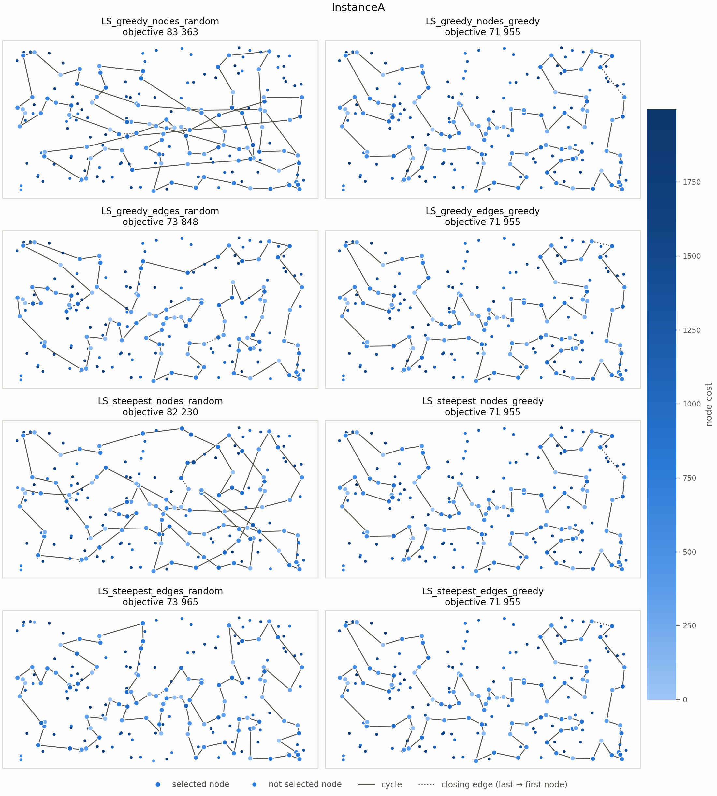
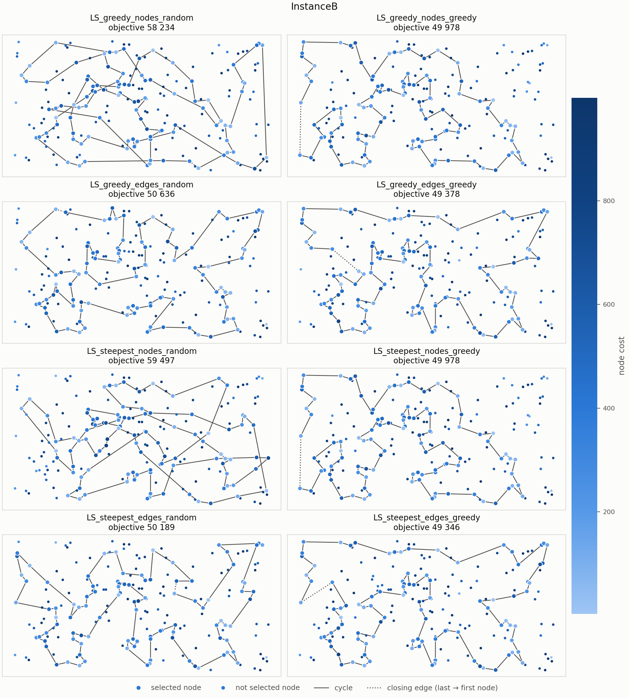

# Problem story

The student still has to attend 100 of the 200 classes in one day while
getting as little tired as possible. This week they do not build the plan from
scratch, but take a ready plan (a random one, or the one made with last week's
weighted regret rule) and keep improving it with small changes: replacing one
attended class with one not attended, swapping the order of two classes, or
walking a part of the route in reverse.

- The **greedy** student makes the first change that helps.
- The **steepest** student checks every possible change and makes the best one.

Both stop when no single change makes the day less tiring.

# Problem description (exactly the same as last week)

We are given a set of $n$ nodes. Each node has $x$ and $y$ coordinates in the
plane and a cost. The goal is to select exactly $k = \lceil n/2 \rceil$ nodes and
form a Hamiltonian cycle through them that minimizes the total length of the
cycle plus the total cost of the selected nodes:

$$
f(C) = \sum_{i=1}^{k} d\left(C_i, C_{(i \bmod k) + 1}\right) + \sum_{i=1}^{k} c(C_i),
$$

where $C = (C_1, \dots, C_k)$ is the cycle, $d$ is the distance between two
nodes and $c$ is the cost of a node.

Distances are Euclidean distances rounded mathematically to integers. The
distance matrix is computed once, right after reading an instance. The
optimization methods access only the distance matrix and the node costs, never
the coordinates, so the same code works for instances defined only by a
distance matrix, including non-Euclidean distances for which the triangle
inequality does not hold.

Both instances used in the experiments (A and B) have $n = 200$ nodes, so every
solution contains $k = 100$ nodes. Node costs range from 0 to 1997 in
instance A and from 3 to 999 in instance B.

# Implemented algorithms

Notation: $D$ is the distance matrix, $c$ the vector of node costs, $C$ the
current cycle with $k$ nodes, $C_i$ its node at position $i$ (indices modulo
$k$), and $U$ the set of nodes not in the cycle.

## Neighborhood

The neighborhood consists of two kinds of moves. Every move is evaluated by its
delta, the change of the objective function, computed only from the edges and
nodes that change; a negative delta means an improvement. The neighbor solution
is never built explicitly and the objective is never recomputed from scratch.

- **Inter-route move**, exchange of a selected and an unselected node: node
  $C_i$ is replaced by $u \in U$. With $a = C_{i-1}$, $v = C_i$, $b = C_{i+1}$:
  $$\Delta = D[a][u] + D[u][b] + c[u] - D[a][v] - D[v][b] - c[v].$$
- **Intra-route move, two-nodes exchange**: the nodes at positions $i$ and $j$
  swap places. Only the (up to four) edges adjacent to them change, and the
  set of selected nodes stays the same, so node costs do not change. When the
  two nodes are neighbors in the cycle, the edge between them stays and only
  the two outer edges change.
- **Intra-route move, two-edges exchange**: edges $(C_i, C_{i+1})$ and
  $(C_j, C_{j+1})$ are replaced by $(C_i, C_j)$ and $(C_{i+1}, C_{j+1})$, which
  reverses the part of the cycle between them:
  $$\Delta = D[C_i][C_j] + D[C_{i+1}][C_{j+1}] - D[C_i][C_{i+1}] - D[C_j][C_{j+1}].$$
  Pairs of edges sharing a node are skipped, as the move changes nothing.

Each local search uses the inter-route move together with one of the two
intra-route moves.

## Local search

The same main loop is used by all eight methods. The type of the starting
solution, the intra-route move and the type of local search are parameters.

```
Input:  distance matrix D, node costs c, start node s,
        type of start, intra-route move, type of local search
Output: locally optimal cycle C

if random start:
    C ← random solution
else:
    C ← best construction heuristic from lab 2 started from s
repeat
    improved ← step(C)                          ▷ steepest or greedy step
until not improved
return C
```

**Steepest step** — the best move of the whole neighborhood (both kinds of
moves) is applied:

```
best ← none, Δbest ← 0
for each position i, for each node u ∈ U:              ▷ inter-route moves
    if Δinter(i, u) < Δbest: best ← (inter, i, u), Δbest ← Δinter(i, u)
for each pair of positions i < j:                      ▷ intra-route moves
    if Δintra(i, j) < Δbest: best ← (intra, i, j), Δbest ← Δintra(i, j)
if best = none: return false                           ▷ local optimum
apply best, return true
```

**Greedy step** — the first improving move is applied, browsing the
neighborhood in a randomized order:

```
draw the kind of moves to browse first, inter or intra, with probability 1/2
for kind in (drawn kind, the other kind):
    draw random offsets r1, r2
    for a = 0, 1, …:                                   ▷ all moves of this kind,
        for b = 0, 1, …:                               ▷ starting from (r1, r2)
            (x, y) ← ((r1 + a) mod ·, (r2 + b) mod ·)  ▷ with wrap-around
            if Δkind(x, y) < 0:
                apply the move, return true
return false                                           ▷ local optimum
```

**Randomization of the greedy version.** In every step the kind of moves
browsed first (inter- or intra-route) is drawn with equal probability, so
neither kind is always tried first. If no move of that kind improves the
solution, the other kind is browsed. Within a kind, the moves are browsed in a
fixed order starting from a random place: for inter-route moves from a random
position in the cycle and a random unselected node, for intra-route moves from
a random pair of positions, with wrap-around, so every move is visited exactly
once. Deltas are computed only until the first improving move is found.

## Starting solutions

- **Random start**: a random set of $k$ nodes in random order.
- **Greedy start**: the best construction heuristic from lab 2 for the given
  instance, started from node $s$: greedy cycle with weighted 2-regret
  ($\alpha = 0.5$) on instance A, and nearest neighbor II with weighted
  2-regret ($\alpha = 0.5$) on instance B. These were the methods that found
  the best solutions in lab 2 (72 011 and 50 485).

# Computational experiment

Each of the eight local search methods was run 200 times per instance. Methods
with a random start were run from 200 random solutions (seeds 1–200). Methods
with a greedy start were started once from every node, which is the starting
node of the construction heuristic. The greedy local search also takes a seed,
because it browses the neighborhood in a random order. All earlier methods were
run again in the same way as in lab 2, and their objective values are identical
to those in the lab 1 and lab 2 reports.

As in lab 2, each run is a separate execution of the `test_algo` program (g++
with `-O2`), and only the time of the `solve` call is measured. For local
search this time includes building the starting solution (see the note below
the table of running times).

\begin{table}[H]
\centering
\small
\textbf{Objective function}\\[6pt]
\begin{tabular}{l r@{\ (}r@{ -- }r@{)\hspace{1.5em}} r@{\ (}r@{ -- }r@{)}}
\toprule
Method & \multicolumn{3}{c}{Instance A} & \multicolumn{3}{c}{Instance B} \\
\cmidrule(lr){2-4} \cmidrule(l){5-7}
 & \multicolumn{3}{c}{av (min -- max)} & \multicolumn{3}{c}{av (min -- max)} \\
\midrule
Random solution                          & 260\,176 & 229\,522 & 286\,183 & 205\,847 & 186\,703 & 227\,217 \\
Nearest neighbor I                       & 87\,477 & 84\,362 & 90\,075 & 59\,397 & 56\,007 & 63\,166 \\
Nearest neighbor II                      & 74\,307 & 72\,328 & 77\,022 & 59\,476 & 52\,915 & 66\,164 \\
Greedy cycle                             & 73\,739 & 72\,590 & 75\,281 & 59\,651 & 55\,655 & 63\,734 \\
\midrule[1pt]
Nearest neighbor II 2-regret             & 122\,861 & 111\,527 & 133\,181 & 74\,763 & 69\,032 & 80\,767 \\
Nearest neighbor II weighted 2-regret    & 75\,561 & 72\,419 & 78\,504 & 55\,698 & 50\,485 & 61\,406 \\
Greedy cycle 2-regret                    & 120\,995 & 112\,654 & 130\,391 & 73\,459 & 69\,609 & 78\,175 \\
Greedy cycle weighted 2-regret           & 73\,353 & 72\,011 & 75\,532 & 57\,863 & 52\,731 & 63\,370 \\
\midrule[1pt]
LS greedy, two-nodes, random start       & 88\,266 & 83\,363 & 94\,744 & 64\,560 & 58\,234 & 72\,315 \\
LS greedy, two-nodes, greedy start       & 73\,025 & \textbf{71\,955} & 74\,877 & 54\,342 & 49\,978 & 61\,265 \\
LS greedy, two-edges, random start       & 75\,646 & 73\,848 & 78\,573 & \textbf{52\,425} & 50\,636 & 54\,784 \\
LS greedy, two-edges, greedy start       & \textbf{72\,961} & \textbf{71\,955} & 74\,607 & 53\,085 & 49\,378 & 60\,266 \\
LS steepest, two-nodes, random start     & 90\,186 & 82\,230 & 98\,727 & 66\,372 & 59\,497 & 73\,726 \\
LS steepest, two-nodes, greedy start     & 73\,022 & \textbf{71\,955} & 74\,861 & 54\,292 & 49\,978 & 61\,265 \\
LS steepest, two-edges, random start     & 76\,208 & 73\,965 & 79\,586 & 52\,713 & 50\,189 & 55\,991 \\
LS steepest, two-edges, greedy start     & 73\,004 & \textbf{71\,955} & 74\,861 & 53\,091 & \textbf{49\,346} & 60\,354 \\
\bottomrule
\end{tabular}
\end{table}

\begin{table}[H]
\centering
\small
\textbf{Running time [ms]}\\[6pt]
\begin{tabular}{l r@{\ (}r@{ -- }r@{)\hspace{1.5em}} r@{\ (}r@{ -- }r@{)}}
\toprule
Method & \multicolumn{3}{c}{Instance A} & \multicolumn{3}{c}{Instance B} \\
\cmidrule(lr){2-4} \cmidrule(l){5-7}
 & \multicolumn{3}{c}{av (min -- max)} & \multicolumn{3}{c}{av (min -- max)} \\
\midrule
Random solution                          & 0.007 & 0.004 & 0.013 & 0.008 & 0.004 & 0.120 \\
Nearest neighbor I                       & 0.083 & 0.040 & 0.151 & 0.085 & 0.036 & 0.188 \\
Nearest neighbor II                      & 2.741 & 1.219 & 4.871 & 2.155 & 1.213 & 3.605 \\
Greedy cycle                             & 2.269 & 1.007 & 3.851 & 2.232 & 1.025 & 3.296 \\
\midrule[1pt]
Nearest neighbor II 2-regret             & 2.755 & 1.159 & 5.387 & 2.588 & 1.233 & 3.570 \\
Nearest neighbor II weighted 2-regret    & 2.679 & 1.276 & 4.303 & 2.597 & 1.214 & 4.163 \\
Greedy cycle 2-regret                    & 3.764 & 1.753 & 5.050 & 3.449 & 1.548 & 5.617 \\
Greedy cycle weighted 2-regret           & 3.248 & 1.555 & 5.017 & 3.124 & 1.482 & 4.684 \\
\midrule[1pt]
LS greedy, two-nodes, random start       & 7.699 & 2.699 & 14.928 & 5.413 & 1.906 & 9.762 \\
LS greedy, two-nodes, greedy start       & 3.891 & 1.779 & 6.388 & 3.983 & 1.626 & 7.996 \\
LS greedy, two-edges, random start       & 6.676 & 1.927 & 12.110 & 4.695 & 1.730 & 7.907 \\
LS greedy, two-edges, greedy start       & 4.015 & 1.757 & 6.419 & 3.985 & 1.520 & 7.478 \\
LS steepest, two-nodes, random start     & 13.551 & 8.833 & 26.024 & 13.532 & 8.883 & 26.182 \\
LS steepest, two-nodes, greedy start     & 4.075 & 1.763 & 7.550 & 4.106 & 1.376 & 7.449 \\
LS steepest, two-edges, random start     & 11.191 & 6.780 & 18.608 & 11.200 & 6.556 & 18.579 \\
LS steepest, two-edges, greedy start     & 3.874 & 1.694 & 6.153 & 4.468 & 1.600 & 7.482 \\
\bottomrule
\end{tabular}
\end{table}

The running time of local search includes building the starting solution. To
get the time of the local search alone, subtract the time of the construction
method from the same table: the random solution for a random start (on
average below 0.01 ms), and for a greedy start greedy cycle with weighted 2-regret on
instance A (3.25 ms) and nearest neighbor II with weighted 2-regret on
instance B (2.60 ms). With a greedy start the local search itself
therefore takes on average only about 0.6–0.8 ms on instance A and
1.4–1.9 ms on instance B.

The next table shows the number of steps, i.e. improving moves applied before a
local optimum was reached. Zero steps mean that the starting solution (a
construction from a greedy start) was already a local optimum.

\begin{table}[H]
\centering
\small
\textbf{Number of steps}\\[6pt]
\begin{tabular}{l r@{\ (}r@{ -- }r@{)\hspace{1.5em}} r@{\ (}r@{ -- }r@{)}}
\toprule
Method & \multicolumn{3}{c}{Instance A} & \multicolumn{3}{c}{Instance B} \\
\cmidrule(lr){2-4} \cmidrule(l){5-7}
 & \multicolumn{3}{c}{av (min -- max)} & \multicolumn{3}{c}{av (min -- max)} \\
\midrule
LS greedy, two-nodes, random start       & 523.7 & 441 & 659 & 520.8 & 422 & 613 \\
LS greedy, two-nodes, greedy start       & 4.2 & 0 & 12 & 17.0 & 0 & 41 \\
LS greedy, two-edges, random start       & 507.1 & 436 & 567 & 515.9 & 451 & 594 \\
LS greedy, two-edges, greedy start       & 5.1 & 0 & 21 & 28.4 & 3 & 63 \\
LS steepest, two-nodes, random start     & 152.9 & 123 & 193 & 151.2 & 110 & 190 \\
LS steepest, two-nodes, greedy start     & 3.3 & 0 & 9 & 10.5 & 0 & 23 \\
LS steepest, two-edges, random start     & 132.3 & 116 & 150 & 133.3 & 114 & 151 \\
LS steepest, two-edges, greedy start     & 3.3 & 0 & 10 & 14.3 & 3 & 30 \\
\bottomrule
\end{tabular}
\end{table}

"2-regret" denotes $\alpha = 1$ and "weighted 2-regret" denotes $\alpha = 0.5$.
"LS greedy" and "LS steepest" are the two types of local search, "two-nodes"
and "two-edges" the intra-route move, and "random" and "greedy" the starting
solution.

# Starting solutions of the best solutions

For every local search method, the table shows the best final solution, the
starting solution it was obtained from (the seed of the random solution, or the
starting node of the construction heuristic) and the objective value of that
starting solution.

\begin{center}
\small
\begin{tabular}{lrrrrrr}
\toprule
 & \multicolumn{3}{c}{Instance A} & \multicolumn{3}{c}{Instance B} \\
\cmidrule(lr){2-4} \cmidrule(lr){5-7}
Method & Final & Start & Initial & Final & Start & Initial \\
\midrule
LS greedy, two-nodes, random start       & 83\,363 & seed 117 & 251\,863 & 58\,234 & seed 190 & 217\,259 \\
LS greedy, two-nodes, greedy start       & 71\,955 & node 6 & 72\,575 & 49\,978 & node 90 & 50\,580 \\
LS greedy, two-edges, random start       & 73\,848 & seed 97 & 267\,117 & 50\,636 & seed 151 & 225\,299 \\
LS greedy, two-edges, greedy start       & 71\,955 & node 6 & 72\,575 & 49\,378 & node 105 & 54\,430 \\
LS steepest, two-nodes, random start     & 82\,230 & seed 97 & 267\,117 & 59\,497 & seed 61 & 206\,038 \\
LS steepest, two-nodes, greedy start     & 71\,955 & node 6 & 72\,575 & 49\,978 & node 90 & 50\,580 \\
LS steepest, two-edges, random start     & 73\,965 & seed 135 & 264\,114 & 50\,189 & seed 43 & 220\,627 \\
LS steepest, two-edges, greedy start     & 71\,955 & node 6 & 72\,575 & 49\,346 & node 193 & 54\,106 \\
\bottomrule
\end{tabular}
\end{center}

The best final solutions do not come from the best starting solutions. On
instance A the best construction (72 011, e.g. from node 31) is improved only
to 71 996, while the start from node 6 (72 575) leads to 71 955. On instance B
the best construction (50 485, node 192) is improved to 50 031, while the best
result, 49 346, comes from a starting solution of 54 106 (node 193).

# Visualization of the best solutions

Each panel shows the best solution found by one local search method. Node color
encodes the node cost (darker means more expensive). Selected nodes are drawn
larger, the solid line shows the cycle, and the dotted line marks the edge from
the last node back to the first.





# Best solutions

The best solutions of the earlier methods are listed in the lab 1 and lab 2
reports.

## Instance A

**LS greedy, two-nodes, random start** (objective 83 363)

```
 28 180 123 100 152 108  49 168  63 149 116  60  31  48  80  91  38  51  16   9
  3  50 159 130 113  93 178  29 136 186 164 142  85  43  89 106 150  67  35 156
132  76   4  71 157 112 139  33  54 174 176  72 134  84  99  36 131   8 169   1
147  37  47 102  30  97 127 171   2 187 141  87  98  58 151  42 107 146 170 153
193  78  88  64  57 182 158 192 181 114 135  73  45 140  53 179 177  52 144 185
```

**LS greedy, two-nodes, greedy start** (objective 71 955)

```
101  55  29 178 184 136 186 164   1 169   3  50  93  85 174   8  54   9  33 131
 36 177  52 179  53 140 144  67  16  51  35 185 102  28 180 132  76   4  71 157
 91  80  48  31 108 152 100 123  83 160  49  60 116 149  63 168  97 127 161  30
187 171   2 189 141  87  45  73 135 114 181 192 158  58  84 134  72 176 150 106
113  89  42 151 138 182  57  64 107  88  78 193 153 170 146 159 130  47  37 147
```

**LS greedy, two-edges, random start** (objective 73 848)

```
 72 176 174   8 142 164  85   1 169   3  50  93  43 106 113  89  42 150 151 182
 57 107  88  78 193 153 170 159 130  47 147 101  55  29 178 184 136 186  62 112
139  51  16  35  76  71 157  91  48  31  80 132  90  83 160 123 100 152 108  60
 49  11  63 149 116 168  97 127 171   2 187  30 141 180  28  87 185  67 144  52
 33   9  54 131  99  36 177 179  53 140  45  73 135 114 181 192 158  58  84 134
```

**LS greedy, two-edges, greedy start** (objective 71 955)

```
 55 101 147  37  47 130 159 146 170 153 193  78  88 107  64  57 182 138 151  42
 89 113 106 150 176  72 134  84  58 158 192 181 114 135  73  45  87 141 189   2
171 187  30 161 127  97 168  63 149 116  60  49 160  83 123 100 152 108  31  48
 80  91 157  71   4  76 132 180  28 102 185  35  51  16  67 144 140  53 179  52
177  36 131  33   9  54   8 174  85  93  50   3 169   1 164 186 136 184 178  29
```

**LS steepest, two-nodes, random start** (objective 82 230)

```
143  62  15 136 184   1 169   3  50 151 138 192 181 114 135 140  53 179 131 174
 93  47 147 101  29 178  85 142   8 164 186 154  39 115 157  71  91  80  48  31
 60 152 160  30 187 141  45  73  41  58 158 111 182  57  89  42 150  54   9  43
107  88  78 153 159 130 113 106 176 134  84 144  67  16  35 156 180  28 102 185
 87 189   2 171  69 127  97 168  63 149  49 123 132  76   4  51  52 177  36  33
```

**LS steepest, two-nodes, greedy start** (objective 71 955)

```
101  55  29 178 184 136 186 164   1 169   3  50  93  85 174   8  54   9  33 131
 36 177  52 179  53 140 144  67  16  51  35 185 102  28 180 132  76   4  71 157
 91  80  48  31 108 152 100 123  83 160  49  60 116 149  63 168  97 127 161  30
187 171   2 189 141  87  45  73 135 114 181 192 158  58  84 134  72 176 150 106
113  89  42 151 138 182  57  64 107  88  78 193 153 170 146 159 130  47  37 147
```

**LS steepest, two-edges, random start** (objective 73 965)

```
 52 143  33   9  54 131 134  72 176 174   8 142  85 164 136 184 178  29 101 147
 47   1 169   3  50  93 130 159 170 107 153 193  78  88  64  57  42  89 113 106
150 151 182 138 158 192  58  84  99  36 177 179  53 140  73 135  45  87 102  28
180 141  30 187 189   2 171  92  69 127  97  95 168  63 149 116  60  49 108 152
123  83  90 132  76  38  80  91  71 157 115 112 139  51  16 156  35 185  67 144
```

**LS steepest, two-edges, greedy start** (objective 71 955)

```
 55 101 147  37  47 130 159 146 170 153 193  78  88 107  64  57 182 138 151  42
 89 113 106 150 176  72 134  84  58 158 192 181 114 135  73  45  87 141 189   2
171 187  30 161 127  97 168  63 149 116  60  49 160  83 123 100 152 108  31  48
 80  91 157  71   4  76 132 180  28 102 185  35  51  16  67 144 140  53 179  52
177  36 131  33   9  54   8 174  85  93  50   3 169   1 164 186 136 184 178  29
```

## Instance B

**LS greedy, two-nodes, random start** (objective 58 234)

```
 99  88  45 134 175 132  29   6 115 170  38 176  30 183 172 136   8 117 156  89
 57 104 162  54 127  80 192  76  86  46  72  48  96 198 116 149  28 145 158  50
121  63 120 133  21  47 140  26 125 177  64  82  87 179 181 152  34  24  25  98
151   3 184 173 122 160  69 189 130 191 154  97 155  71  60  40  85  59  73  51
167  67  66  74   2  93 110 105  94  81 187 196 114  10  90 129 153  14  20 171
```

**LS greedy, two-nodes, greedy start** (objective 49 978)

```
 65 145  28 149  13 146  37 116 147  42  50 191 130 121 198  96  48 156  89  57
185  76 162  54 192  80 127 129  90 153  14   2  20  74  17 171  99  88 179  87
 82  51  85  59  73 167 181 152  34  24  67  66  27  98 151 122   3 184  46  72
117   8 120 133 136 172 160  69 189  21 183  30  38 154 140  47  64  33  40 141
155  71  60 157  45 134 175  62  36 197   6 115 170 125 177 178  29 132 174   1
```

**LS greedy, two-edges, random start** (objective 50 636)

```
147 121 198  58  96  48 120 133 136 172 160  69  21 183  30 130 191  38  47  64
151 122   3 184  46  72 156  89  57  79 185  76 104 190  70  81  94 105  61 139
196 114  10  54 162 192  80 127 129  90  52 153  74  20  14   2  17 171  99  88
 87  82 179  67  24  34 152 181 167  73  59  51  85  40 141  60 157  45 134 175
 62  36 197 132  29   6 180 170 115  71 155  97 140 154  26 125 145  28 149 116
```

**LS greedy, two-edges, greedy start** (objective 49 378)

```
158 145  28 149  13 146  37 116 147  42 121 198  96  48  89  57 190  70  81  94
105 196 114 148  10  78  54 162 192  80 127 129  90 153  14   2  20  74  17 171
 39  99  67  24  34 181 179  87  82 167  51  85  59  73  98 151   3 184  46  72
117   8 120 133 136 172 160  69  21 183  30 130 191  38  47  64  33  40 155  71
 60 157  45 134 175  62  91  36 197 132  29   6 180 115 170 177 125  97 140 154
```

**LS steepest, two-nodes, random start** (objective 59 497)

```
136 133 130 191  30 183 176  21 189 168 160   8 117  46  76 162 192 127 129  90
 52 153  74  20  14 118 131  56  80  67  88  87  82 179 181 152 167  51  73  59
 85  45 134 175 157  60  40 184   3  27  11  34  24  66  54  70 190  57  89 156
 48  96 198 121 120  72  86 104  78  10 196 114 148 110   2  17 171  99  98 151
122  69 124   4  64  33  47 140 154 125 158 149  28 170 115  71 155  97  38 172
```

**LS steepest, two-nodes, greedy start** (objective 49 978)

```
 65 145  28 149  13 146  37 116 147  42  50 191 130 121 198  96  48 156  89  57
185  76 162  54 192  80 127 129  90 153  14   2  20  74  17 171  99  88 179  87
 82  51  85  59  73 167 181 152  34  24  67  66  27  98 151 122   3 184  46  72
117   8 120 133 136 172 160  69 189  21 183  30  38 154 140  47  64  33  40 141
155  71  60 157  45 134 175  62  36 197   6 115 170 125 177 178  29 132 174   1
```

**LS steepest, two-edges, random start** (objective 50 189)

```
 76 162 192  54 187  70 190  94 105  81 196 114  10 148 143  90 129 127  80 182
153  14   2  20  74 171  39  99  31  67  66  24  34 152 181 179  87  82  85  59
 51 167  73 151 122 173   3 184 117   8 133 136 172 160  69  64  40 141 155  71
 60 157  45 134 175  62  36 197 132  29   6 115 170 125 177  65 145  28  13 146
149 158 154  97 140  47  38  21  30 130 121  96 120  72  46  86  89  57 104 185
```

**LS steepest, two-edges, greedy start** (objective 49 346)

```
 65 145  28 149  13 146  37 116 147  42 121 198  96  48  89  57 190  70 187  81
 94 105  61 139 196 114  10  78  54 162 192  80 127 129  90 153  14   2  20  74
 17 171  39  99  67  24  34 181 179  87  82 167  51  85  59  73  98 151 122   3
184  46  72 117   8 120 133 136 172 160  69  21  38 154 140  47  64  33  40 155
 71  60 157  45 134 175  62  91  36 197 132  29   6 180 115 170 177 125  26 158
```

# Solution checker

The best solutions have been checked with the Solution checker.xlsx provided on
ekursy, and we confirmed that the values computed by the checker match those
computed by our algorithms.

# Conclusions

- **Local search gives the best solutions so far:** 71 955 on instance A and
  49 346 on instance B, compared with 72 011 and 50 485 in lab 2.
- **Two-edges exchange is much better than two-nodes exchange from a random
  start:** on average about 75 600–76 200 instead of 88 300–90 200 on
  instance A, and 52 400–52 700 instead of 64 600–66 400 on instance B.
  Swapping two nodes cannot reverse a part of the cycle, so crossing edges
  remain (see the figures); the two-edges solutions have none.
- **From a random start, two-nodes exchange is worse than the simplest
  construction.** Its averages are worse than those of nearest neighbor I on
  both instances.
- **From a random start, two-edges exchange is competitive with the
  construction heuristics.** On instance B its average (52 425–52 713) is
  better than that of every construction heuristic (best 55 698); on
  instance A it is slightly worse (75 646–76 208 vs 73 353).
- **Local search improves a random solution about 3–4 times, but the greedy construction is improved just a little bit** (from 260 176 to
  75 646–90 186 on instance A, and from 205 847 to 52 425–66 372 on
  instance B).
- **With a greedy start, the type of the intra-route move matters little.**
  All four methods give similar results; local search improves the
  construction by about 0.5% on instance A and 2–5% on instance B.
- **Why all four methods with a greedy start find the same best solution on
  instance A.** The start from node 6 (72 575) is only a few moves from a
  local optimum: exchanges of a selected and an unselected node (the same in
  every method) and one swap of two neighboring nodes. Such a swap is also a
  two-edges exchange (reversing a part of two nodes), so all four methods
  reach the same cycle; the two-edges methods list it in the opposite
  direction. Only 4 of the 200 starts reach 71 955.
- **Greedy and steepest local search give solutions of similar quality**; the
  averages differ by less than 3%.
- **With a random start, greedy local search is faster than steepest local
  search, although it makes more steps:** about 5–8 ms instead of 11–14 ms,
  with 3.4–3.9 times more steps (510–525 instead of 130–155). A greedy step
  stops at the first improving move, a steepest step evaluates the whole
  neighborhood.
- **A greedy start is much faster than a random one.** Only a few steps are
  needed (on average 3–5 on instance A and 10–28 on instance B), so all four
  versions take about 4 ms, most of which is the construction heuristic.
- **The best starting solution does not lead to the best local optimum.** On
  both instances the best final solutions come from worse starting
  solutions, so it is worth starting local search from many different
  solutions.

# Source code

The source code is available at <https://github.com/Kari3600/EC-Project>.

The local search is in `src/lab3_algos/`, and a single run can be executed with
`src/TestAlgo.cpp` (the construction heuristic for the greedy start is chosen
with `--init`). The experiment is run by `scripts/run_experiment.py`, and the
figures of the best solutions are generated by `scripts/plot.py`.
