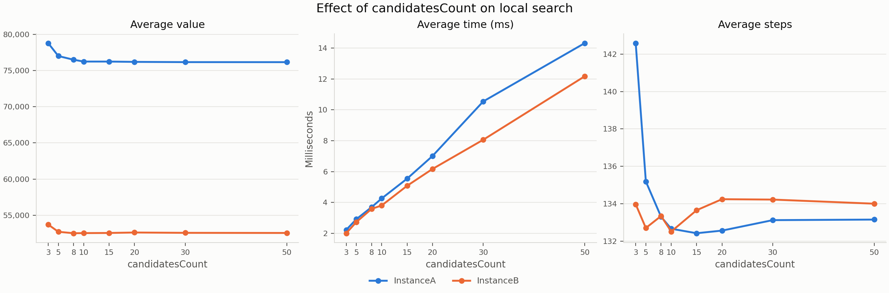

# Problem story

The student still has to attend 100 of the 200 classes in one day while
getting as little tired as possible. This week they do not build the plan from
scratch, but take a ready random plan and keep improving it with small changes:
replacing one attended class with one not attended, or walking a part of the
route in reverse. To plan faster, they now consider only changes that add a
walk from a class to one of its 10 most convenient classes (short walk, not
tiring class).

# Problem description (exactly the same as last week)

We are given a set of $n$ nodes. Each node has $x$ and $y$ coordinates in the
plane and a cost. The goal is to select exactly $k = \lceil n/2 \rceil$ nodes and
form a Hamiltonian cycle through them that minimizes the total length of the
cycle plus the total cost of the selected nodes:

$$
f(C) = \sum_{i=1}^{k} d\left(C_i, C_{(i \bmod k) + 1}\right) + \sum_{i=1}^{k} c(C_i),
$$

where $C = (C_1, \dots, C_k)$ is the cycle, $d$ is the distance between two
nodes and $c$ is the cost of a node.

Distances are Euclidean distances rounded mathematically to integers. The
distance matrix is computed once, right after reading an instance. The
optimization methods access only the distance matrix and the node costs, never
the coordinates, so the same code works for instances defined only by a
distance matrix, including non-Euclidean distances for which the triangle
inequality does not hold.

Both instances used in the experiments (A and B) have $n = 200$ nodes, so every
solution contains $k = 100$ nodes. Node costs range from 0 to 1997 in
instance A and from 3 to 999 in instance B.

# Implemented algorithms

Notation: $D$ is the distance matrix, $c$ the vector of node costs, $C$ the
current cycle with $k$ nodes, $C_i$ its node at position $i$ (indices modulo
$k$), and $U$ the set of nodes not in the cycle.

## Neighborhood

The neighborhood is the best one from lab 3. Every move is evaluated by its
delta, the change of the objective function, computed only from the edges and
nodes that change; a negative delta means an improvement. The neighbor solution
is never built explicitly and the objective is never recomputed from scratch.

- **Inter-route move**, exchange of a selected and an unselected node: node
  $C_i$ is replaced by $u \in U$. With $a = C_{i-1}$, $v = C_i$, $b = C_{i+1}$:
  $$\Delta = D[a][u] + D[u][b] + c[u] - D[a][v] - D[v][b] - c[v].$$
- **Intra-route move, two-edges exchange**: edges $(C_i, C_{i+1})$ and
  $(C_j, C_{j+1})$ are replaced by $(C_i, C_j)$ and $(C_{i+1}, C_{j+1})$, which
  reverses the part of the cycle between them:
  $$\Delta = D[C_i][C_j] + D[C_{i+1}][C_{j+1}] - D[C_i][C_{i+1}] - D[C_j][C_{j+1}].$$
  Pairs of edges sharing a node are skipped, as the move changes nothing.

## Candidate moves

For each node $v$ we determine the $m = 10$ "nearest" other nodes, where
"nearest" means the smallest value of $D[v][u] + c[u]$ (edge length plus the
cost of the other node). An edge is a **candidate edge** if at least one of its
endpoints chose the other one, so the lists are made symmetric; after this a
list contains on average 17.7 nodes on instance A and 16.2 nodes on instance B.
A move is a **candidate move** if it adds at least one candidate edge to the
solution. For a candidate edge $(v, u)$ with $v = C_i$ in the cycle there are
two such moves:

- **$u$ not in the cycle (inter-route move):** $u$ replaces the predecessor
  $C_{i-1}$ or the successor $C_{i+1}$ of $v$. Replacing $v$ itself would not
  add the edge $(v, u)$.
- **$u = C_j$ in the cycle (two-edges exchange):** either the edges
  $(C_i, C_{i+1})$ and $(C_j, C_{j+1})$, or the edges $(C_{i-1}, C_i)$ and
  $(C_{j-1}, C_j)$ are removed; both moves add the edge $(C_i, C_j)$.

The candidate lists depend only on the instance. In our implementation they are
built at the beginning of every run, and this time is included in the measured
running time.

## Local search with candidate moves

Steepest local search starting from a random solution. The baseline is the same
steepest local search (two-edges exchange, random start) from lab 3, which
evaluates the whole neighborhood in every step.

```
Input:  distance matrix D, node costs c, seed s, number of candidates m = 10
Output: locally optimal cycle C

C ← random solution (seed s)
for each node v:
    N[v] ← m nodes u ≠ v with the smallest D[v][u] + c[u]
make the lists symmetric: if u ∈ N[v], add v to N[u]
repeat
    improved ← steepest step(C)
until not improved
return C
```

**Steepest step with candidate moves** — the loops go only over the candidate
edges, so only candidate moves are evaluated:

```
best ← none, Δbest ← 0
for each node v in C:
    for each u ∈ N[v]:                              ▷ candidate edge (v, u)
        if u ∉ C:                                   ▷ inter-route moves
            for p in (position before v, position after v):
                if Δinter(p, u) < Δbest:
                    best ← (inter, p, u), Δbest ← Δinter(p, u)
        else if v < u:                              ▷ two-edges exchange
            i ← position of v, j ← position of u
            for (p, q) in ((i, j), (i − 1, j − 1)):
                if Δ2edges(p, q) < Δbest:
                    best ← (2-edges, p, q), Δbest ← Δ2edges(p, q)
if best = none: return false                        ▷ local optimum
apply best, return true
```

The condition $v < u$ prevents evaluating the same pair of nodes twice. A move
can still be evaluated twice when it adds two candidate edges at once; on random
starting solutions this concerns about 5–6% of the evaluated moves. Instead of
all 14 950 moves of the full neighborhood (10 000 inter-route moves and 4 950
pairs of edges), a step on a random starting solution evaluates only about
2 400–2 700 moves.

## Starting solutions

- **Random start**: a random set of $k$ nodes in random order. Both methods
  start from the same 200 random solutions.

# Computational experiment

Both methods of this assignment, steepest local search with two-edges exchange
from a random start without candidate moves (the baseline) and with candidate
moves, were run 200 times per instance from the same 200 random starting
solutions (seeds 1–200). For reference, the tables also contain all earlier
methods, run again in the same experiment. The construction heuristics give the
same objective values as in the lab 1 and lab 2 reports. The random solutions
differ from the earlier reports, because the random number generator is now
seeded inside the algorithm, so the random solution and local search from a
random start differ slightly from the lab 3 report. Local search with a greedy
start now uses greedy cycle with weighted 2-regret on both instances (in lab 3,
nearest neighbor II with weighted 2-regret was used on instance B).

As in the previous labs, each run is a separate execution of the `test_algo`
program (g++ with `-O2`), and only the time of the `solve` call is measured.
For local search this time includes building the random starting solution and,
with candidate moves, building the candidate lists. All values in the tables
come from one run of the experiment.

\begin{table}[H]
\centering
\small
\textbf{Objective function}\\[6pt]
\begin{tabular}{l r@{\ (}r@{ -- }r@{)\hspace{1.5em}} r@{\ (}r@{ -- }r@{)}}
\toprule
Method & \multicolumn{3}{c}{Instance A} & \multicolumn{3}{c}{Instance B} \\
\cmidrule(lr){2-4} \cmidrule(l){5-7}
 & \multicolumn{3}{c}{av (min -- max)} & \multicolumn{3}{c}{av (min -- max)} \\
\midrule
Random solution      & 262,653 & 238,917 & 286,724 & 206,842 & 181,610 & 226,734 \\
NearestNeighborI        & 87,477 & 84,362 & 90,075 & 59,397 & 56,007 & 63,166 \\
NearestNeighborII        & 74,307 & 72,328 & 77,022 & 59,476 & 52,915 & 66,164 \\
GreedyCycle        & 73,739 & 72,590 & 75,281 & 59,651 & 55,655 & 63,734 \\
\midrule[1pt]
Nearest neighbor II 2-regret        & 122,861 & 111,527 & 133,181 & 74,763 & 69,032 & 80,767 \\
Nearest neighbor II weighted 2-regret        & 75,561 & 72,419 & 78,504 & 55,698 & 50,485 & 61,406 \\
Greedy cycle 2-regret        & 120,995 & 112,654 & 130,391 & 73,459 & 69,609 & 78,175 \\
Greedy cycle weighted 2-regret        & 73,353 & 72,011 & 75,532 & 57,863 & 52,731 & 63,370 \\
\midrule[1pt]
LS greedy, two-nodes, random start        & 88,669 & 82,989 & 96,524 & 64,576 & 57,464 & 71,404 \\
LS greedy, two-nodes, greedy start        & 73,022& 71,955 & 74,861 & 57,528 & 52,702 & 62,933 \\
LS greedy, two-edges, random start        & 75,557 & 73,618 & 77,679 & 52,452 & 50,399 & 55,468 \\
LS greedy, two-edges, greedy start        & 72,966& 71,955 & 74,861 & 57,196 & 52,542 & 62,428 \\
LS steepest, two-nodes, random start        & 89,321 & 79,649 & 96,354 & 65,871 & 59,357 & 74,662 \\
LS steepest, two-nodes, greedy start        & 73,022 & 71,955 & 74,861 & 57,525 & 52,702 & 62,933 \\
LS steepest, two-edges, random start        & 76,161 & 74,008 & 80,204 & 52,570 & 50,492 & 56,091 \\
LS steepest, two-edges, greedy start        & 73,004 & 71,955 & 74,861 & 57,126 & 52,542 & 62,301 \\
\midrule[1pt]
LS with candidates        & 76,234 & 73,878 & 79,182 & 52,546 & 50,422 & 55,822\\
\bottomrule
\end{tabular}
\end{table}

\begin{table}[H]
\centering
\small
\textbf{Running time [ms]}\\[6pt]
\begin{tabular}{l r@{\ (}r@{ -- }r@{)\hspace{1.5em}} r@{\ (}r@{ -- }r@{)}}
\toprule
Method & \multicolumn{3}{c}{Instance A} & \multicolumn{3}{c}{Instance B} \\
\cmidrule(lr){2-4} \cmidrule(l){5-7}
 & \multicolumn{3}{c}{av (min -- max)} & \multicolumn{3}{c}{av (min -- max)} \\
\midrule
Random solution      & 0.004 & 0.003 & 0.009 & 0.003 & 0.003 & 0.009 \\
NearestNeighborI        & 0.029 & 0.026 & 0.049 & 0.029 & 0.027 & 0.050 \\
NearestNeighborII        & 1.130 & 1.083 & 1.923 & 1.157 & 1.082 & 2.056 \\
GreedyCycle        & 0.778 & 0.755 & 1.221 & 0.792 & 0.755 & 1.357 \\
\midrule[1pt]
Nearest neighbor II 2-regret        & 1.008 & 0.940 & 1.572 & 1.054 & 0.933 & 1.657 \\
Nearest neighbor II weighted 2-regret        & 1.037 & 0.922 & 1.661 & 1.036 & 0.883 & 1.519 \\
Greedy cycle 2-regret        & 1.365 & 1.286 & 1.902 & 1.379 & 1.288 & 1.831 \\
Greedy cycle weighted 2-regret        & 1.338 & 1.262 & 1.950 & 1.311 & 1.219 & 1.815 \\
\midrule[1pt]
LS greedy, two-nodes, random start        & 3.589 & 1.732 & 5.992 &2.437 & 1.115 & 4.002 \\
LS greedy, two-nodes, greedy start        & 1.600 & 1.382 & 3.926 & 1.642 & 1.404 & 2.435 \\
LS greedy, two-edges, random start        & 2.964 & 1.431 & 4.742 &2.174 & 1.046 & 4.796 \\
LS greedy, two-edges, greedy start        & 1.559 & 1.361 & 2.122 & 1.732 & 1.430 & 2.684 \\
LS steepest, two-nodes, random start        & 10.672 & 8.225 & 17.996 & 11.100 & 8.556 & 20.230 \\
LS steepest, two-nodes, greedy start        & 1.609 & 1.349 & 2.072 & 1.758 & 1.393 & 3.084 \\
LS steepest, two-edges, random start        & 7.029 & 6.200 & 11.413 & 7.200 & 6.120 & 10.756 \\
LS steepest, two-edges, greedy start        & 1.557 & 1.331 & 2.676 & 1.879 & 1.442 & 3.143 \\
\midrule[1pt]
LS with candidates        & 3.540 & 3.213 & 4.673 & 3.325 & 2.870 & 4.806 \\
\bottomrule
\end{tabular}
\end{table}

Local search with candidate moves reaches practically the same objective values
as the baseline (LS steepest, two-edges, random start) in about half the time:
3.54 ms instead of 7.03 ms on instance A (2.0 times faster) and 3.33 ms instead
of 7.20 ms on instance B (2.2 times faster).

The next table shows the number of steps, i.e. improving moves applied before a
local optimum was reached. Zero steps mean that the starting solution (a
construction from a greedy start) was already a local optimum.

\begin{table}[H]
\centering
\small
\textbf{Number of steps}\\[6pt]
\begin{tabular}{l r@{\ (}r@{ -- }r@{)\hspace{1.5em}} r@{\ (}r@{ -- }r@{)}}
\toprule
Method & \multicolumn{3}{c}{Instance A} & \multicolumn{3}{c}{Instance B} \\
\cmidrule(lr){2-4} \cmidrule(l){5-7}
 & \multicolumn{3}{c}{av (min -- max)} & \multicolumn{3}{c}{av (min -- max)} \\
\midrule
LS greedy, two-nodes, random start        & 525.0 & 412 & 605 & 521.4 & 445 & 603 \\
LS greedy, two-nodes, greedy start        & 4.3 & 0 & 17 & 5.8 & 1 & 32 \\
LS greedy, two-edges, random start        & 510.2 & 449 & 578 & 510.5 & 459 & 596 \\
LS greedy, two-edges, greedy start        & 5.2 & 0 & 19 & 10.2 & 2 & 39 \\
LS steepest, two-nodes, random start        & 154.1 & 123 & 201 & 151.4 & 123 & 200 \\
LS steepest, two-nodes, greedy start        & 3.3 & 0 & 9 & 5.3 & 1 & 21 \\
LS steepest, two-edges, random start        & 133.2 & 119 & 150 & 134.0 & 119 & 152 \\
LS steepest, two-edges, greedy start        & 3.3 & 0 & 10 & 9.2 & 2 & 24 \\
\midrule[1pt]
LS with candidates        & 132.7 & 116 & 154 & 132.5 & 115 & 150 \\
\bottomrule
\end{tabular}
\end{table}

"2-regret" denotes $\alpha = 1$ and "weighted 2-regret" denotes $\alpha = 0.5$.
"LS greedy" and "LS steepest" are the two types of local search, "two-nodes"
and "two-edges" the intra-route move, and "random" and "greedy" the starting
solution.

# Visualization of the best solutions

Each panel shows the best solution of the baseline (steepest local search with
two-edges exchange from a random start, left) and of local search with
candidate moves (right). Node color
encodes the node cost (darker means more expensive). Selected nodes are drawn
larger, the solid line shows the cycle, and the dotted line marks the edge from
the last node back to the first.


# Best solutions

The best solutions of the earlier methods are listed in the lab 1 and lab 2
reports.

## Instance A

**LS steepest, two-edges, random start** (objective 74 008)

```
30 187 189 2 171 92 69 127 97 95 168 63 116 149 49 152 108 60 31 48 80 91 100 123 83 90 132 76 4 71 157 115 112 139 51 16 67 144 52 179 177 36 33 9 54 131 99 84 58 158 134 72 176 174 8 142 164 85 93 50 3 169 1 178 136 163 29 101 147 47 130 159 170 78 193 153 107 113 89 42 106 150 151 57 182 111 192 181 135 73 140 53 45 87 28 185 35 156 180 141
```

**Local search with candidates** (objective 73 878)

```
185 102 87 28 180 141 30 187 2 171 92 104 129 69 127 95 97 160 83 123 100 152 49 11 63 168 116 149 60 108 31 48 80 91 157 71 4 76 132 51 16 156 35 67 144 140 53 179 52 177 36 131 33 9 54 194 8 174 85 164 186 136 184 178 29 101 147 37 47 1 3 50 93 81 106 43 113 130 159 170 78 193 153 107 64 57 182 151 42 89 150 176 134 158 192 58 84 135 73 45
```

## Instance B

**LS steepest, two-edges, random start** (objective 50 492)

```
30 38 47 140 154 40 60 45 134 175 71 155 125 170 115 180 6 29 132 178 65 145 28 149 116 147 42 121 198 96 48 89 57 190 70 94 105 81 169 187 196 114 10 148 56 118 110 93 2 17 171 39 99 74 20 14 153 52 90 129 127 80 192 54 162 76 66 67 31 24 34 152 181 126 88 179 87 82 85 59 73 51 167 98 151 3 184 86 46 72 117 8 120 133 136 172 160 69 21 183
```

**Local search with candidates** (objective 50 422)

```
149 116 147 42 121 198 96 48 89 83 57 190 70 81 94 105 196 114 10 90 129 153 14 2 74 20 182 80 127 54 192 162 104 185 76 66 67 24 34 152 181 179 87 82 51 85 59 73 167 151 122 173 184 3 86 46 72 120 133 136 8 117 160 69 172 189 21 183 30 130 191 38 47 140 154 97 71 40 60 157 45 134 175 62 91 36 197 29 132 103 6 180 115 170 177 125 26 158 145 28
```

# Effect of candidates count on local search

The candidate count $m$ controls the size of the neighborhood considered by the
local search. These runs were made separately from the main experiment, so the
times differ slightly from the tables above (e.g. about 4.2 ms instead of
3.54 ms for 10 candidates on instance A). Increasing it from 3 to 10 substantially improves the average
objective value on both instances: from 78,779 to 76,234 on A (about 3.2%) and
from 53,728 to 52,546 on B (about 2.2%). Further increases bring only small
gains. On A, the best average in this experiment is 76,152 at a count of 50,
only about 0.1% below the result at 10. On B, the best average is 52,529 at a
count of 8; counts from 8 to 50 remain close, between 52,529 and 52,628.

Runtime, in contrast, rises steadily with the candidate count. From 3 to 50 it
increases from 2.22 ms to 14.32 ms on A and from 2.00 ms to 12.17 ms on B.
The average number of improving steps changes much less: it falls from about
143 to 133 on A and stays around 133–134 on B. Thus, the extra runtime mainly
comes from evaluating a larger neighborhood, not from taking substantially
more search steps.

Overall, a count around 8–10 offers a good quality/runtime trade-off for these
instances: most of the objective improvement is already achieved, while
runtime remains far below that at counts of 30 or 50. The best setting may
depend on whether a small additional quality gain is worth the extra runtime.



# Solution checker

The best solutions have been checked with the Solution checker.xlsx provided on
ekursy, and we confirmed that the values computed by the checker match those
computed by our algorithms.

# Conclusions

- **Candidate moves halve the running time without loss of quality.** Local
  search with candidate moves is 2.0 times faster on instance A (3.54 ms vs
  7.03 ms) and 2.2 times faster on instance B (3.33 ms vs 7.20 ms). Its average
  objective is practically the same: 76 234 vs 76 161 on instance A (0.1%
  worse) and 52 546 vs 52 570 on instance B (slightly better).
- **The best and the worst runs are even slightly better with candidate
  moves**: best 73 878 vs 74 008 and 50 422 vs 50 492, worst 79 182 vs 80 204
  and 55 822 vs 56 091. Restricting the search to candidate moves skips almost
  no good moves: improving moves nearly always add short edges to cheap nodes.
- **The number of steps does not change** (132.7 vs 133.2 on instance A, 132.5
  vs 134.0 on instance B). Candidate moves reduce the work in each step, not
  the number of improvements, so one step takes about 0.026 ms instead of
  0.053 ms.
- **The speedup is smaller than the reduction of evaluated moves.** A step
  evaluates about 6 times fewer moves, but the run is only about 2 times
  faster. Part of the difference is building the candidate lists in every run
  (about 1.3 ms when measured separately on one of our computers), which could
  be done only once per instance.
- **The running time is more stable with candidate moves**: 3.21–4.67 ms vs
  6.20–11.41 ms on instance A, and 2.87–4.81 ms vs 6.12–10.76 ms on instance B.
- **About 10 candidates is a good choice.** With 3 candidates the average is
  3.2% (A) and 2.2% (B) worse, while more than 10 candidates improve it by at
  most 0.1% and cost a lot of time: with 20 candidates the time on instance A
  is about the same as without candidate moves, and with 30 and 50 candidates
  the method is slower than the baseline on both instances.
- **Greedy local search without candidate moves is still faster.** From a
  random start, greedy local search with two-edges exchange takes 2.96 ms (A)
  and 2.17 ms (B) and gives similar averages (75 557 and 52 452), so applying
  candidate moves to the greedy version could speed it up further.

# Source code

The source code is available at <https://github.com/Kari3600/EC-Project>.

The local search with candidate moves is in `src/lab4_algos/`, and a single run
can be executed with `src/TestAlgo.cpp`, e.g.
`test_algo LocalSearchWithCandidates data/InstanceA.csv --seed 1 --candidatesCount 10`;
the baseline is `LocalSearch` with `--searchType Steepest --intraMove Edges
--initialSolver RandomSolver`. The experiment is run by
`scripts/run_experiment.py`, and the figures of the best solutions are
generated by `scripts/plot.py`.
