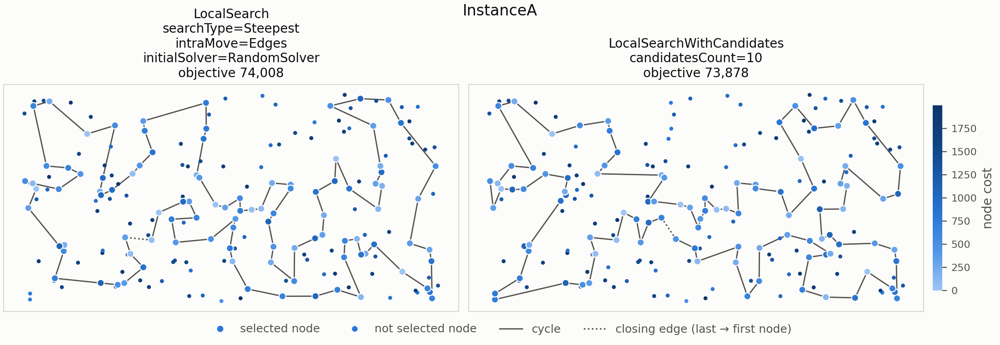
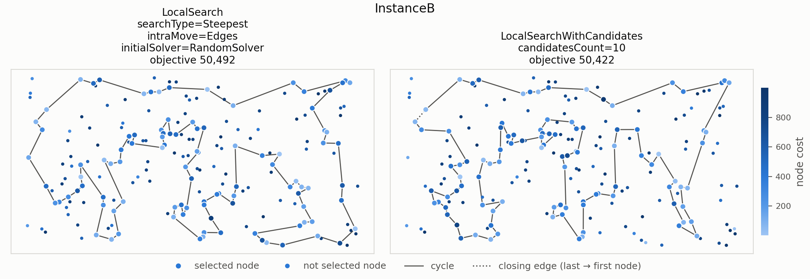

# Problem story

The student still has to attend 100 of the 200 classes in one day while
getting as little tired as possible. This week they do not build the plan from
scratch, but take a ready plan (a random one, or the one made with last week's
weighted regret rule) and keep improving it with small changes: replacing one
attended class with one not attended, swapping the order of two classes, or
walking a part of the route in reverse.

- The **greedy** student makes the first change that helps.
- The **steepest** student checks every possible change and makes the best one.

Both stop when no single change makes the day less tiring.

# Problem description (exactly the same as last week)

We are given a set of $n$ nodes. Each node has $x$ and $y$ coordinates in the
plane and a cost. The goal is to select exactly $k = \lceil n/2 \rceil$ nodes and
form a Hamiltonian cycle through them that minimizes the total length of the
cycle plus the total cost of the selected nodes:

$$
f(C) = \sum_{i=1}^{k} d\left(C_i, C_{(i \bmod k) + 1}\right) + \sum_{i=1}^{k} c(C_i),
$$

where $C = (C_1, \dots, C_k)$ is the cycle, $d$ is the distance between two
nodes and $c$ is the cost of a node.

Distances are Euclidean distances rounded mathematically to integers. The
distance matrix is computed once, right after reading an instance. The
optimization methods access only the distance matrix and the node costs, never
the coordinates, so the same code works for instances defined only by a
distance matrix, including non-Euclidean distances for which the triangle
inequality does not hold.

Both instances used in the experiments (A and B) have $n = 200$ nodes, so every
solution contains $k = 100$ nodes. Node costs range from 0 to 1997 in
instance A and from 3 to 999 in instance B.

# Implemented algorithms

Notation: $D$ is the distance matrix, $c$ the vector of node costs, $C$ the
current cycle with $k$ nodes, $C_i$ its node at position $i$ (indices modulo
$k$), and $U$ the set of nodes not in the cycle.

## Neighborhood

The neighborhood consists of two kinds of moves. Every move is evaluated by its
delta, the change of the objective function, computed only from the edges and
nodes that change; a negative delta means an improvement. The neighbor solution
is never built explicitly and the objective is never recomputed from scratch.

- **Inter-route move**, exchange of a selected and an unselected node: node
  $C_i$ is replaced by $u \in U$. With $a = C_{i-1}$, $v = C_i$, $b = C_{i+1}$:
  $$\Delta = D[a][u] + D[u][b] + c[u] - D[a][v] - D[v][b] - c[v].$$
- **Intra-route move, two-edges exchange**: edges $(C_i, C_{i+1})$ and
  $(C_j, C_{j+1})$ are replaced by $(C_i, C_j)$ and $(C_{i+1}, C_{j+1})$, which
  reverses the part of the cycle between them:
  $$\Delta = D[C_i][C_j] + D[C_{i+1}][C_{j+1}] - D[C_i][C_{i+1}] - D[C_j][C_{j+1}].$$
  Pairs of edges sharing a node are skipped, as the move changes nothing.

The lab 4 variant keeps the same two move families, but it restricts attention
to a small candidate set for every node. For each node $v$, the algorithm ranks
all other nodes by the value $D[v][u] + c(u)$, keeps the $m$ best candidates,
and stores them in a symmetric list of neighbors. A steepest step then
considers only moves that add an edge between a selected node and one of its
candidates, or between two selected nodes whose candidate relation is present.
This keeps the neighborhood sparse while preserving the two main move types:
inter-route replacement and 2-edge exchange.

## Local search

The same main loop is used by all eight methods. The type of the starting
solution, the intra-route move and the type of local search are parameters.

```
Input:  distance matrix D, node costs c, start node s,
        type of start, intra-route move, type of local search
Output: locally optimal cycle C

if random start:
    C ← random solution
else:
    C ← best construction heuristic from lab 2 started from s
repeat
    improved ← step(C)                          ▷ steepest or greedy step
until not improved
return C
```

**Steepest step** — the best improving move in the candidate neighborhood is
applied. The candidate list is built once at the beginning of the run, and the
search considers only moves that use one of the candidate edges.

```
precompute candidateNeighbors[v] := m cheapest nodes u ≠ v by D[v][u] + c(u)
for every v: candidateNeighbors[v] = sorted unique symmetric list
best ← none, Δbest ← 0
for each selected node x:
    for each candidate u in candidateNeighbors[x]:
        if u ∉ C:
            for each adjacent position i of x:                ▷ inter-route moves
                if Δinter(i, u) < Δbest: best ← (inter, i, u), Δbest ← Δinter(i, u)
for each selected pair x, y with x < y:
    if y ∈ candidateNeighbors[x]:
        for each relevant pair of positions (p, q):        ▷ 2-edge exchange
            if Δ2edge(p, q) < Δbest: best ← (2-edge, p, q), Δbest ← Δ2edge(p, q)
if best = none: return false                               ▷ local optimum
apply best, return true

```
draw the kind of moves to browse first, inter or intra, with probability 1/2
for kind in (drawn kind, the other kind):
    draw random offsets r1, r2
    for a = 0, 1, …:                                   ▷ all moves of this kind,
        for b = 0, 1, …:                               ▷ starting from (r1, r2)
            (x, y) ← ((r1 + a) mod ·, (r2 + b) mod ·)  ▷ with wrap-around
            if Δkind(x, y) < 0:
                apply the move, return true
return false                                           ▷ local optimum
```

**Randomization of the greedy version.** In every step the kind of moves
browsed first (inter- or intra-route) is drawn with equal probability, so
neither kind is always tried first. If no move of that kind improves the
solution, the other kind is browsed. Within a kind, the moves are browsed in a
fixed order starting from a random place: for inter-route moves from a random
position in the cycle and a random unselected node, for intra-route moves from
a random pair of positions, with wrap-around, so every move is visited exactly
once. Deltas are computed only until the first improving move is found.

## Starting solutions

- **Random start**: a random set of $k$ nodes in random order.

# Computational experiment

Each of the eight local search methods was run 200 times per instance. Methods
with a random start were run from 200 random solutions (seeds 1–200).
All earlier methods were run again in the same way as in lab 2, and their
objective values are identical to those in the lab 1 and lab 2 reports.

As in lab 2, each run is a separate execution of the `test_algo` program (g++
with `-O2`), and only the time of the `solve` call is measured. For local
search this time includes building the starting solution (see the note below
the table of running times).

\begin{table}[H]
\centering
\small
\textbf{Objective function}\\[6pt]
\begin{tabular}{l r@{\ (}r@{ -- }r@{)\hspace{1.5em}} r@{\ (}r@{ -- }r@{)}}
\toprule
Method & \multicolumn{3}{c}{Instance A} & \multicolumn{3}{c}{Instance B} \\
\cmidrule(lr){2-4} \cmidrule(l){5-7}
 & \multicolumn{3}{c}{av (min -- max)} & \multicolumn{3}{c}{av (min -- max)} \\
\midrule
Random solution                          & 260\,176 & 229\,522 & 286\,183 & 205\,847 & 186\,703 & 227\,217 \\
Nearest neighbor I                       & 87\,477 & 84\,362 & 90\,075 & 59\,397 & 56\,007 & 63\,166 \\
Nearest neighbor II                      & 74\,307 & 72\,328 & 77\,022 & 59\,476 & 52\,915 & 66\,164 \\
Greedy cycle                             & 73\,739 & 72\,590 & 75\,281 & 59\,651 & 55\,655 & 63\,734 \\
\midrule[1pt]
Nearest neighbor II 2-regret             & 122\,861 & 111\,527 & 133\,181 & 74\,763 & 69\,032 & 80\,767 \\
Nearest neighbor II weighted 2-regret    & 75\,561 & 72\,419 & 78\,504 & 55\,698 & 50\,485 & 61\,406 \\
Greedy cycle 2-regret                    & 120\,995 & 112\,654 & 130\,391 & 73\,459 & 69\,609 & 78\,175 \\
Greedy cycle weighted 2-regret           & 73\,353 & 72\,011 & 75\,532 & 57\,863 & 52\,731 & 63\,370 \\
\midrule[1pt]
LS greedy, two-nodes, random start       & 88\,266 & 83\,363 & 94\,744 & 64\,560 & 58\,234 & 72\,315 \\
LS greedy, two-nodes, greedy start       & 73\,025 & \textbf{71\,955} & 74\,877 & 54\,342 & 49\,978 & 61\,265 \\
LS greedy, two-edges, random start       & 75\,646 & 73\,848 & 78\,573 & \textbf{52\,425} & 50\,636 & 54\,784 \\
LS greedy, two-edges, greedy start       & \textbf{72\,961} & \textbf{71\,955} & 74\,607 & 53\,085 & 49\,378 & 60\,266 \\
LS steepest, two-nodes, random start     & 90\,186 & 82\,230 & 98\,727 & 66\,372 & 59\,497 & 73\,726 \\
LS steepest, two-nodes, greedy start     & 73\,022 & \textbf{71\,955} & 74\,861 & 54\,292 & 49\,978 & 61\,265 \\
LS steepest, two-edges, random start     & 76\,208 & 73\,965 & 79\,586 & 52\,713 & 50\,189 & 55\,991 \\
LS steepest, two-edges, greedy start     & 73\,004 & \textbf{71\,955} & 74\,861 & 53\,091 & \textbf{49\,346} & 60\,354 \\
Local search with candidates             & 76\,234 & 73\,878 & 79\,182, & 52\,546 & 50\,422 & 55\,822 \\
\bottomrule
\end{tabular}
\end{table}

\begin{table}[H]
\centering
\small
\textbf{Running time [ms]}\\[6pt]
\begin{tabular}{l r@{\ (}r@{ -- }r@{)\hspace{1.5em}} r@{\ (}r@{ -- }r@{)}}
\toprule
Method & \multicolumn{3}{c}{Instance A} & \multicolumn{3}{c}{Instance B} \\
\cmidrule(lr){2-4} \cmidrule(l){5-7}
 & \multicolumn{3}{c}{av (min -- max)} & \multicolumn{3}{c}{av (min -- max)} \\
\midrule
Random solution                          & 0.007 & 0.004 & 0.013 & 0.008 & 0.004 & 0.120 \\
Nearest neighbor I                       & 0.083 & 0.040 & 0.151 & 0.085 & 0.036 & 0.188 \\
Nearest neighbor II                      & 2.741 & 1.219 & 4.871 & 2.155 & 1.213 & 3.605 \\
Greedy cycle                             & 2.269 & 1.007 & 3.851 & 2.232 & 1.025 & 3.296 \\
\midrule[1pt]
Nearest neighbor II 2-regret             & 2.755 & 1.159 & 5.387 & 2.588 & 1.233 & 3.570 \\
Nearest neighbor II weighted 2-regret    & 2.679 & 1.276 & 4.303 & 2.597 & 1.214 & 4.163 \\
Greedy cycle 2-regret                    & 3.764 & 1.753 & 5.050 & 3.449 & 1.548 & 5.617 \\
Greedy cycle weighted 2-regret           & 3.248 & 1.555 & 5.017 & 3.124 & 1.482 & 4.684 \\
\midrule[1pt]
LS greedy, two-nodes, random start       & 7.699 & 2.699 & 14.928 & 5.413 & 1.906 & 9.762 \\
LS greedy, two-nodes, greedy start       & 3.891 & 1.779 & 6.388 & 3.983 & 1.626 & 7.996 \\
LS greedy, two-edges, random start       & 6.676 & 1.927 & 12.110 & 4.695 & 1.730 & 7.907 \\
LS greedy, two-edges, greedy start       & 4.015 & 1.757 & 6.419 & 3.985 & 1.520 & 7.478 \\
LS steepest, two-nodes, random start     & 13.551 & 8.833 & 26.024 & 13.532 & 8.883 & 26.182 \\
LS steepest, two-nodes, greedy start     & 4.075 & 1.763 & 7.550 & 4.106 & 1.376 & 7.449 \\
LS steepest, two-edges, random start     & 11.191 & 6.780 & 18.608 & 11.200 & 6.556 & 18.579 \\
LS steepest, two-edges, greedy start     & 3.874 & 1.694 & 6.153 & 4.468 & 1.600 & 7.482 \\
Local search with candidates             & 3.540 & 3.213 & 4.673 & 3.325 & 2.871 & 4.806 \\
\bottomrule
\end{tabular}
\end{table}

The improvement in run time is clearly visible - Local search with candidates achieves simillar performance in fraction of time (on average 3x faster)

The next table shows the number of steps, i.e. improving moves applied before a
local optimum was reached. Zero steps mean that the starting solution (a
construction from a greedy start) was already a local optimum.

\begin{table}[H]
\centering
\small
\textbf{Number of steps}\\[6pt]
\begin{tabular}{l r@{\ (}r@{ -- }r@{)\hspace{1.5em}} r@{\ (}r@{ -- }r@{)}}
\toprule
Method & \multicolumn{3}{c}{Instance A} & \multicolumn{3}{c}{Instance B} \\
\cmidrule(lr){2-4} \cmidrule(l){5-7}
 & \multicolumn{3}{c}{av (min -- max)} & \multicolumn{3}{c}{av (min -- max)} \\
\midrule
LS greedy, two-nodes, random start       & 523.7 & 441 & 659 & 520.8 & 422 & 613 \\
LS greedy, two-nodes, greedy start       & 4.2 & 0 & 12 & 17.0 & 0 & 41 \\
LS greedy, two-edges, random start       & 507.1 & 436 & 567 & 515.9 & 451 & 594 \\
LS greedy, two-edges, greedy start       & 5.1 & 0 & 21 & 28.4 & 3 & 63 \\
LS steepest, two-nodes, random start     & 152.9 & 123 & 193 & 151.2 & 110 & 190 \\
LS steepest, two-nodes, greedy start     & 3.3 & 0 & 9 & 10.5 & 0 & 23 \\
LS steepest, two-edges, random start     & 132.3 & 116 & 150 & 133.3 & 114 & 151 \\
LS steepest, two-edges, greedy start     & 3.3 & 0 & 10 & 14.3 & 3 & 30 \\
Local search with candidates             & 132.7 & 116 & 154 & 132.5 & 115 & 150 \\
\bottomrule
\end{tabular}
\end{table}

"2-regret" denotes $\alpha = 1$ and "weighted 2-regret" denotes $\alpha = 0.5$.
"LS greedy" and "LS steepest" are the two types of local search, "two-nodes"
and "two-edges" the intra-route move, and "random" and "greedy" the starting
solution.

# Starting solutions of the best solutions

For every local search method, the table shows the best final solution, the
starting solution it was obtained from (the seed of the random solution, or the
starting node of the construction heuristic) and the objective value of that
starting solution.

\begin{center}
\small
\begin{tabular}{lrrrrrr}
\toprule
 & \multicolumn{3}{c}{Instance A} & \multicolumn{3}{c}{Instance B} \\
\cmidrule(lr){2-4} \cmidrule(lr){5-7}
Method & Final & Start & Initial & Final & Start & Initial \\
\midrule
LS greedy, two-nodes, random start       & 83\,363 & seed 117 & 251\,863 & 58\,234 & seed 190 & 217\,259 \\
LS greedy, two-nodes, greedy start       & 71\,955 & node 6 & 72\,575 & 49\,978 & node 90 & 50\,580 \\
LS greedy, two-edges, random start       & 73\,848 & seed 97 & 267\,117 & 50\,636 & seed 151 & 225\,299 \\
LS greedy, two-edges, greedy start       & 71\,955 & node 6 & 72\,575 & 49\,378 & node 105 & 54\,430 \\
LS steepest, two-nodes, random start     & 82\,230 & seed 97 & 267\,117 & 59\,497 & seed 61 & 206\,038 \\
LS steepest, two-nodes, greedy start     & 71\,955 & node 6 & 72\,575 & 49\,978 & node 90 & 50\,580 \\
LS steepest, two-edges, random start     & 73\,965 & seed 135 & 264\,114 & 50\,189 & seed 43 & 220\,627 \\
LS steepest, two-edges, greedy start     & 71\,955 & node 6 & 72\,575 & 49\,346 & node 193 & 54\,106 \\
\bottomrule
\end{tabular}
\end{center}

The best final solutions do not come from the best starting solutions. On
instance A the best construction (72 011, e.g. from node 31) is improved only
to 71 996, while the start from node 6 (72 575) leads to 71 955. On instance B
the best construction (50 485, node 192) is improved to 50 031, while the best
result, 49 346, comes from a starting solution of 54 106 (node 193).

# Visualization of the best solutions

Each panel shows the best solution found by one local search method. Node color
encodes the node cost (darker means more expensive). Selected nodes are drawn
larger, the solid line shows the cycle, and the dotted line marks the edge from
the last node back to the first.





# Best solutions

The best solutions of the earlier methods are listed in the lab 1 and lab 2
reports.

## Instance A

**LS steepest, two-edges, random start** (objective 74 008)

```
30 187 189 2 171 92 69 127 97 95 168 63 116 149 49 152 108 60 31 48 80 91 100 123 83 90 132 76 4 71 157 115 112 139 51 16 67 144 52 179 177 36 33 9 54 131 99 84 58 158 134 72 176 174 8 142 164 85 93 50 3 169 1 178 136 163 29 101 147 47 130 159 170 78 193 153 107 113 89 42 106 150 151 57 182 111 192 181 135 73 140 53 45 87 28 185 35 156 180 141
```

**Local search with candidates** (objective 73 878)

```
185 102 87 28 180 141 30 187 2 171 92 104 129 69 127 95 97 160 83 123 100 152 49 11 63 168 116 149 60 108 31 48 80 91 157 71 4 76 132 51 16 156 35 67 144 140 53 179 52 177 36 131 33 9 54 194 8 174 85 164 186 136 184 178 29 101 147 37 47 1 3 50 93 81 106 43 113 130 159 170 78 193 153 107 64 57 182 151 42 89 150 176 134 158 192 58 84 135 73 45
```

## Instance B

**LS steepest, two-edges, random start** (objective 50 492)

```
30 38 47 140 154 40 60 45 134 175 71 155 125 170 115 180 6 29 132 178 65 145 28 149 116 147 42 121 198 96 48 89 57 190 70 94 105 81 169 187 196 114 10 148 56 118 110 93 2 17 171 39 99 74 20 14 153 52 90 129 127 80 192 54 162 76 66 67 31 24 34 152 181 126 88 179 87 82 85 59 73 51 167 98 151 3 184 86 46 72 117 8 120 133 136 172 160 69 21 183
```

**Local search with candidates** (objective 50 422)

```
149 116 147 42 121 198 96 48 89 83 57 190 70 81 94 105 196 114 10 90 129 153 14 2 74 20 182 80 127 54 192 162 104 185 76 66 67 24 34 152 181 179 87 82 51 85 59 73 167 151 122 173 184 3 86 46 72 120 133 136 8 117 160 69 172 189 21 183 30 130 191 38 47 140 154 97 71 40 60 157 45 134 175 62 91 36 197 29 132 103 6 180 115 170 177 125 26 158 145 28
```

# Solution checker

The best solutions have been checked with the Solution checker.xlsx provided on
ekursy, and we confirmed that the values computed by the checker match those
computed by our algorithms.

# Conclusions

- **The candidate-based local search matches the best baseline in quality while
  being much faster.** On instance A it reaches 76 234 on average, essentially
  the same as the steepest two-edges local search with random start (76 208),
  and on instance B it is even slightly better on average (52 546 vs 52 713).
  The best runs are also very close: 73 878 vs 73 965 on instance A and 50 422
  vs 50 189 on instance B, so the candidate variant is essentially tied with
  the classical method in objective value. The difference is in time: the
  candidate version takes only 3.54 ms on instance A and 3.33 ms on instance B,
  compared with 11.19 ms and 11.20 ms for the classic steepest method, while
  the average number of improving steps stays almost unchanged (132.7 vs 132.3
  and 132.5 vs 133.3).

# Source code

The source code is available at <https://github.com/Kari3600/EC-Project>.

The candidate-based local search is in `src/lab4_algos/`, and a single run can
be executed with `src/TestAlgo.cpp` (the construction heuristic for the greedy
start is chosen with `--init`). The experiment is run by
`scripts/run_experiment.py`, and the figures of the best solutions are
generated by `scripts/plot.py`.
