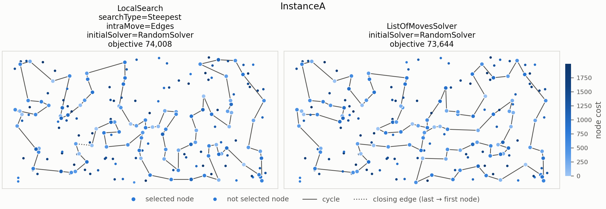
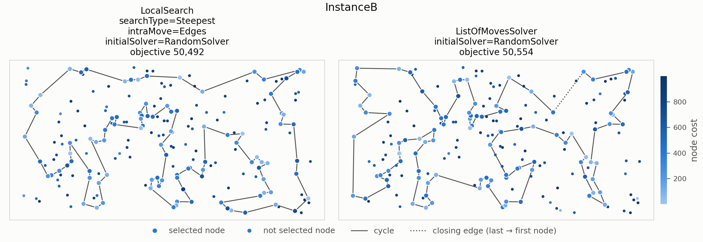

# Problem story

The student still has to attend 100 of the 200 classes in one day while
getting as little tired as possible. Starting from a random plan, they can
either replace an attended class with one not attended, or change the route by
reconnecting two edges. This experiment compares two ways of choosing these
improvements: a steepest local search that scans the neighborhood each step,
and a solver that keeps a sorted list of promising moves and updates it after
each change.

# Problem description

Given $n$ nodes, each with coordinates and a cost, select exactly
$k = \lceil n/2 \rceil$ nodes and form a Hamiltonian cycle through them. The
objective is to minimize the cycle length plus the costs of the selected nodes:

$$
f(C) = \sum_{i=1}^{k} d\left(C_i, C_{(i \bmod k) + 1}\right)
       + \sum_{i=1}^{k} c(C_i),
$$

where $d$ is the distance between two nodes and $c$ is the node cost. Distances
are Euclidean distances rounded mathematically to integers. Both instances
contain $n=200$ nodes, so each solution selects $k=100$.

# Compared algorithms

Both methods start from the same type of solution: a random set of 100 nodes in
random order. Both use the same two move types:

- **Inter-route move**, exchange of a selected and an unselected node: node
  $C_i$ is replaced by $u \in U$. With $a = C_{i-1}$, $v = C_i$, $b = C_{i+1}$:
  $$\Delta = D[a][u] + D[u][b] + c[u] - D[a][v] - D[v][b] - c[v].$$
- **Intra-route move, two-edges exchange**: edges $(C_i, C_{i+1})$ and
  $(C_j, C_{j+1})$ are replaced by $(C_i, C_j)$ and $(C_{i+1}, C_{j+1})$, which
  reverses the part of the cycle between them:
  $$\Delta = D[C_i][C_j] + D[C_{i+1}][C_{j+1}] - D[C_i][C_{i+1}] - D[C_j][C_{j+1}].$$
  Pairs of edges sharing a node are skipped, as the move changes nothing.

## List of moves

`ListOfMovesSolver` starts by generating all improving node-replacement and
two-edges moves. It stores them in an ordered set, with the most negative
objective delta first. Each stored move describes the nodes and edges it
depends on, along with its delta. A move can become obsolete after other moves
change the cycle, so it is validated when removed from the list. Invalid moves
are discarded; valid moves are applied, and only candidates affected by that
change are generated again.

The delta is the objective change, $f(C_{\mathrm{after}})-f(C_{\mathrm{before}})$.
Only moves with $\Delta < 0$ are stored. For a node replacement, let $v$ be
the selected node at position $i$, $u$ an unselected node, and $a,b$ the
previous and next nodes. The delta is

$$
\Delta_{\mathrm{replace}} =
D[a][u] + D[u][b] + c[u]
- D[a][v] - D[v][b] - c[v].
$$

For a two-edges move, let the current edges be $(x_1,x_2)$ and $(x_3,x_4)$.
The proposed reconnection replaces them by $(x_1,x_3)$ and $(x_2,x_4)$:

$$
\Delta_{\mathrm{edges}} =
D[x_1][x_3] + D[x_2][x_4]
- D[x_1][x_2] - D[x_3][x_4].
$$

The list is ordered by increasing delta, so its first element is the most
improving candidate. The following pseudocode separates initialization and
selection from the two move-specific procedures:

```
procedure LIST-OF-MOVES(D, c, seed):
    C <- random initial cycle using seed
    selected <- nodes in C
    L <- empty ordered set, sorted by (delta, node identifiers)

    for each position p in C:
        GENERATE-REPLACEMENTS(p)
    for each pair of non-adjacent edges in C:
        GENERATE-TWO-EDGES-MOVES(edge pair)

    while L is not empty:
        m <- remove the first (lowest-delta) move from L
        if m is a replacement:
            VALIDATE-AND-APPLY-REPLACEMENT(m)
        else:
            VALIDATE-AND-APPLY-TWO-EDGES(m)

    return C
```

### Node-replacement moves

For each selected position, the solver tries every currently unselected node
as its replacement. A candidate stores the incoming node $u$, outgoing node
$v$, their neighboring nodes, and the calculated delta. On extraction, it must
still be the case that $v$ is selected, $u$ is unselected, and the neighbors
of $v$ are the same pair recorded by the candidate (in either order). After
the replacement, candidates are regenerated for the changed position and its
two adjacent positions. Two-edges candidates are also regenerated for the two
edges incident to the replaced position.

```
procedure GENERATE-REPLACEMENTS(position p):
    a <- predecessor of p in C
    v <- node at p
    b <- successor of p in C
    for each node u not in selected:
        delta <- D[a][u] + D[u][b] + c[u]
                 - D[a][v] - D[v][b] - c[v]
        if delta < 0:
            insert (REPLACE, incoming=u, outgoing=v,
                    neighbors=a,b, delta) into L

procedure VALIDATE-AND-APPLY-REPLACEMENT(m):
    if m.outgoing is not selected or m.incoming is selected:
        discard m
        return
    p <- current position of m.outgoing in C
    if {predecessor(p), successor(p)} != {m.neighbors}:
        discard m
        return

    replace m.outgoing at p by m.incoming
    update selected to reflect the replacement

    for each position q in {predecessor(p), p, successor(p)}:
        GENERATE-REPLACEMENTS(q)
    GENERATE-TWO-EDGES-MOVES(edge predecessor(p)->p)
    GENERATE-TWO-EDGES-MOVES(edge p->successor(p))
```

In the final two calls, generating moves for an edge means pairing it with
each other non-adjacent cycle edge and testing both possible reconnections.
The predecessor and successor are interpreted in the updated cycle.

### Two-edges moves

The initial candidate generation considers pairs of non-adjacent cycle edges.
For each pair it tests both ways to reconnect the four endpoints and inserts
each improving reconnection. A saved move can be used only if all four nodes
are still in the cycle and the saved endpoint pairs still form edges. The
current traversal direction of each edge is checked as well. If exactly one
edge is now traversed in the opposite direction, applying the saved
reconnection would split the cycle; the solver recalculates its delta in the
current orientation and re-adds it only if it is still improving. Otherwise,
it reverses the segment between the edges. Afterward, it generates replacement
candidates at the four affected boundary positions and tests new two-edges
candidates involving the two newly created boundary edges.

```
procedure GENERATE-TWO-EDGES-MOVES(edge (x1,x2)):
    for each cycle edge (x3,x4) non-adjacent to (x1,x2):
        for each added-edge pair in
            { ((x1,x3),(x2,x4)), ((x1,x4),(x2,x3)) }:
            delta <- sum(lengths of added edges)
                     - D[x1][x2] - D[x3][x4]
            if delta < 0:
                insert (TWO-EDGES, endpoints=x1,x2,x3,x4,
                        added-edge pair, delta) into L

procedure VALIDATE-AND-APPLY-TWO-EDGES(m):
    find current positions of m.x1 and m.x3
    if either node is absent:
        discard m
        return
    orient each saved edge so its endpoints are consecutive
    if either saved edge is no longer consecutive:
        discard m
        return

    if the two oriented edges have opposite traversal directions:
        recalculate delta using the current edge orientations
        if delta < 0:
            reinsert this oriented candidate into L
        return

    reverse the cycle segment between the two edges
    for each of the four affected boundary positions:
        GENERATE-REPLACEMENTS(position)
    GENERATE-TWO-EDGES-MOVES(first new boundary edge)
    GENERATE-TWO-EDGES-MOVES(second new boundary edge)
```

The set comparison uses the delta and node identifiers to order candidates.
Because the cycle changes as moves are applied, validation is done immediately
before applying each extracted candidate rather than assuming every stored
candidate remains current.

# Computational experiment

Each method was run 200 times per instance using random seeds 1--200. The
objective values, running times, and step counts below are taken from
`results/lab5_summary.csv`. A step is one improving move applied. Running time
is the average time per `solve` call in milliseconds and includes creation of
the random starting solution. The experiment runner compiles with `g++` and
`-O2`.

Lower objective values are better. The tables show the average and the
minimum--maximum range over the runs.

\begin{table}[H]
\centering
\small
\textbf{Objective function}\\[6pt]
\begin{tabular}{l r@{\ (}r@{ -- }r@{)\hspace{1.5em}} r@{\ (}r@{ -- }r@{)}}
\toprule
Method & \multicolumn{3}{c}{Instance A} & \multicolumn{3}{c}{Instance B} \\
\cmidrule(lr){2-4} \cmidrule(l){5-7}
 & \multicolumn{3}{c}{av (min -- max)} & \multicolumn{3}{c}{av (min -- max)} \\
\midrule
RandomSolver        & 262\,653 & 238\,917 & 286\,724 & 206\,842 & 181\,610 & 226\,734 \\
NearestNeighborI        & 87\,477 & 84\,362 & 90\,075 & 59\,397 & 56\,007 & 63\,166 \\
NearestNeighborII        & 74\,307 & 72\,328 & 77\,022 & 59\,476 & 52\,915 & 66\,164 \\
GreedyCycle        & 73\,739 & 72\,590 & 75\,281 & 59\,651 & 55\,655 & 63\,734 \\
\midrule[1pt]
NearestNeighborII_2regret_alpha=1.0        & 122\,861 & 111\,527 & 133\,181 & 74\,763 & 69\,032 & 80\,767\\
NearestNeighborII_2regret_alpha=0.5        & 75\,561 & 72\,419 & 78\,504 & 55\,698 & 50\,485 & 61\,406 \\
GreedyCycle_2regret_alpha=1.0        & 120\,995 & 112\,654 & 130\,391 & 73\,459 & 69\,609 & 78\,175 \\
GreedyCycle_2regret_alpha=0.5        & 73\,353 & 72\,011 & 75\,532 & 57\,863 & 52\,731 & 63\,370 \\
\midrule[1pt]
LocalSearch_searchType=Greedy_intraMove=Nodes_initialSolver=RandomSolver        & 88\,669 & 82\,989 & 96\,524 & 64\,576 & 57\,464 & 71\,404 \\
LocalSearch_searchType=Greedy_intraMove=Nodes_initialSolver=GreedyCycle_2regret_alpha=0.5        & 73\,022 & 71\,955 & 74\,861 & 57\,528 & 52\,702 & 62\,933 \\
LocalSearch_searchType=Greedy_intraMove=Edges_initialSolver=RandomSolver        & 75\,557 & 73\,618 & 77\,679 & 52\,452 & 50\,399 & 55\,468 \\
LocalSearch_searchType=Greedy_intraMove=Edges_initialSolver=GreedyCycle_2regret_alpha=0.5        & 72\,966 & 71\,955 & 74\,861 & 57\,196 & 52\,542 & 62\,428 \\
LocalSearch_searchType=Steepest_intraMove=Nodes_initialSolver=RandomSolver        & 89\,321 & 79\,649 & 96\,354 & 65\,871 & 59\,357 & 74\,662 \\
LocalSearch_searchType=Steepest_intraMove=Nodes_initialSolver=GreedyCycle_2regret_alpha=0.5        & 73\,022 & 71\,955 & 74\,861 & 57\,525 & 52\,702 & 62\,933 \\
LocalSearch_searchType=Steepest_intraMove=Edges_initialSolver=RandomSolver        & 76\,161 & 74\,008 & 80\,204 & 52\,570 & 50\,492 & 56\,091 \\
LocalSearch_searchType=Steepest_intraMove=Edges_initialSolver=GreedyCycle_2regret_alpha=0.5        & 73\,004 & 71\,955 & 74\,861 & 57\,126 & 52\,542 & 62\,301 \\
\midrule[1pt]
LocalSearchWithCandidates_candidatesCount=10        & 76\,234 & 73\,878 & 79\,182 & 52\,546 & 50\,422 & 55\,822 \\
\midrule[1pt]
ListOfMovesSolver_initialSolver=RandomSolver        & 76\,361 & 73\,644 & 80\,838 & 52\,794 & 50\,554 & 56\,128 \\
\bottomrule
\end{tabular}
\end{table}

\begin{table}[H]
\centering
\small
\textbf{Running time [ms]}\\[6pt]
\begin{tabular}{l r@{\ (}r@{ -- }r@{)\hspace{1.5em}} r@{\ (}r@{ -- }r@{)}}
\toprule
Method & \multicolumn{3}{c}{Instance A} & \multicolumn{3}{c}{Instance B} \\
\cmidrule(lr){2-4} \cmidrule(l){5-7}
 & \multicolumn{3}{c}{av (min -- max)} & \multicolumn{3}{c}{av (min -- max)} \\
\midrule
RandomSolver        & 0.003 & 0.003 & 0.009 & 0.003 & 0.003 & 0.009 \\
NearestNeighborI        & 0.028 & 0.025 & 0.050 & 0.027 & 0.025 & 0.042 \\
NearestNeighborII        & 1.164 & 1.071 & 4.034 & 1.112 & 1.071 & 2.097 \\
GreedyCycle        & 0.794 & 0.749 & 1.250 & 0.778 & 0.749 & 1.311 \\
\midrule[1pt]
NearestNeighborII_2regret_alpha=1.0        & 0.981 & 0.916 & 1.406 & 0.983 & 0.901 & 1.430 \\
NearestNeighborII_2regret_alpha=0.5        & 0.986 & 0.889 & 1.497 & 0.988 & 0.867 & 1.394 \\
GreedyCycle_2regret_alpha=1.0        & 1.337 & 1.277 & 1.926 & 1.361 & 1.280 & 1.998 \\
GreedyCycle_2regret_alpha=0.5        & 1.339 & 1.247 & 2.084 & 1.297 & 1.198 & 1.813 \\
\midrule[1pt]
LocalSearch_searchType=Greedy_intraMove=Nodes_initialSolver=RandomSolver        & 3.662 & 1.697 & 8.574 &2.424 & 1.114 & 3.931 \\
LocalSearch_searchType=Greedy_intraMove=Nodes_initialSolver=GreedyCycle_2regret_alpha=0.5        & 1.584 & 1.374 & 2.496 & 1.603 & 1.390 & 2.427 \\
LocalSearch_searchType=Greedy_intraMove=Edges_initialSolver=RandomSolver        & 2.969 & 1.483 & 4.957 &2.054 & 0.994 & 3.223 \\
LocalSearch_searchType=Greedy_intraMove=Edges_initialSolver=GreedyCycle_2regret_alpha=0.5        & 1.562 & 1.347 & 2.274 & 1.685 & 1.409 & 2.825 \\
LocalSearch_searchType=Steepest_intraMove=Nodes_initialSolver=RandomSolver        & 10.056 & 7.780 & 16.214 & 9.774 & 8.027 & 16.659 \\
LocalSearch_searchType=Steepest_intraMove=Nodes_initialSolver=GreedyCycle_2regret_alpha=0.5        & 1.607 & 1.332 & 2.526 & 1.708 & 1.364 & 2.673 \\
LocalSearch_searchType=Steepest_intraMove=Edges_initialSolver=RandomSolver        & 6.565 & 5.711 & 9.653& 6.694 & 5.734 & 10.952 \\
LocalSearch_searchType=Steepest_intraMove=Edges_initialSolver=GreedyCycle_2regret_alpha=0.5        & 1.534 & 1.318 & 2.216 & 1.811 & 1.410 & 2.765 \\
\midrule[1pt]
LocalSearchWithCandidates_candidatesCount=10        & 3.568 & 3.183 & 4.967 & 3.184 & 2.805 & 4.935 \\
\midrule[1pt]
ListOfMovesSolver_initialSolver=RandomSolver        & 3.466 & 2.852 & 5.175 & 3.394 & 2.738 & 4.393 \\
\bottomrule
\end{tabular}
\end{table}

\begin{table}[H]
\centering
\small
\textbf{Number of steps}\\[6pt]
\begin{tabular}{l r@{\ (}r@{ -- }r@{)\hspace{1.5em}} r@{\ (}r@{ -- }r@{)}}
\toprule
Method & \multicolumn{3}{c}{Instance A} & \multicolumn{3}{c}{Instance B} \\
\cmidrule(lr){2-4} \cmidrule(l){5-7}
 & \multicolumn{3}{c}{av (min -- max)} & \multicolumn{3}{c}{av (min -- max)} \\
\midrule
LocalSearch_searchType=Greedy_intraMove=Nodes_initialSolver=RandomSolver        & 525.00 & 412 & 605 & 521.4 & 445 & 603 \\
LocalSearch_searchType=Greedy_intraMove=Nodes_initialSolver=GreedyCycle_2regret_alpha=0.5        & 4.3 & 0 & 17 & 5.8 & 1 & 32 \\
LocalSearch_searchType=Greedy_intraMove=Edges_initialSolver=RandomSolver        & 510.2 & 449 & 578 & 510.5 & 459 & 596 \\
LocalSearch_searchType=Greedy_intraMove=Edges_initialSolver=GreedyCycle_2regret_alpha=0.5        & 5.2 & 0 & 19 & 10.2 & 2 & 39 \\
LocalSearch_searchType=Steepest_intraMove=Nodes_initialSolver=RandomSolver        & 154.1 & 123 & 201 & 151.4 & 123 & 200 \\
LocalSearch_searchType=Steepest_intraMove=Nodes_initialSolver=GreedyCycle_2regret_alpha=0.5        & 3.3 & 0 & 9 & 5.3 & 1 & 21 \\
LocalSearch_searchType=Steepest_intraMove=Edges_initialSolver=RandomSolver        & 133.2 & 119 & 150 & 134.0 & 119 & 152 \\
LocalSearch_searchType=Steepest_intraMove=Edges_initialSolver=GreedyCycle_2regret_alpha=0.5        & 3.3 & 0 & 10 & 9.2 & 2 & 24 \\
\midrule[1pt]
LocalSearchWithCandidates_candidatesCount=10        & 132.7 & 116 & 154 & 132.5 & 115 & 150 \\
\midrule[1pt]
ListOfMovesSolver_initialSolver=RandomSolver        & 139.5 & 123 & 167 & 138.8 & 124 & 157 \\
\bottomrule
\end{tabular}
\end{table}

# Visualization of the best solutions

Each panel shows the best solution found by one local search method. Node color
encodes the node cost (darker means more expensive). Selected nodes are drawn
larger, the solid line shows the cycle, and the dotted line marks the edge from
the last node back to the first.





# Best solutions

The best solutions of the earlier methods are listed in the other lab reports.

## Instance A

**LS steepest, two-edges, random start** (objective 74 008)

```
30 187 189 2 171 92 69 127 97 95 168 63 116 149 49 152 108 60 31 48 80 91 100 123 83 90 132 76 4 71 157 115 112 139 51 16 67 144 52 179 177 36 33 9 54 131 99 84 58 158 134 72 176 174 8 142 164 85 93 50 3 169 1 178 136 163 29 101 147 47 130 159 170 78 193 153 107 113 89 42 106 150 151 57 182 111 192 181 135 73 140 53 45 87 28 185 35 156 180 141
```

**List of Moves solver** (objective 73 644)

```
53 177 36 131 174 85 1 3 50 93 43 106 113 89 42 151 150 176 72 134 84 58 135 114 181 192 158 138 182 57 107 153 193 78 170 159 130 47 147 101 29 178 184 136 186 164 8 54 9 33 62 143 52 179 144 67 185 28 180 156 35 16 51 139 112 157 71 4 76 132 38 91 80 48 31 60 108 152 100 123 83 160 49 63 149 116 168 97 127 69 171 2 189 187 30 141 87 45 73 140
```

## Instance B

**LS steepest, two-edges, random start** (objective 50 492)

```
30 38 47 140 154 40 60 45 134 175 71 155 125 170 115 180 6 29 132 178 65 145 28 149 116 147 42 121 198 96 48 89 57 190 70 94 105 81 169 187 196 114 10 148 56 118 110 93 2 17 171 39 99 74 20 14 153 52 90 129 127 80 192 54 162 76 66 67 31 24 34 152 181 126 88 179 87 82 85 59 73 51 167 98 151 3 184 86 46 72 117 8 120 133 136 172 160 69 21 183
```

**List of Moves solver** (objective 50 554)

```
104 57 89 72 86 46 117 8 160 69 172 136 133 120 96 198 121 63 183 21 30 130 50 147 116 37 146 149 28 145 158 65 1 174 36 197 132 29 6 115 170 125 26 154 38 47 140 97 155 71 175 134 45 157 60 40 85 59 73 167 51 82 87 179 88 67 66 24 34 181 152 151 184 3 135 76 162 192 54 127 80 182 20 74 2 14 153 90 129 78 10 148 114 196 61 105 94 81 70 190
```

# Solution checker

The best solutions have been checked with the Solution checker.xlsx provided on
ekursy, and we confirmed that the values computed by the checker match those
computed by our algorithms.

# Conclusions

- **The average solution quality is very close.** Steepest local search has a
  lower mean objective by about 200 (0.26%) on instance A and 224 (0.43%) on
  instance B. In the 200 runs, the list-of-moves method found the better
  individual solution on A (73\,644 vs. 74\,008), while steepest local search
  was slightly better on B (50\,492 vs. 50\,554).
- **The list-of-moves method is faster.** Its mean runtime is 3.466 ms vs.
  6.565 ms on A and 3.394 ms vs. 6.694 ms on B. That is about 47% and 49%
  less time, respectively.
- **The list-of-moves method applies slightly more moves.** It averages 139.5
  vs. 133.2 steps on A and 138.8 vs. 134.0 on B. Step counts alone do not
  measure the amount of computation: the list-based method avoids rebuilding
  and scanning the full neighborhood after every move.
- **The score ranges overlap substantially.** Thus, in these experiments,
  the faster list maintenance comes with a small increase in mean objective,
  not a dramatic change in solution quality. The best individual outcomes
  vary by instance.

# Source code and data

The list-of-moves implementation is in
`src/lab5_algos/ListOfMovesSolver.cpp`. The local-search implementation is in
`src/lab3_algos/`. Experiment results are in `results/lab5_summary.csv` and
`results/lab5_best.csv`; runs are managed by `scripts/run_experiment.py`.
