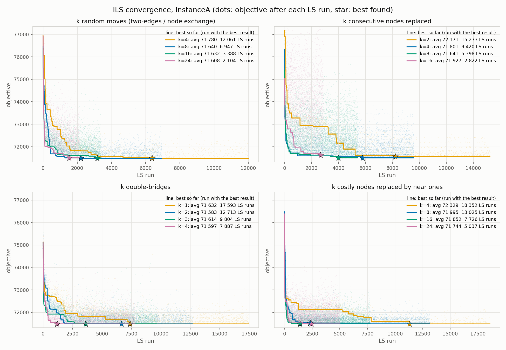
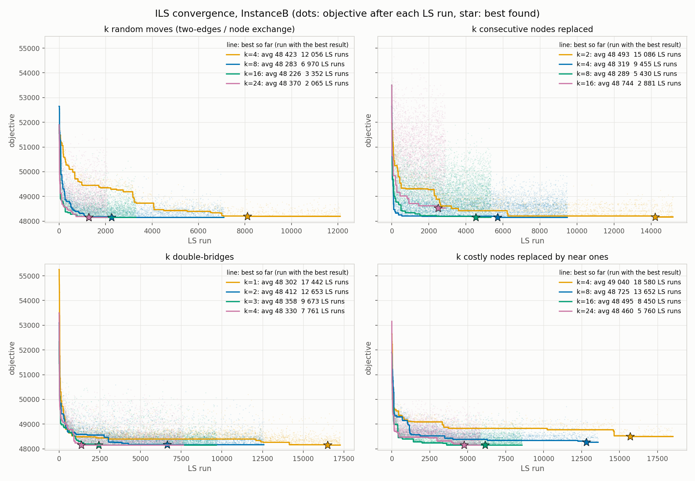
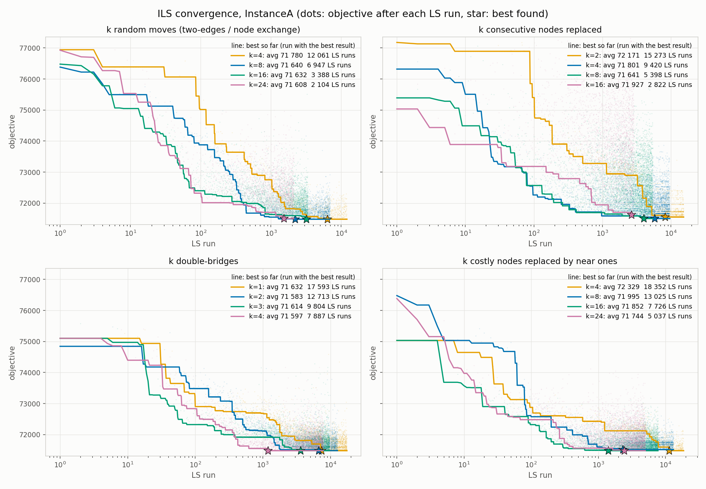
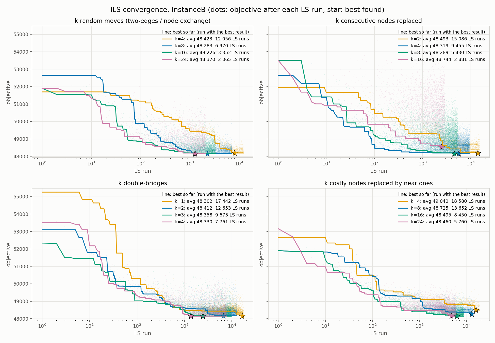
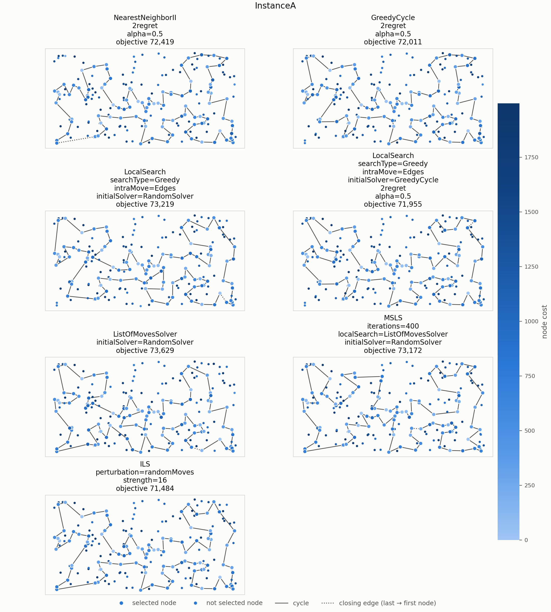
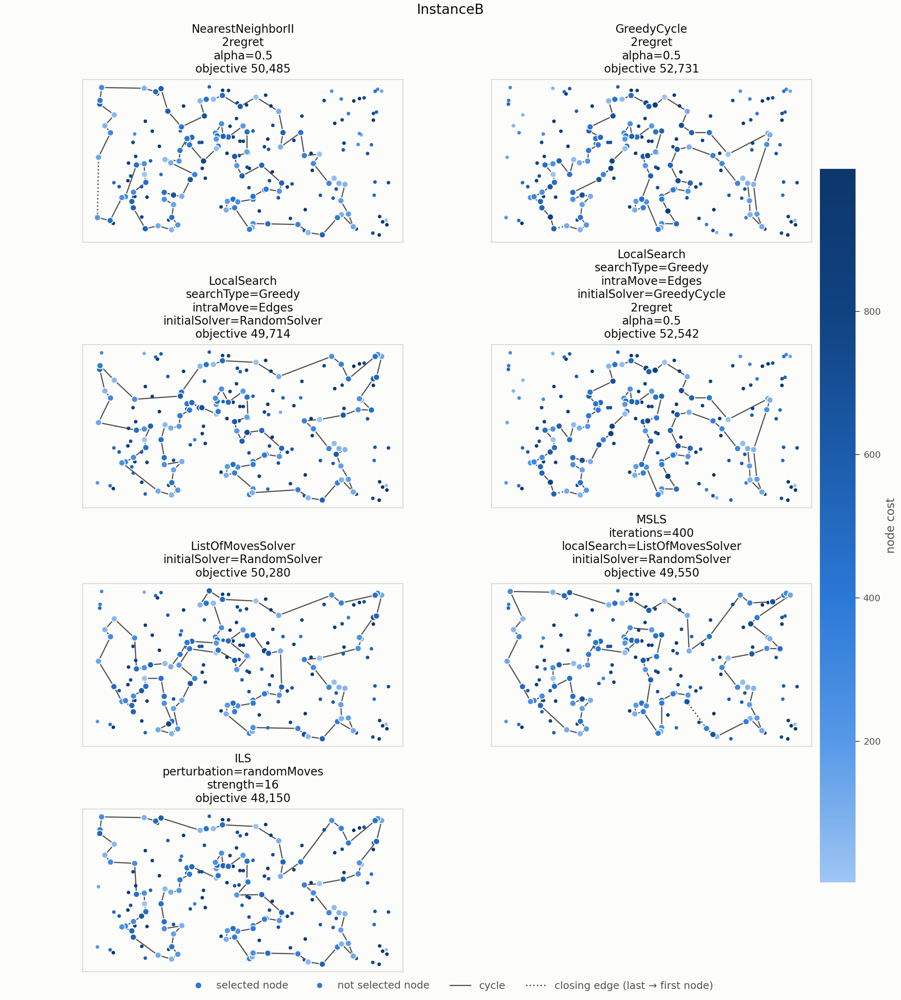

# Problem description

Given $n$ nodes, each with coordinates and a cost, select exactly
$m = \lceil n/2 \rceil$ nodes and form a Hamiltonian cycle through them. The
objective is to minimize the cycle length plus the costs of the selected nodes:

$$
f(C) = \sum_{i=1}^{m} d\left(C_i, C_{(i \bmod m) + 1}\right)
       + \sum_{i=1}^{m} c(C_i),
$$

where $d$ is the distance between two nodes and $c$ is the node cost. Distances
are Euclidean distances rounded mathematically to integers. Both instances
contain $n=200$ nodes, so each solution selects $m=100$.

# Compared algorithms

## Local search

Both methods use the steepest local search with the list of moves from lab 5
(`ListOfMovesSolver`). Its neighborhood consists of the exchange of a selected
and an unselected node (inter-route move) and the two-edges exchange
(intra-route move); the moves and the list of moves are described in the
reports of labs 3 and 5. Below, $\mathrm{LS}(C)$ means running this local
search from solution $C$ until a local optimum is reached.

## Multiple start local search (MSLS)

MSLS runs the local search 400 times, each time from a different random
solution, and returns the best local optimum. Run $s$ of MSLS ($s = 1..20$) uses
the random solutions with seeds $400(s-1)+1, \dots, 400s$.

```
procedure MSLS(s):
    best <- none
    for i <- 1 to 400:
        C <- LS(random solution with seed 400(s - 1) + i)
        if best = none or f(C) < f(best):
            best <- C
    return best
```

## Iterated local search (ILS)

ILS starts from one random solution improved by the local search. Then it
repeatedly perturbs the current solution $x$, runs the local search from the
perturbed solution, and accepts the result if it is better than $x$. It stops
after the average running time of MSLS on the given instance (1466 ms on
instance A, 1423 ms on instance B); the time is checked after every LS run.

```
procedure ILS(s, timeLimit):
    x <- LS(random solution with seed s)
    while elapsed time < timeLimit:
        y <- PERTURB(x)
        y <- LS(y)
        if f(y) < f(x):
            x <- y
    return x
```

## Perturbation: k random moves

The perturbation applies $k = 16$ random moves from the neighborhoods of the
local search. Each move is, with probability 1/2, a two-edges move (reversal of
a random part of the cycle) or an exchange of a random node of the cycle with a
random node outside it. A single random move would usually be undone by the next
local search, but a combination of $k$ moves cannot be undone in one step. The
perturbation changes both the order of the cycle and the set of selected nodes.

In the pseudocode, $C = (C_0, \dots, C_{m-1})$ is the cycle, $U$ the set of
nodes not in the cycle, and `random(a, b)` an integer drawn uniformly from
$[a, b]$.

```
procedure RANDOM-MOVES(C, U, k):
    repeat k times:
        if random(0, 1) = 0:                       ▷ two-edges move
            i <- random(0, m - 2)
            j <- random(i + 1, min(m - 1, i + m - 2))
            reverse C[i..j]                       ▷ j - i < m - 1: reversing the whole
                                                  ▷ cycle would not change it
        else:                                     ▷ node exchange
            p <- random(0, m - 1)
            u <- random node of U
            U <- U - {u} + {C[p]}
            C[p] <- u
```

## Other tested perturbations

We also tested three other perturbations, each with strength $k$:

- **Segment replacement:** $k$ consecutive nodes of the cycle are replaced by
  $k$ random nodes outside the cycle (changes only the set of selected nodes).
- **Double-bridge:** the cycle is cut at three random points into parts
  $A\,B\,C\,D$ and reconnected as $A\,C\,B\,D$, $k$ times (changes only the
  order; one two-edges move cannot undo it).
- **Guided replacement:** $k$ nodes are removed with probability proportional
  to how much their removal would decrease the objective, and each is replaced
  by a random one of the 10 free nodes nearest to it (distance plus cost).

Their exact description and pseudocode are in a
[separate document](https://github.com/Kari3600/EC-Project/blob/main/reports/lab6_perturbations.pdf).
The choice of the perturbation and of $k$ is explained in the next section.

# Computational experiment

Each method was run 20 times per instance (seeds 1--20). MSLS performs 400 runs
of the local search; ILS stops after the average running time of MSLS, measured
in a first run of the experiment. The results of the earlier methods are taken
from `results/lab5_summary.csv`, the results of MSLS and ILS from
`results/lab6_summary.csv`. The tables include the best construction heuristic
and the best local search for each instance, and the local search with the list
of moves that MSLS and ILS are built on. Lower objective values are better; the
tables show the average and the minimum--maximum range over the runs.

\begin{table}[H]
\centering
\small
\textbf{Objective function}\\[6pt]
\begin{tabular}{l r@{\ (}r@{ -- }r@{)\hspace{1.5em}} r@{\ (}r@{ -- }r@{)}}
\toprule
Method & \multicolumn{3}{c}{Instance A} & \multicolumn{3}{c}{Instance B} \\
\cmidrule(lr){2-4} \cmidrule(l){5-7}
 & \multicolumn{3}{c}{av (min -- max)} & \multicolumn{3}{c}{av (min -- max)} \\
\midrule
Greedy cycle weighted 2-regret           & 73\,353 & 72\,011 & 75\,532 & 57\,863 & 52\,731 & 63\,370 \\
Nearest neighbor II weighted 2-regret    & 75\,561 & 72\,419 & 78\,504 & 55\,698 & 50\,485 & 61\,406 \\
\midrule[1pt]
LS greedy, two-edges, greedy start       & 72\,960 & 71\,955 & 74\,877 & 57\,198 & 52\,542 & 62\,572 \\
LS greedy, two-edges, random start       & 75\,508 & 73\,219 & 78\,672 & 52\,356 & 49\,714 & 54\,905 \\
LS with list of moves, random start      & 76\,237 & 73\,629 & 81\,989 & 52\,603 & 50\,280 & 55\,256 \\
\midrule[1pt]
MSLS (400 LS runs)                       & 73\,650 & 73\,172 & 74\,151 & 50\,163 & 49\,550 & 50\,559 \\
ILS (random moves, $k=16$)               & \textbf{71\,632} & 71\,484 & 72\,152 & \textbf{48\,226} & 48\,150 & 48\,431 \\
\bottomrule
\end{tabular}
\end{table}

\begin{table}[H]
\centering
\small
\textbf{Running time [ms]}\\[6pt]
\begin{tabular}{l r@{\ (}r@{ -- }r@{)\hspace{1.5em}} r@{\ (}r@{ -- }r@{)}}
\toprule
Method & \multicolumn{3}{c}{Instance A} & \multicolumn{3}{c}{Instance B} \\
\cmidrule(lr){2-4} \cmidrule(l){5-7}
 & \multicolumn{3}{c}{av (min -- max)} & \multicolumn{3}{c}{av (min -- max)} \\
\midrule
Greedy cycle weighted 2-regret           & 3.805 & 3.055 & 5.011 & 3.832 & 2.944 & 5.575 \\
Nearest neighbor II weighted 2-regret    & 2.879 & 2.204 & 3.862 & 2.980 & 2.181 & 4.197 \\
\midrule[1pt]
LS greedy, two-edges, greedy start       & 4.295 & 3.470 & 6.760 & 4.611 & 3.290 & 6.479 \\
LS greedy, two-edges, random start       & 7.055 & 3.475 & 10.774 & 4.496 & 2.369 & 7.854 \\
LS with list of moves, random start      & 8.117 & 6.316 & 17.589 & 7.558 & 6.021 & 9.417 \\
\midrule[1pt]
MSLS (400 LS runs)                       & 1469.2 & 1450.6 & 1536.2 & 1434.3 & 1412.4 & 1469.8 \\
ILS (random moves, $k=16$)               & 1466.3 & 1466.0 & 1466.5 & 1423.2 & 1423.0 & 1423.4 \\
\bottomrule
\end{tabular}
\end{table}

\begin{table}[H]
\centering
\small
\textbf{Number of LS runs}\\[6pt]
\begin{tabular}{l r@{\ (}r@{ -- }r@{)\hspace{1.5em}} r@{\ (}r@{ -- }r@{)}}
\toprule
Method & \multicolumn{3}{c}{Instance A} & \multicolumn{3}{c}{Instance B} \\
\cmidrule(lr){2-4} \cmidrule(l){5-7}
 & \multicolumn{3}{c}{av (min -- max)} & \multicolumn{3}{c}{av (min -- max)} \\
\midrule
MSLS (400 LS runs)                       & 400 & 400 & 400 & 400 & 400 & 400 \\
ILS (random moves, $k=16$)               & 3\,388 & 3\,342 & 3\,457 & 3\,352 & 3\,250 & 3\,417 \\
\bottomrule
\end{tabular}
\end{table}

The number of LS runs of ILS includes the first run from the random solution.
The MSLS times above come from the final run of the experiment and differ from
the time limits of ILS by less than 1%.

## Choice of the perturbation and its strength

All four perturbations were run with several values of $k$ (20 runs each, same
time limit). The figures show, for each perturbation and $k$, the run with the
best result: the dots are the objective after every LS run ($f(y)$), the line
is the best objective so far ($f(x)$), and the star marks the LS run where the
best solution was found. The x axis is the number of the LS run, so the length
of a line is the number of LS runs done within the time limit. The legend gives
the average objective and number of LS runs over all 20 runs. The first two
figures use a linear x axis, the other two a logarithmic one, which shows the
early phase better.









Random moves with $k=16$ have the best average over both instances (71 632 on
A, 48 226 on B). Double-bridge with $k=2$ is slightly better on instance A
(71 583) but worse on B (48 412), and random moves with $k=24$ are better on A
(71 608) but worse on B (48 370); $k=2$ and $k=32$ were also tested for random
moves and the guided replacement and are not shown in the figures. The
averages of the best configurations differ by less than 0.4%, less than the
differences between the runs of one configuration (e.g. 71 484 -- 72 152 for
random moves with $k=16$ on instance A).

# Visualization of the best solutions

Each panel shows the best solution of one method from the tables. Node color
encodes the node cost (darker means more expensive). Selected nodes are drawn
larger, the solid line shows the cycle, and the dotted line marks the edge from
the last node back to the first.





# Best solutions

The best solutions of the earlier methods are listed in the previous lab reports.

## Instance A

**MSLS** (objective 73 172)

```
134  72 176 150 106  43 113  89  42 151 182  57  64  88  78 153 107 159 130  47
147 101  55  29 178 184 136 186 164   1 169   3  50  93 174  54   9  33 131  99
 36 177 179  52 144  67  35 156  16  51 139 112  71 157  91   4  76 132  90  83
123 152 108  80  48  31  60  49  63 149 116 168  95  97 127  69 129 104 171   2
189 187  30 141  87 180  28 102 185  45  53 140  73 135 114 181 192 158  58  84
```

**ILS, random moves, k = 16** (objective 71 484)

```
106 150 176  72 134  84  58 158 192 181 114 135  73  45  87 141  30 187 189   2
171 104 129  69 127  97 160  83 123 100 152 108  49 168  63 149 116  60  31  48
 80  91 157  71   4  76 132 180  28 102 185  35 156  51  16  67 144 140  53 179
 52 177  36 131  33   9  54   8 174  85  93  50   3 169   1 164 186 136 184 178
 29 101 147  47 130 159 146 170 153 193  78  88 107  64  57 182 151  42  89 113
```

## Instance B

**MSLS** (objective 49 550)

```
 31  67  24  34 152 181 179  87  82  51  85  59  73 167  98 151 122 184   3  86
 46  72 120 133 136 172   8 117 160  69  21 183  30  38  47 140 154  26 125 170
115  97 155  71 141  40  60 157  45 134 175 197   6  29 132 178  65 145  28 149
 37 116 147  42 121 198  96  48 156  89  57  76 104 190  70 169  81  94 105 187
 18 196 114 148  10  78  54 192  80 127 129  90 153  14   2  20  74 171  39  99
```

**ILS, random moves, k = 16** (objective 48 150)

```
125 170 115 180   6  29 132 197  36 175 134  45 157  60  40  71 155  97 154 140
 47  38  21  30 183  69 160 172 136 133 120   8 117  72  46 184   3 151  27  66
 67  24  34 152 181 167  73  59  85  51  82  87 179  88  99 171  17  74  20   2
 14 153  90 129 127  80 192 162  54  78  10 114 196  61 105  94  81 187  70 190
104  76 185  57  89  48  96 198 121  42 147 116  37 146  13 149  28 145 158 177
```

# Solution checker

<!-- TODO before submitting: check the MSLS and ILS solutions in Solution checker.xlsx -->

The best solutions have been checked with the Solution checker.xlsx provided on
ekursy, and we confirmed that the values computed by the checker match those
computed by our algorithms.

# Conclusions

- **ILS is clearly better than MSLS in the same time.** Its average is 2.7%
  better on instance A (71 632 vs 73 650) and 3.9% better on instance B
  (48 226 vs 50 163), and even its worst run (72 152 and 48 431) is better than
  the best run of MSLS (73 172 and 49 550). ILS is also better than all earlier
  methods, including the local search from a greedy starting solution on
  instance A (72 960).
- **ILS does many more LS runs in the same time.** After a perturbation, the
  local search starts close to a local optimum and needs only a few moves, so
  ILS does about 3 400 LS runs instead of the 400 runs of MSLS, and each run
  starts from a good solution instead of a random one.
- **The strength of the perturbation matters more than its type.** With small
  $k$ the local search almost always returns to a solution as good as the
  current one (99% of LS runs for random moves with $k=2$, 22--25% with $k=16$),
  so the search stagnates. With too large $k$ ILS gets closer to random
  restarts: there are fewer LS runs and the results get worse (random moves
  with $k=32$, segment replacement with $k=16$).
- **Double-bridge is the least sensitive to $k$.** All tested values give
  averages between 71 583 and 71 632 on instance A and between 48 302 and
  48 412 on instance B, close to the best random moves.
- **Guiding the perturbation by the objective did not help.** The guided
  replacement chooses replacements near the removed nodes, so the local search
  easily undoes them, and it needs a larger $k$ than the random perturbations
  to reach similar, still slightly worse results.
- **MSLS gives a moderate improvement over a single local search.** The best
  of 400 runs is on average 3.4% (A) and 4.6% (B) better than one run, but
  most of these runs repeat the same work from a random solution.

# Source code and data

MSLS and ILS are implemented in `src/lab6_algos/`, the local search with the
list of moves in `src/lab5_algos/ListOfMovesSolver.cpp`. Experiment results are
in `results/lab6_summary.csv`, `results/lab6_best.csv` and
`results/lab6_trace.csv` (objective after every LS run of the best ILS runs);
they are produced by `python3 scripts/run_experiment.py --name lab6 --only MSLS ILS`.
The figures are produced by `python3 scripts/lab6/plot_convergence.py` (with
`--logx --name lab6_convergence_logx` for the logarithmic axis) and
`scripts/plot.py`.
