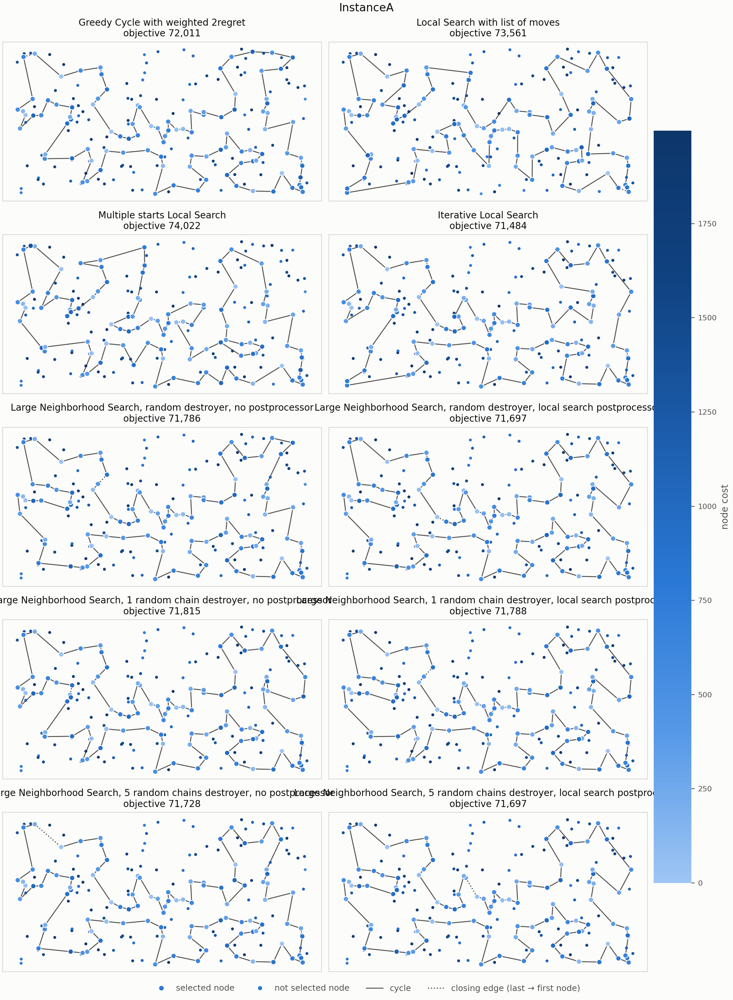

# Problem description

Given $n$ nodes, each with coordinates and a cost, select exactly
$m = \lceil n/2 \rceil$ nodes and form a Hamiltonian cycle through them. The
objective is to minimize the cycle length plus the costs of the selected nodes:

$$
f(C) = \sum_{i=1}^{m} d\left(C_i, C_{(i \bmod m) + 1}\right)
       + \sum_{i=1}^{m} c(C_i),
$$

where $d$ is the distance between two nodes and $c$ is the node cost. Distances
are Euclidean distances rounded mathematically to integers. Both instances
contain $n=200$ nodes, so each solution selects $m=100$.

# Compared algorithms

## Large neighborhood search (LNS)

Large Neighborhood Search alternates destruction and reconstruction of a
current solution. At every iteration it copies the current cycle, removes
$r = 30$ nodes ($30\%$ of $m=100$), repairs it to a complete 100-node cycle,
optionally improves the repaired candidate with local search, and accepts the
candidate for the search only if it improves the best objective found.

```
procedure LNS(current, timeLimit):
    best <- current
    while elapsed time < timeLimit:
        candidate <- copy(current)
        destroy(candidate, r)
        repair(candidate)
        if postprocessor is enabled:
            postprocessor(candidate)
        if f(candidate) < f(best):
            current <- candidate
            best <- candidate
    return best
```

The search is initialized from a random solution of 100 nodes that is first
improved by `ListOfMovesSolver`. All six LNS variants use a limit of 2500 ms
and 20 independent runs, but the destroyer and repair/postprocessing stages
are configured differently as follows.

## Destroyers

### Random destroyer

The random destroyer removes $r$ selected nodes, one at a time, choosing a
position uniformly at random from the remaining cycle.

```
procedure RANDOM-DESTROY(C, r):
    repeat r times:
        p <- random(0, |C| - 1)
        C <- C without C[p]
```

### Random-chain destroyer

The random-chain destroyer removes one or five contiguous chains. Its first
implementation with one chain removes a chain of 30 nodes. For five chains,
the 30 removals are divided into five chains of six consecutive nodes. Every
chain starts at a position chosen uniformly at random; if the chain crosses
the end of the vector, the removal continues from the beginning. The chains are
removed one after another from the already shortened cycle, so a later chain may
occasionally touch or span the gap left by an earlier one.

```
procedure RANDOM-CHAIN-DESTROY(C, r, q):
    for i <- 1 to q:
        l <- r * i / q - r * (i - 1) / q
        s <- random(0, |C| - 1)
        C <- C with l nodes starting at s removed cyclically
```

The destruction therefore removes 30 nodes in each case, but a random-chain
destroyer keeps a chain of neighboring positions together while the random
destroyer scatters the removed nodes around the cycle.

## Repair and postprocessing

The repairer is always `GreedyCycle_2regret` with $\alpha=0.5$. The
destroyed solution contains only 70 nodes, so the repairer inserts nodes until
the cycle again has 100 nodes using the weighted two-regret criterion.
The candidates for insertion are all unselected nodes, i.e. both the 30 removed
nodes and the nodes that were already outside the solution, so the repaired
cycle may contain different nodes than before the destruction.

```
procedure REPAIR(C):
    while |C| < 100:
        for every unselected node v:
            D1(v), D2(v) <- the two smallest insertion costs of v into an edge
                            (a, b) of C: d(a,v) + d(v,b) - d(a,b) + c(v)
        v* <- argmax over v of  alpha * (D2(v) - D1(v)) - (1 - alpha) * D1(v)
        insert v* into its cheapest edge of C
```

The weighted 2-regret greedy cycle was the best construction heuristic on
instance A in lab 2 (on instance B the weighted 2-regret nearest neighbor was
slightly better). We use the greedy cycle for both instances, because it works
directly on the incomplete cycle, so it does not have to be cut into an open
path.

The repaired candidate is then tested in two variants: directly, or after
running `ListOfMovesSolver` as a postprocessor. The postprocessor uses the
steepest local search with the list of moves from lab 5 (our best version of
steepest local search, also used for the initial solution): it can replace a selected node
with an unselected node or exchange two edges of the cycle.

## Compared configurations

The experiment compares the random destroyer and the random-chain destroyer
with one and five chains, each with and without the local-search postprocessor.
Greedy cycle, random-start list-of-moves local search, and 400-start MSLS are
kept in the tables as baselines. ILS (with the perturbation of 16 random moves
from lab 6) is also shown because it is the strongest previous local-search
method.

# Computational experiment

Each method was run 20 times per instance (seeds 0--19). The greedy weighted
2-regret heuristic was run once from every possible starting node, the random
list-of-moves local search was run with 200 seeds, and MSLS was run with 400
local-search iterations in each of 20 seeds. ILS and all LNS variants use a
2500 ms time limit per run, the average running time of MSLS on the computer
used for this experiment (MSLS was rerun on it to set the limit). Lower objective values are better; the tables show
the average and the minimum--maximum range over the runs.

\begin{table}[H] 
\centering 
\small 
\textbf{Objective function}\\[6pt] 
\resizebox{\textwidth}{!}{\begin{tabular}{l r@{\ (}r@{ -- }r@{)\hspace{1.5em}} r@{\ (}r@{ -- }r@{)}} 
\toprule 
Method & \multicolumn{3}{c}{Instance A} & \multicolumn{3}{c}{Instance B} \\ 
\cmidrule(lr){2-4} \cmidrule(l){5-7} 
& \multicolumn{3}{c}{av (min -- max)} & \multicolumn{3}{c}{av (min -- max)} \\ 
\midrule
Greedy Cycle with weighted 2regret                                                & 73\,350 & 72\,011 & 75\,532 & 57\,771 & 52\,906 & 63\,326 \\
Local Search with list of moves                                                   & 76\,235 & 73\,561 & 80\,874 & 52\,510 & 50\,333 & 56\,533 \\
Multiple starts Local Search                                                      & 73\,660 & 73\,187 & 74\,256 & 50\,206 & 49\,675 & 50\,458 \\
Iterative Local Search                                                            & 71\,575 & 71\,484 & 71\,960 & 48\,277 & 48\,149 & 48\,665 \\
Large Neighborhood Search, random destroyer, no postprocessor                     & 72\,238 & 71\,696 & 73\,041 & 49\,127 & 48\,271 & 50\,542 \\
Large Neighborhood Search, random destroyer, local search postprocessor           & 72\,115 & 71\,698 & 72\,781 & 49\,067 & 48\,346 & 50\,410 \\
Large Neighborhood Search, 1 random chain destroyer, no postprocessor             & 72\,221 & 71\,857 & 73\,094 & 49\,867 & 49\,066 & 50\,719 \\
Large Neighborhood Search, 1 random chain destroyer, local search postprocessor   & 72\,112 & 71\,788 & 72\,894 & 49\,503 & 48\,304 & 50\,800 \\
Large Neighborhood Search, 5 random chains destroyer, no postprocessor            & 71\,796 & 71\,704 & 72\,111 & 48\,995 & 48\,271 & 50\,566 \\
Large Neighborhood Search, 5 random chains destroyer, local search postprocessor  & 71\,726 & 71\,679 & 71\,843 & 48\,716 & 48\,215 & 49\,362 \\
\bottomrule 
\end{tabular}} 
\end{table}

\begin{table}[H] 
\centering 
\small 
\textbf{Running time [ms]}\\[6pt] 
\resizebox{\textwidth}{!}{\begin{tabular}{l r@{\ (}r@{ -- }r@{)\hspace{1.5em}} r@{\ (}r@{ -- }r@{)}} 
\toprule 
Method & \multicolumn{3}{c}{Instance A} & \multicolumn{3}{c}{Instance B} \\ 
\cmidrule(lr){2-4} \cmidrule(l){5-7} 
& \multicolumn{3}{c}{av (min -- max)} & \multicolumn{3}{c}{av (min -- max)} \\ 
\midrule
Greedy Cycle with weighted 2regret                                                & 4.257 & 3.292 & 7.096 & 4.297 & 3.169 & 6.235 \\
Local Search with list of moves                                                   & 8.791 & 6.135 & 15.738 & 8.543 & 6.419 & 15.768 \\
Multiple starts Local Search                                                      & 2515.992 & 2451.031 & 2591.982 & 2476.057 & 2388.659 & 2561.652 \\
Iterative Local Search                                                            & 2500.484 & 2500.026 & 2500.821 & 2500.343 & 2500.054 & 2500.663 \\
Large Neighborhood Search, random destroyer, no postprocessor                     & 2500.633 & 2500.029 & 2501.184 & 2500.633 & 2500.012 & 2501.115 \\
Large Neighborhood Search, random destroyer, local search postprocessor           & 2500.578 & 2500.060 & 2501.178 & 2500.792 & 2500.094 & 2501.811 \\
Large Neighborhood Search, 1 random chain destroyer, no postprocessor             & 2500.492 & 2500.066 & 2501.096 & 2500.499 & 2500.027 & 2501.310 \\
Large Neighborhood Search, 1 random chain destroyer, local search postprocessor   & 2500.618 & 2500.037 & 2501.284 & 2500.554 & 2500.036 & 2501.037 \\
Large Neighborhood Search, 5 random chains destroyer, no postprocessor            & 2500.723 & 2500.029 & 2501.060 & 2500.533 & 2500.017 & 2501.167 \\
Large Neighborhood Search, 5 random chains destroyer, local search postprocessor  & 2500.588 & 2500.058 & 2501.255 & 2500.697 & 2500.068 & 2501.209 \\
\bottomrule 
\end{tabular}} 
\end{table}

\begin{table}[H] 
\centering 
\small 
\textbf{Iterations of the main loop}\\[6pt] 
\resizebox{\textwidth}{!}{\begin{tabular}{l r@{\ (}r@{ -- }r@{)\hspace{1.5em}} r@{\ (}r@{ -- }r@{)}} 
\toprule 
Method & \multicolumn{3}{c}{Instance A} & \multicolumn{3}{c}{Instance B} \\ 
\cmidrule(lr){2-4} \cmidrule(l){5-7} 
& \multicolumn{3}{c}{av (min -- max)} & \multicolumn{3}{c}{av (min -- max)} \\ 
\midrule
Iterative Local Search                                                            & 3\,348 & 3\,266 & 3\,397 & 3\,419 & 3\,274 & 3\,518 \\
Large Neighborhood Search, random destroyer, no postprocessor                     & 2\,079 & 1\,881 & 2\,196 & 2\,056 & 1\,894 & 2\,242 \\
Large Neighborhood Search, random destroyer, local search postprocessor           & 1\,902 & 1\,732 & 1\,997 & 1\,902 & 1\,774 & 2\,034 \\
Large Neighborhood Search, 1 random chain destroyer, no postprocessor             & 2\,163 & 2\,066 & 2\,228 & 2\,193 & 2\,047 & 2\,330 \\
Large Neighborhood Search, 1 random chain destroyer, local search postprocessor   & 2\,054 & 1\,965 & 2\,138 & 2\,044 & 1\,904 & 2\,141 \\
Large Neighborhood Search, 5 random chains destroyer, no postprocessor            & 2\,140 & 1\,984 & 2\,249 & 2\,100 & 1\,896 & 2\,259 \\
Large Neighborhood Search, 5 random chains destroyer, local search postprocessor  & 1\,921 & 1\,809 & 2\,018 & 1\,921 & 1\,753 & 2\,031 \\
\bottomrule 
\end{tabular}} 
\end{table}

The iteration counts above are counted by the LNS implementation. The initial
solution is not included as an iteration; every later entry is the result of
destroying, repairing, and optionally postprocessing one candidate.

## Destroyer and postprocessor comparison

The five-chain destroyer gives the best LNS averages on both instances. With
the local-search postprocessor it obtains 71\,726 on average on instance A and
48\,716 on instance B. The random destroyer and one-chain destroyer perform
slightly worse. The postprocessor consistently improves the averages for all
three destroyers, and it reduces the dispersion of the
five-chain configuration on instance A.

\newpage

# Visualization of the best solutions 
 
Each panel shows the best solution of one method from the tables. Node color 
encodes the node cost (darker means more expensive). Selected nodes are drawn 
larger, the solid line shows the cycle, and the dotted line marks the edge from 
the last node back to the first. 

{height=85%} 

{height=85%} 

# Best solutions 
 
The following are the best solutions found by each tested LNS destroyer and
postprocessing configuration. Node numbers are 0-based, as in the data and
source code.

## Instance A

**Large Neighborhood Search, random destroyer, no postprocessor** (objective 71,696) 

```
 73  45  87 141  30 187 189   2 171  92 104 129  69 127  97 160 123 100 152 108
 49  11 168  63 149 116  60  31  48  80  91 157  71   4  76 132 180  28 102 185
 35  51  16  67 144 140  53 179  52 177  36 131  33   9  54   8 142 164 186 136
184 178  29 101   1 169   3  50  93  47 130 159 146 170 153 193  78  88 107  64
 57 182 138 151  42  89 113 106 150 174 176  72 134  84  58 158 192 181 114 135
``` 

**Large Neighborhood Search, random destroyer, local search postprocessor** (objective 71,698) 

```
 35  51  16  67 144 140  53 179  52 177  36 131  33   9  54   8 142 164 186 136
184 178  29 101 147  47   1 169   3  50  93 130 159 146 170 153 193  78  88 107
 64  57 182 138 151  42  89 113 106 150 174 176  72 134  84  58 158 192 181 114
135  73  45  87 141  30 187 189   2 171  92  69 127  97 160  83 123 100 152 108
 49  11 168  63 149 116  60  31  48  80  91 157  71   4  76 132 180  28 102 185
``` 

**Large Neighborhood Search, 1 random chain destroyer, no postprocessor** (objective 71,857) 

```
 29 101  59   1 169   3  50  93  47 130 159 146 170 153 193  78  88 107  64  57
182 138 151  42  89 113 106 150 176  72 134  84  58 158 192 181 114 135  73  45
 87 141 189   2 171 187  30 161 127  97 160  83 123 100 152 108  49  11 168  63
149 116  60  31  48  80  91 157  71   4  76 132 180  28 102 185  35  51  16  67
144 140  53 179  52 177  36 131  33   9  54   8 174  85 142 164 186 136 184 178
``` 

**Large Neighborhood Search, 1 random chain destroyer, local search postprocessor** (objective 71,788) 

```
 11  63 149 116 168  97 127 161  30 187 171   2 189 141  87  45  73 135 114 181
192 158  58  84 134  72 176 174 150 106 113  89  42 151 138 182  57  64 107  88
 78 193 153 170 146 159 130  93  50   3 169   1  47  37 147 101  29 178 184 136
186 164 142   8  54   9  33 131  36 177  52 179  53 140 144  67  16  51  35 185
102  28 180 132  76   4  71 157  91  80  48  31  60 108 152 100 123  83 160  49
``` 

**Large Neighborhood Search, 5 random chains destroyer, no postprocessor** (objective 71,704) 

```
158  58  84 134  72 176 174 150 106 113  89  42 151 138 182  57  64 107  88  78
193 153 170 146 159 130  47  93  50   3 169   1 101  29 178 184 136 186 164 142
  8  54   9  33 131  36 177  52 179  53 140 144  67  16  51  35 156  28 180 132
 76   4  71 157  91  80  48  31  60 116 149  63 168  11  49 108 152 100 123  83
160  97 127  69  92 171   2 189 187  30 141  87 102 185  45  73 135 114 181 192
``` 

**Large Neighborhood Search, 5 random chains destroyer, local search postprocessor** (objective 71,679) 

```
 97 160 123 100 152 108  49  11 168  63 149 116  60  31  48  80  91 157  71   4
 76 132 180  28 102 185  35  51  16  67 144 140  53 179  52 177  36 131  33   9
 54   8 174  85  93  50   3 169   1 164 186 136 184 178  29 101 147  47 130 159
146 170 153 193  78  88 107  64  57 182 138 151  42  89 106 150 176  72 134  84
 58 158 192 181 114 135  73  45  87 141  30 187 189   2 171  92 104 129  69 127
``` 

## Instance B

**Large Neighborhood Search, random destroyer, no postprocessor** (objective 48,271) 

```
 81  70 190 104  76 185  57  89 156  48  96 198 121  42 147 116  37 146  13 149
 28 145  65 178 103 132  29   6 197  36  62 175 134  45 157  60  40  71 155 115
170 125  26 154 140  47  38  21  30 183 189  69 160 172 136 133 120  72  46 184
  3 151  27  66  67  24  34 152 181 167  73  59  85  51  82  87 179  88  99 171
 17  74  20   2  14 153  90 129 127  80 192 162  54  78  10 114 196  61 105  94
``` 

**Large Neighborhood Search, random destroyer, local search postprocessor** (objective 48,346) 

```
 74  20   2  14 153  90 129 127  80 192 162  54  78  10 114 196  61 105  94  81
187  70 190 104  76 185  57  89 156  48  96 198 121  42 147 116  37 146  13 149
 28 145  65 178 103 132  29   6 197  36  62 175 134  45 157  60  40  71 155 115
170 125  26 154 140  47  38  21  30 183  69 160 172 136 133 120 117  72  46 184
  3 151  98  73  59  85  51 167 181 152  34  24  67 179  82  87  88  99 171  17
``` 

**Large Neighborhood Search, 1 random chain destroyer, no postprocessor** (objective 49,066) 

```
191 130 121 198  96  48 156  89  57 185  76 162 192  54 104 190  70 187 169  81
 94 105  61 196 114  10  78 127  80 129  90 153  14   2  20  74  17 171  99  88
179  87  82  51  85  59  73 167 181 152  34  24  98 151   3 184  46  72 117   8
120 133 136 172 160  69 124  64  33  40 155  71  60 157  45 134 175  62  36 197
132  29   6 180 115 170 125 177  65 145  28 149 158  26 154 140  47  38  21  30
``` 

**Large Neighborhood Search, 1 random chain destroyer, local search postprocessor** (objective 48,304) 

```
 72  46 184   3 151  98  34  24  67 152 181 167  73  59  85  51 179  82  87  88
 99 171  17  74  20   2  14 153  90 129 127  80 192 162  54  78  10 114 196  61
105  94  81  70 190 104  76 185  57  89 156  48  96 198 121  42 147 116  37 146
 13 149  28 145  65 178 103 132  29   6 197  36  62 175 134  45 157  60  40  71
155 115 170 177 125  26 154 140  47  38  21  30 183 189  69 160 172 136 133 120
``` 

**Large Neighborhood Search, 5 random chains destroyer, no postprocessor** (objective 48,271) 

```
 51  82  87 179  88  99 171  17  74  20   2  14 153  90 129 127  80 192 162  54
 78  10 114 196  61 105  94  81  70 190 104  76 185  57  89 156  48  96 198 121
 42 147 116  37 146  13 149  28 145  65 178 103 132  29   6 197  36  62 175 134
 45 157  60  40  71 155 115 170 125  26 154 140  47  38  21  30 183 189  69 160
172 136 133 120  72  46 184   3 151  27  66  67  24  34 152 181 167  73  59  85
``` 

**Large Neighborhood Search, 5 random chains destroyer, local search postprocessor** (objective 48,215) 

```
149  28 145  65 178 103 132  29   6 197  36  62 175 134  45 157  60  40  71 155
115 170 177 125  26 154 140  47  38  21  30 183 189  69 160 172 136 133 120  72
 46 184   3 151  27  66  67  24  34 152 181 167  73  59  85  51  82  87 179  88
 99 171  17  74  20   2  14 153  90 129 127  80 192 162  54  78  10 114 196  61
105  94  81  70 190 104  76 185  57  89  48  96 198 121  42 147 116  37 146  13
``` 

# Solution checker

The objective values in the report are computed with `Problem::evaluate`, which
adds Euclidean cycle length to the costs of the 100 selected nodes. Before
submission, the listed cycles can also be verified in the Solution
checker.xlsx spreadsheet by checking that they contain 100 node numbers, with
no duplicates and no number outside 0--199.

# Conclusions

- **LNS improves on the tested random local-search baseline.** The 5-chain
  configuration with postprocessing averages 71\,726 on instance A, while
  one random local-search run averages 76\,235. It also improves instance B
  from 52\,510 to 48\,716.
- **Five-chain destruction is generally more effective than one chain or
  random destruction.** It averages 71\,796 on instance A without
  postprocessing and 48\,995 on instance B, both better than the corresponding
  random and one-chain configurations.
- **Local-search postprocessing is beneficial for random and one-chain
  destruction.** It lowers the averages from 72\,238 to 72\,115 and from
  49\,127 to 49\,067 for random destruction, and from 72\,221 to 72\,112 and
  from 49\,867 to 49\,503 for one-chain destruction.
- **Postprocessing also helps for five chains.** It improves instance A from
  71\,796 to 71\,726 and instance B from 48\,995 to 48\,716. The best observed
  LNS solution on instance B is also obtained with postprocessing (48\,215).
- **ILS remains the strongest tested approach.** It averages 71\,575 on
  instance A and 48\,277 on instance B, compared with 71\,726 and 48\,716 for
  the best 5-chain LNS configurations in the respective primary comparison.
- **The time budget is the dominant stopping condition.** All LNS and ILS runs
  take approximately 2500 ms, while MSLS takes about 2516 ms on instance A and
  2476 ms on instance B. LNS performs roughly 1900--2200 candidates in the
  fixed time, whereas the first random local-search run takes only a few ms.

# Source code and data

LNS is implemented in `src/lab7_algos/LNS.cpp`, and the random and random-chain
destroyers are implemented in `src/lab7_algos/RandomDestroyer.cpp` and
`src/lab7_algos/RandomChainDestroyer.cpp`. Repair is performed with
`src/lab2_algos/GreedyCycle_2regret.cpp`, and optional postprocessing uses
`src/lab5_algos/ListOfMovesSolver.cpp`.

The experimental configurations are defined in `tests/lab7_test.py`. Raw
results are stored in `results/lab7_results.json`, and the tables and best
solution listings can be regenerated with
`python3 scripts/generate_tables.py --data results/lab7_results.json` and
`python3 scripts/plot_best_solution.py`. The visualization is generated in
`reports/figures/lab7_plot_InstanceA.png` and
`reports/figures/lab7_plot_InstanceB.png`.
