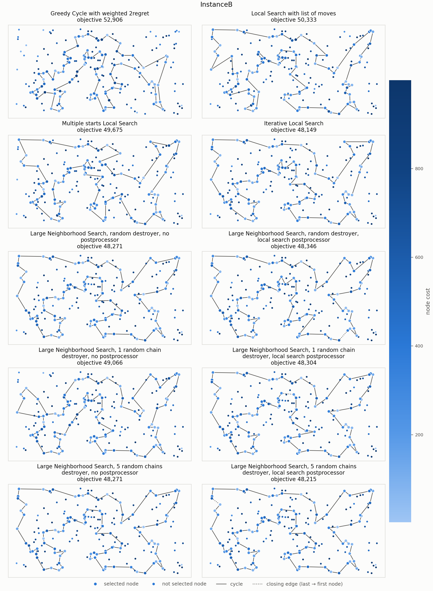

# Problem description

Given $n$ nodes, each with coordinates and a cost, select exactly
$m = \lceil n/2 \rceil$ nodes and form a Hamiltonian cycle through them. The
objective is to minimize the cycle length plus the costs of the selected nodes:

$$
f(C) = \sum_{i=1}^{m} d\left(C_i, C_{(i \bmod m) + 1}\right)
       + \sum_{i=1}^{m} c(C_i),
$$

where $d$ is the distance between two nodes and $c$ is the node cost. Distances
are Euclidean distances rounded mathematically to integers. Both instances
contain $n=200$ nodes, so each solution selects $m=100$.

# Compared algorithms

## Large neighborhood search (LNS)

LNS repeatedly destroys a part of the current solution $x$ and repairs it with
a greedy heuristic. The candidate $y$ replaces $x$ only if it is strictly
better, so $x$ is always the best solution found so far.

```
procedure LNS(timeLimit):
    x <- random solution of m = 100 nodes
    x <- LocalSearch(x)                        (always applied to the start)
    while elapsed time < timeLimit:
        y <- copy(x)
        Destroy(y, r)                          (remove r = 30 nodes, 30% of m)
        Repair(y)                              (greedy weighted 2-regret)
        if the LS version is used:
            y <- LocalSearch(y)
        if f(y) < f(x):
            x <- y
    return x
```

The starting solution is a random selection of 100 nodes in random order,
improved with the steepest local search with the list of moves (lab 5,
`ListOfMovesSolver`), which is also used after the repair in the LS versions.
It is the best (fastest) version of steepest local search we implemented: its
neighborhood contains the inter-route exchange of a selected node with an
unselected one and the intra-route two-edges exchange. The stopping condition
is the running time (see the computational experiment).

## Destroy operators

All three destroy operators remove $r = 0.3 \cdot m = 30$ of the 100 selected
nodes. The removed nodes simply become unselected; the remaining 70 nodes keep
their order, so the incomplete solution is still a cycle (the neighbors of a
removed part become adjacent).

### Random nodes

$r$ times a position is drawn uniformly from the current (shrinking) cycle and
the node at this position is removed. The removed nodes are therefore scattered
over the whole cycle.

```
procedure DESTROY-RANDOM(C, r):
    repeat r times:
        p <- uniform random position in 0 .. |C| - 1
        remove C[p] from C
```

### One random subpath

A single subpath of $r = 30$ consecutive nodes is removed. Its first position
is drawn uniformly; when the subpath passes the end of the vector it continues
from its beginning (the solution is a cycle).

### Several random subpaths

$q = 5$ subpaths of $r/q = 6$ consecutive nodes each are removed (the assignment
allows 3--5 subpaths; we use five). The subpaths are removed one after another,
each with a uniformly drawn start in the already shortened cycle, so two of them
can occasionally be adjacent and form one longer gap; the total number of
removed nodes is always 30. The one-subpath operator is the same procedure with
$q = 1$.

```
procedure DESTROY-SUBPATHS(C, r, q):
    for i <- 1 to q:
        l <- floor(r * i / q) - floor(r * (i - 1) / q)     (lengths sum up to r)
        s <- uniform random position in 0 .. |C| - 1
        remove C[s], C[s+1], ..., C[s+l-1] from C        (indices modulo |C|)
```

## Repair operator

The repair operator is the greedy cycle with the weighted 2-regret criterion
($\alpha = 0.5$, lab 2), started from the incomplete 70-node cycle instead of a
single node. It considers all unselected nodes, i.e. both the 30 just removed
nodes and the 100 nodes that were already outside the solution. In each step,
for every unselected node $v$ it computes the insertion cost into every edge
$(a, b)$ of the cycle, $\Delta = d(a,v) + d(v,b) - d(a,b) + c(v)$, takes the
best ($\Delta_1$) and second best ($\Delta_2$) one, and inserts the node that
maximizes $\alpha(\Delta_2 - \Delta_1) - (1-\alpha)\Delta_1$ at its best edge.
Nodes are inserted until the cycle again has 100 nodes, so the repair may select
different nodes than the removed ones.

```
procedure REPAIR(C):
    while |C| < m:
        for every unselected node v:
            Delta1(v), Delta2(v) <- two smallest insertion costs of v into an edge of C
        v* <- argmax over v of  alpha * (Delta2(v) - Delta1(v)) - (1 - alpha) * Delta1(v)
        insert v* into its best edge of C
```

We use the same repair heuristic for both instances. In lab 2 the weighted
2-regret greedy cycle was the best construction heuristic on instance A, and
weighted 2-regret nearest neighbor was slightly better on B; we chose the greedy
cycle for both because it works directly on a cycle, so the incomplete solution
does not have to be cut into an open path. The insertion costs are computed
from the objective delta (not by evaluating the whole solution); one repair of
30 nodes takes about 1 ms.

## Compared methods

Six LNS versions are tested: the three destroy operators (random nodes, one
subpath, five subpaths), each with (LNS+LS) and without (LNS) local search after
the repair. They are compared with the
best methods of the previous assignments: the greedy cycle with weighted
2-regret ($\alpha=0.5$, the best construction heuristic), the steepest local
search with the list of moves from a random start (the local search used inside
MSLS, ILS and LNS), MSLS with 400 local search runs, and the best ILS from lab 6
(16 random moves as the perturbation).

# Computational experiment

Each MSLS, ILS and LNS version was run 20 times per instance (seeds 0--19; the
seed is used both for the random starting solution and inside the method). The
greedy heuristic was started from each of the 200 nodes and the local search
from 200 random solutions. As required, the time limit of ILS and LNS is the
average running time of MSLS: since the experiment was run on a different
computer than lab 6, MSLS was rerun first on this machine (2558 ms on instance A
and 2469 ms on B on average), and the limit was set to 2500 ms for both
instances. The local search of the random starting solution of LNS (a few
milliseconds) is run before the timed loop. Lower objective values are better;
the tables show the average and the minimum--maximum range over the runs.

\begin{table}[H]
\centering
\small
\textbf{Objective function}\\[6pt]
\begin{tabular}{l r@{\ (}r@{ -- }r@{)\hspace{1.5em}} r@{\ (}r@{ -- }r@{)}}
\toprule
Method & \multicolumn{3}{c}{Instance A} & \multicolumn{3}{c}{Instance B} \\
\cmidrule(lr){2-4} \cmidrule(l){5-7}
& \multicolumn{3}{c}{av (min -- max)} & \multicolumn{3}{c}{av (min -- max)} \\
\midrule
Greedy cycle weighted 2-regret      & 73\,350 & 72\,011 & 75\,532 & 57\,771 & 52\,906 & 63\,326 \\
LS with list of moves, random start & 76\,235 & 73\,561 & 80\,874 & 52\,510 & 50\,333 & 56\,533 \\
MSLS (400 LS runs)                  & 73\,660 & 73\,187 & 74\,256 & 50\,206 & 49\,675 & 50\,458 \\
ILS, 16 random moves                & 71\,575 & 71\,484 & 71\,960 & 48\,277 & 48\,149 & 48\,665 \\
LNS, random nodes                   & 72\,238 & 71\,696 & 73\,041 & 49\,127 & 48\,271 & 50\,542 \\
LNS+LS, random nodes                & 72\,115 & 71\,698 & 72\,781 & 49\,067 & 48\,346 & 50\,410 \\
LNS, 1 subpath                      & 72\,221 & 71\,857 & 73\,094 & 49\,867 & 49\,066 & 50\,719 \\
LNS+LS, 1 subpath                   & 72\,112 & 71\,788 & 72\,894 & 49\,503 & 48\,304 & 50\,800 \\
LNS, 5 subpaths                     & 71\,796 & 71\,704 & 72\,111 & 48\,995 & 48\,271 & 50\,566 \\
LNS+LS, 5 subpaths                  & 71\,726 & 71\,679 & 71\,843 & 48\,716 & 48\,215 & 49\,362 \\
\bottomrule
\end{tabular}
\end{table}

\begin{table}[H]
\centering
\small
\textbf{Running time [ms]}\\[6pt]
\begin{tabular}{l r@{\ (}r@{ -- }r@{)\hspace{1.5em}} r@{\ (}r@{ -- }r@{)}}
\toprule
Method & \multicolumn{3}{c}{Instance A} & \multicolumn{3}{c}{Instance B} \\
\cmidrule(lr){2-4} \cmidrule(l){5-7}
& \multicolumn{3}{c}{av (min -- max)} & \multicolumn{3}{c}{av (min -- max)} \\
\midrule
Greedy cycle weighted 2-regret      & 4.3 & 3.3 & 7.1 & 4.3 & 3.2 & 6.2 \\
LS with list of moves, random start & 8.8 & 6.1 & 15.7 & 8.5 & 6.4 & 15.8 \\
MSLS (400 LS runs)                  & 2516.0 & 2451.0 & 2592.0 & 2476.1 & 2388.7 & 2561.7 \\
ILS, 16 random moves                & 2500.5 & 2500.0 & 2500.8 & 2500.3 & 2500.1 & 2500.7 \\
LNS, random nodes                   & 2500.6 & 2500.0 & 2501.2 & 2500.6 & 2500.0 & 2501.1 \\
LNS+LS, random nodes                & 2500.6 & 2500.1 & 2501.2 & 2500.8 & 2500.1 & 2501.8 \\
LNS, 1 subpath                      & 2500.5 & 2500.1 & 2501.1 & 2500.5 & 2500.0 & 2501.3 \\
LNS+LS, 1 subpath                   & 2500.6 & 2500.0 & 2501.3 & 2500.6 & 2500.0 & 2501.0 \\
LNS, 5 subpaths                     & 2500.7 & 2500.0 & 2501.1 & 2500.5 & 2500.0 & 2501.2 \\
LNS+LS, 5 subpaths                  & 2500.6 & 2500.1 & 2501.3 & 2500.7 & 2500.1 & 2501.2 \\
\bottomrule
\end{tabular}
\end{table}

\begin{table}[H]
\centering
\small
\textbf{Iterations of the main loop}\\[6pt]
\begin{tabular}{l r@{\ (}r@{ -- }r@{)\hspace{1.5em}} r@{\ (}r@{ -- }r@{)}}
\toprule
Method & \multicolumn{3}{c}{Instance A} & \multicolumn{3}{c}{Instance B} \\
\cmidrule(lr){2-4} \cmidrule(l){5-7}
& \multicolumn{3}{c}{av (min -- max)} & \multicolumn{3}{c}{av (min -- max)} \\
\midrule
ILS, 16 random moves                & 3\,348 & 3\,266 & 3\,397 & 3\,419 & 3\,274 & 3\,518 \\
LNS, random nodes                   & 2\,079 & 1\,881 & 2\,196 & 2\,056 & 1\,894 & 2\,242 \\
LNS+LS, random nodes                & 1\,902 & 1\,732 & 1\,997 & 1\,902 & 1\,774 & 2\,034 \\
LNS, 1 subpath                      & 2\,163 & 2\,066 & 2\,228 & 2\,193 & 2\,047 & 2\,330 \\
LNS+LS, 1 subpath                   & 2\,054 & 1\,965 & 2\,138 & 2\,044 & 1\,904 & 2\,141 \\
LNS, 5 subpaths                     & 2\,140 & 1\,984 & 2\,249 & 2\,100 & 1\,896 & 2\,259 \\
LNS+LS, 5 subpaths                  & 1\,921 & 1\,809 & 2\,018 & 1\,921 & 1\,753 & 2\,031 \\
\bottomrule
\end{tabular}
\end{table}

The iteration count of ILS is the number of perturbation + local search runs
after the local search of the starting solution, and the iteration count of
LNS is the number of destroy--repair(--LS) candidates evaluated after the local
search of the starting solution. All six LNS versions produced feasible
solutions (100 distinct nodes) in every run; the objective values were
recomputed independently from the node lists.

## Comparison of the destroy operators

Removing five short subpaths is the best destroy operator on both instances,
both without (71\,796 on A, 48\,995 on B) and with local search (71\,726 and
48\,716); with local search it also has the smallest spread on A
(71\,679--71\,843). The random-node and the single-subpath operators are
similar on A (about 72\,100--72\,240), but on B the single long subpath is
clearly the worst (49\,867 without LS). When one long subpath of 30 nodes is
removed, the greedy repair rebuilds one large region from scratch and it often
returns a similar path, while removing scattered nodes changes only single
insertions. Five shorter subpaths are a compromise: every gap is long enough to
let the repair reorder and replace a group of neighboring nodes, and the gaps
are spread over the whole cycle.

## Local search after the repair

Local search after the repair improved the average result for every destroy
operator on both instances (e.g. 49\,867 $\to$ 49\,503 for one subpath and
48\,995 $\to$ 48\,716 for five subpaths on B). It costs only 5--10\% of the
iterations (2\,140 $\to$ 1\,921 for five subpaths on A), because the repaired
solution is already close to a local optimum and the steepest local search with
the list of moves needs only a few steps. Most of the time of an iteration is
spent in the repair: one repair evaluates the insertion of about 130 unselected
nodes into about 85 edges for each of the 30 inserted nodes, which takes about
1 ms.

## Comparison with the previous methods

All LNS versions are much better than the construction heuristic, a single local
search and MSLS. The best LNS version (five subpaths with LS) is on average
1\,934 better than MSLS on A and 1\,490 better on B within the same time.
ILS with 16 random moves (lab 6) is still slightly better: 71\,575 vs 71\,726 on
A and 48\,277 vs 48\,716 on B, and it found the best solutions overall (71\,484
and 48\,149). ILS performs about 3\,350 iterations versus about 1\,900--2\,150 of
LNS, because its perturbation is cheap, whereas the greedy repair of LNS is the
most expensive part of an iteration.

# Visualization of the best solutions

Each panel shows the best solution of one method from the tables. Node color
encodes the node cost (darker means more expensive). Selected nodes are drawn
larger, the solid line shows the cycle, and the dotted line marks the edge from
the last node back to the first.




# Best solutions

The best solutions found by each LNS version. Node numbers are 0-based, as in
the data and source code.

## Instance A

**LNS, random nodes** (objective 71\,696)

```
 73  45  87 141  30 187 189   2 171  92 104 129  69 127  97 160 123 100 152 108
 49  11 168  63 149 116  60  31  48  80  91 157  71   4  76 132 180  28 102 185
 35  51  16  67 144 140  53 179  52 177  36 131  33   9  54   8 142 164 186 136
184 178  29 101   1 169   3  50  93  47 130 159 146 170 153 193  78  88 107  64
 57 182 138 151  42  89 113 106 150 174 176  72 134  84  58 158 192 181 114 135
```

**LNS+LS, random nodes** (objective 71\,698)

```
 35  51  16  67 144 140  53 179  52 177  36 131  33   9  54   8 142 164 186 136
184 178  29 101 147  47   1 169   3  50  93 130 159 146 170 153 193  78  88 107
 64  57 182 138 151  42  89 113 106 150 174 176  72 134  84  58 158 192 181 114
135  73  45  87 141  30 187 189   2 171  92  69 127  97 160  83 123 100 152 108
 49  11 168  63 149 116  60  31  48  80  91 157  71   4  76 132 180  28 102 185
```

**LNS, 1 subpath** (objective 71\,857)

```
 29 101  59   1 169   3  50  93  47 130 159 146 170 153 193  78  88 107  64  57
182 138 151  42  89 113 106 150 176  72 134  84  58 158 192 181 114 135  73  45
 87 141 189   2 171 187  30 161 127  97 160  83 123 100 152 108  49  11 168  63
149 116  60  31  48  80  91 157  71   4  76 132 180  28 102 185  35  51  16  67
144 140  53 179  52 177  36 131  33   9  54   8 174  85 142 164 186 136 184 178
```

**LNS+LS, 1 subpath** (objective 71\,788)

```
 11  63 149 116 168  97 127 161  30 187 171   2 189 141  87  45  73 135 114 181
192 158  58  84 134  72 176 174 150 106 113  89  42 151 138 182  57  64 107  88
 78 193 153 170 146 159 130  93  50   3 169   1  47  37 147 101  29 178 184 136
186 164 142   8  54   9  33 131  36 177  52 179  53 140 144  67  16  51  35 185
102  28 180 132  76   4  71 157  91  80  48  31  60 108 152 100 123  83 160  49
```

**LNS, 5 subpaths** (objective 71\,704)

```
158  58  84 134  72 176 174 150 106 113  89  42 151 138 182  57  64 107  88  78
193 153 170 146 159 130  47  93  50   3 169   1 101  29 178 184 136 186 164 142
  8  54   9  33 131  36 177  52 179  53 140 144  67  16  51  35 156  28 180 132
 76   4  71 157  91  80  48  31  60 116 149  63 168  11  49 108 152 100 123  83
160  97 127  69  92 171   2 189 187  30 141  87 102 185  45  73 135 114 181 192
```

**LNS+LS, 5 subpaths** (objective 71\,679)

```
 97 160 123 100 152 108  49  11 168  63 149 116  60  31  48  80  91 157  71   4
 76 132 180  28 102 185  35  51  16  67 144 140  53 179  52 177  36 131  33   9
 54   8 174  85  93  50   3 169   1 164 186 136 184 178  29 101 147  47 130 159
146 170 153 193  78  88 107  64  57 182 138 151  42  89 106 150 176  72 134  84
 58 158 192 181 114 135  73  45  87 141  30 187 189   2 171  92 104 129  69 127
```

## Instance B

**LNS, random nodes** (objective 48\,271)

```
 81  70 190 104  76 185  57  89 156  48  96 198 121  42 147 116  37 146  13 149
 28 145  65 178 103 132  29   6 197  36  62 175 134  45 157  60  40  71 155 115
170 125  26 154 140  47  38  21  30 183 189  69 160 172 136 133 120  72  46 184
  3 151  27  66  67  24  34 152 181 167  73  59  85  51  82  87 179  88  99 171
 17  74  20   2  14 153  90 129 127  80 192 162  54  78  10 114 196  61 105  94
```

**LNS+LS, random nodes** (objective 48\,346)

```
 74  20   2  14 153  90 129 127  80 192 162  54  78  10 114 196  61 105  94  81
187  70 190 104  76 185  57  89 156  48  96 198 121  42 147 116  37 146  13 149
 28 145  65 178 103 132  29   6 197  36  62 175 134  45 157  60  40  71 155 115
170 125  26 154 140  47  38  21  30 183  69 160 172 136 133 120 117  72  46 184
  3 151  98  73  59  85  51 167 181 152  34  24  67 179  82  87  88  99 171  17
```

**LNS, 1 subpath** (objective 49\,066)

```
191 130 121 198  96  48 156  89  57 185  76 162 192  54 104 190  70 187 169  81
 94 105  61 196 114  10  78 127  80 129  90 153  14   2  20  74  17 171  99  88
179  87  82  51  85  59  73 167 181 152  34  24  98 151   3 184  46  72 117   8
120 133 136 172 160  69 124  64  33  40 155  71  60 157  45 134 175  62  36 197
132  29   6 180 115 170 125 177  65 145  28 149 158  26 154 140  47  38  21  30
```

**LNS+LS, 1 subpath** (objective 48\,304)

```
 72  46 184   3 151  98  34  24  67 152 181 167  73  59  85  51 179  82  87  88
 99 171  17  74  20   2  14 153  90 129 127  80 192 162  54  78  10 114 196  61
105  94  81  70 190 104  76 185  57  89 156  48  96 198 121  42 147 116  37 146
 13 149  28 145  65 178 103 132  29   6 197  36  62 175 134  45 157  60  40  71
155 115 170 177 125  26 154 140  47  38  21  30 183 189  69 160 172 136 133 120
```

**LNS, 5 subpaths** (objective 48\,271)

```
 51  82  87 179  88  99 171  17  74  20   2  14 153  90 129 127  80 192 162  54
 78  10 114 196  61 105  94  81  70 190 104  76 185  57  89 156  48  96 198 121
 42 147 116  37 146  13 149  28 145  65 178 103 132  29   6 197  36  62 175 134
 45 157  60  40  71 155 115 170 125  26 154 140  47  38  21  30 183 189  69 160
172 136 133 120  72  46 184   3 151  27  66  67  24  34 152 181 167  73  59  85
```

**LNS+LS, 5 subpaths** (objective 48\,215)

```
149  28 145  65 178 103 132  29   6 197  36  62 175 134  45 157  60  40  71 155
115 170 177 125  26 154 140  47  38  21  30 183 189  69 160 172 136 133 120  72
 46 184   3 151  27  66  67  24  34 152 181 167  73  59  85  51  82  87 179  88
 99 171  17  74  20   2  14 153  90 129 127  80 192 162  54  78  10 114 196  61
105  94  81  70 190 104  76 185  57  89  48  96 198 121  42 147 116  37 146  13
```

# Solution checker

<!-- TODO before submitting: check the best LNS solutions in Solution checker.xlsx -->

All solutions of all runs were verified with an independent script: every
solution contains 100 distinct nodes from 0--199, and the objective recomputed
from the instance data matches the value reported by our program.

# Conclusions

- **LNS is a strong method.** All six versions are clearly better than the
  best construction heuristic, a single local search and MSLS run for the same
  time (best LNS: 71\,726 on A and 48\,716 on B on average, MSLS: 73\,660 and
  50\,206).
- **Removing several short subpaths is the best destroy operator**, better
  than removing random nodes and much better than removing one long subpath
  (on instance B). It keeps some locality (neighboring nodes are removed
  together) but spreads the changes over the whole cycle.
- **Local search after the repair always helps.** It improves every version
  on both instances, and it costs only 5--10\% of the iterations, because the
  greedy repair dominates the running time of one iteration.
- **ILS from lab 6 remains slightly better than LNS** in our implementation
  (71\,575 and 48\,277 on average). Its iterations are cheaper (about 3\,350
  vs 2\,000 in 2.5 s); a faster repair (e.g. keeping the insertion costs between
  the steps of the greedy heuristic) would allow LNS to make more iterations.
- **Time limit.** As the experiment was run on a different machine than the
  previous one, MSLS was rerun on it and the time limit of ILS and LNS was set to
  its average running time (2.5 s).

# Source code and data

LNS is implemented in `src/lab7_algos/LNS.cpp`, and the destroy operators in
`src/lab7_algos/RandomDestroyer.cpp` (random nodes) and
`src/lab7_algos/RandomChainDestroyer.cpp` (one or several subpaths). Repair is
`src/lab2_algos/GreedyCycle_2regret.cpp` and the local search
`src/lab5_algos/ListOfMovesSolver.cpp`. MSLS and ILS are in `src/lab6_algos/`.

The experiment is defined in `tests/lab7_test.py` and run with
`python3 scripts/run_experiment.py`; the raw results are in
`results/lab7_results.json`. The tables are generated with
`python3 scripts/generate_tables.py` and the figures and node lists with
`python3 scripts/plot_best_solution.py`.
