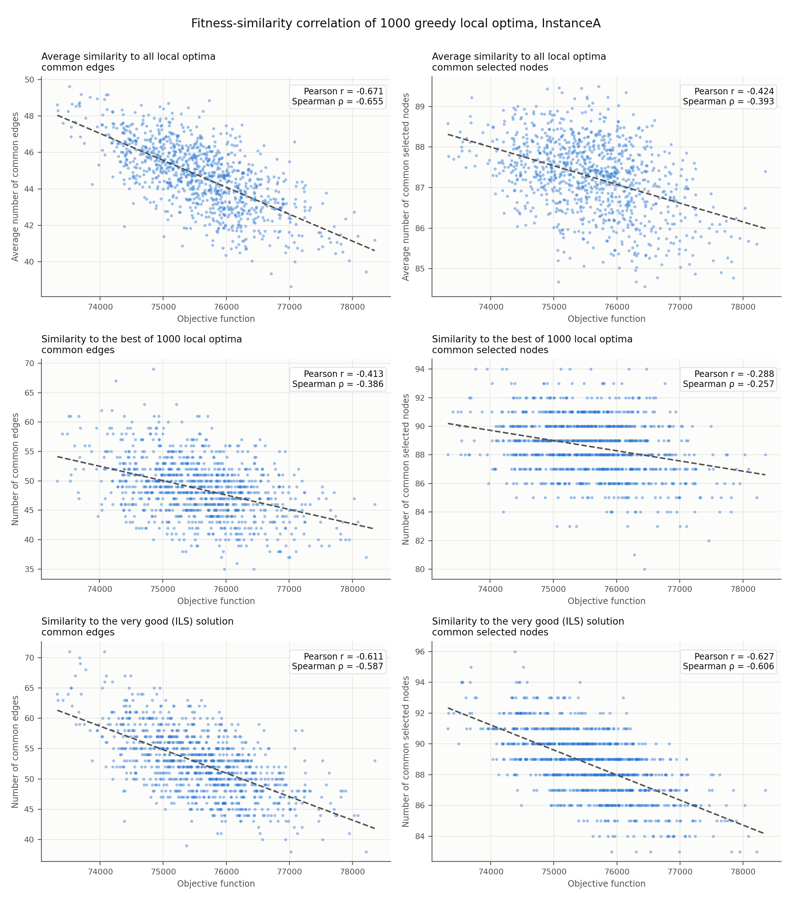
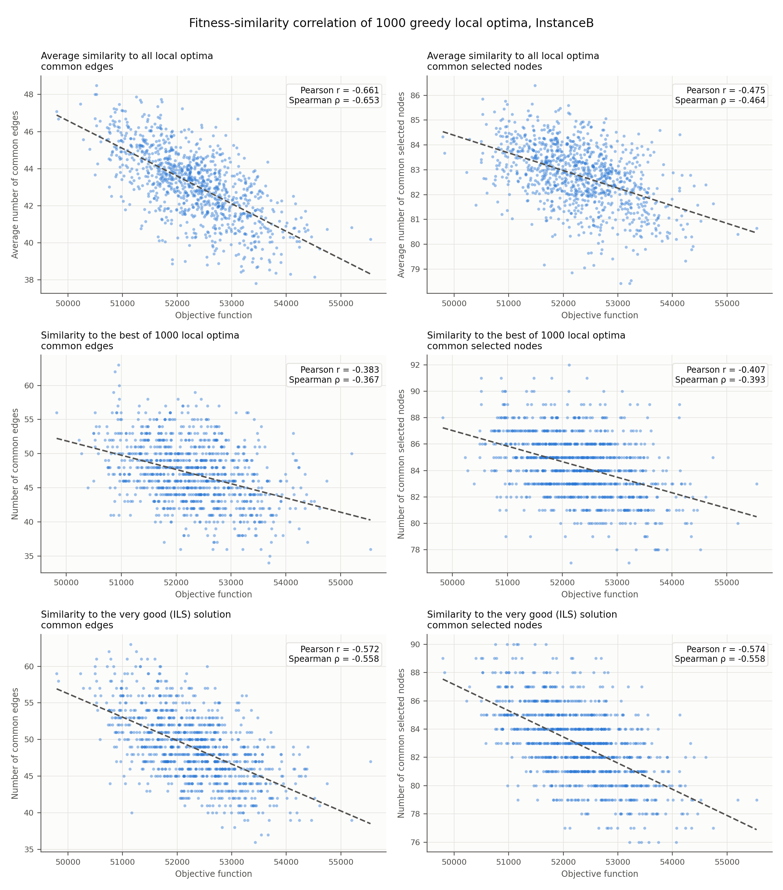

# Problem description

Given $n$ nodes, each with coordinates and a cost, select exactly
$m = \lceil n/2 \rceil$ nodes and form a Hamiltonian cycle through them. The
objective is to minimize the cycle length plus the costs of the selected nodes:

$$
f(C) = \sum_{i=1}^{m} d\left(C_i, C_{(i \bmod m) + 1}\right)
       + \sum_{i=1}^{m} c(C_i),
$$

where $d$ is the distance between two nodes and $c$ is the node cost. Distances
are Euclidean distances rounded mathematically to integers. Both instances
contain $n=200$ nodes, so each solution selects $m=100$.

# Global convexity tests

The goal of this assignment is to check whether the problem is globally convex,
i.e. whether good local optima are more similar to each other (and to very good
solutions) than worse ones. We measure the correlation between the objective
value of a local optimum and its similarity to other good solutions.

## Local optima

For each instance we generated 1000 local optima. Each one is obtained from a
different random solution (seeds 0--999) improved by the greedy local search
from lab 3: the neighborhood consists of the exchange of a selected node with an
unselected one and of the two-edges exchange, moves are browsed in a randomized
order and the first improving move is applied, until no improving move exists.

\begin{table}[H] 
\centering 
\small 
\textbf{1000 local optima of greedy local search}\\[6pt] 
\begin{tabular}{l r@{\ (}r@{ -- }r@{)\hspace{1.5em}} r@{\ (}r@{ -- }r@{)}} 
\toprule 
Statistic & \multicolumn{3}{c}{Instance A} & \multicolumn{3}{c}{Instance B} \\ 
\cmidrule(lr){2-4} \cmidrule(l){5-7} 
& \multicolumn{3}{c}{av (min -- max)} & \multicolumn{3}{c}{av (min -- max)} \\ 
\midrule
Objective function            & 75\,585 & 73\,319 & 78\,355 & 52\,288 & 49\,792 & 55\,543 \\
Running time [ms]             & 7.298 & 3.458 & 19.147 & 4.877 & 2.103 & 10.314 \\
Local search steps            & 507 & 436 & 594 & 513 & 430 & 599 \\
\bottomrule 
\end{tabular} 
\end{table} 

All 1000 local optima of each instance are different solutions.

## Good solutions

The similarity of a local optimum is computed in three versions:

1. **Average similarity** to all the other 999 local optima.
2. **Similarity to the best of the 1000 local optima** (73\,319 on instance A,
   49\,792 on instance B). The best local optimum itself is not included in the
   chart and in the correlation, because it would be an outlier with 100\%
   similarity to itself, so these results contain 999 points.
3. **Similarity to a very good solution** generated by our best method so far,
   iterated local search: the best ILS solution from lab 6 (71\,484 on
   instance A, 48\,149 on instance B). It is not one of the 1000 local optima,
   so all 1000 points are used.

## Similarity measures

Two measures are used separately; both are between 0 and 100.

**Common edges.** The problem is symmetric, so an edge is an unordered pair of
nodes: the edge $(a, b)$ is the same as $(b, a)$, regardless of the direction in
which the cycle is written. The edge closing the cycle (from the last node to the
first one) is also included.

**Common selected nodes.** The number of nodes selected in both solutions,
regardless of their order in the cycles.

```
procedure EDGES(C):
    E <- {}
    for i <- 1 to |C|:
        a <- C[i];  b <- C[(i mod |C|) + 1]          // includes the closing edge
        E <- E + {(min(a, b), max(a, b))}            // undirected edge
    return E

procedure COMMON-EDGES(A, B):
    return |EDGES(A) intersected with EDGES(B)|

procedure COMMON-NODES(A, B):
    return |set(A) intersected with set(B)|
```

```
procedure SIMILARITIES(L, G, sim):        // L: 1000 local optima, G: very good solution
    best <- argmin over A in L of f(A)
    for every A in L:
        average(A) <- sum of sim(A, B) over B in L, B != A, divided by |L| - 1
        if A != best:
            toBest(A) <- sim(A, best)     // the best itself is left out
        toGood(A) <- sim(A, G)
```

For every chart we computed the Pearson correlation coefficient between the
objective value and the similarity. Additionally we give the Spearman rank
correlation coefficient, which does not assume a linear relationship. The
objective is minimized, so global convexity shows as a *negative* correlation:
the lower (better) the objective, the higher the similarity.

# Results

## Correlation coefficients

\begin{table}[H] 
\centering 
\small 
\textbf{Correlation coefficients between the objective function and similarity}\\[6pt] 
\begin{tabular}{l l r r r r} 
\toprule 
Similarity & Measure & \multicolumn{2}{c}{Instance A} & \multicolumn{2}{c}{Instance B} \\ 
\cmidrule(lr){3-4} \cmidrule(l){5-6} 
& & Pearson & Spearman & Pearson & Spearman \\ 
\midrule
Average to all local optima & common edges & $-$0.671 & $-$0.655 & $-$0.661 & $-$0.653 \\
To the best of 1000 local optima & common edges & $-$0.413 & $-$0.386 & $-$0.383 & $-$0.367 \\
To the very good (ILS) solution & common edges & $-$0.611 & $-$0.587 & $-$0.572 & $-$0.558 \\
\midrule
Average to all local optima & common nodes & $-$0.424 & $-$0.393 & $-$0.475 & $-$0.464 \\
To the best of 1000 local optima & common nodes & $-$0.288 & $-$0.257 & $-$0.407 & $-$0.393 \\
To the very good (ILS) solution & common nodes & $-$0.627 & $-$0.606 & $-$0.574 & $-$0.558 \\
\bottomrule 
\end{tabular} 
\end{table}

\newpage

## Charts

Each figure shows the 6 charts of one instance: the rows are the three versions
of similarity, the left column uses common edges and the right column common
selected nodes. The x-axis is the objective value of a local optimum, the y-axis
its (average) similarity; the dashed line is the least-squares linear fit.

{height=90%}

{height=90%}

# Conclusions

- **Both instances are globally convex for both similarity measures.** All 12
  correlations are negative (Pearson from $-0.29$ to $-0.67$): local optima with a
  lower objective share more edges and more selected nodes with other good
  solutions. Spearman coefficients are close to Pearson ones, so the relation is
  monotonic and not caused by a few outliers.
- **For common edges, the average similarity gives the strongest correlation**
  ($-0.67$ on A, $-0.66$ on B), as in the experiment of Boese, Kahng and Muddu
  for the TSP. The average over 999 solutions smooths out the noise, while the
  similarity to a single solution depends on which solution is chosen.
- **The best of 1000 local optima is a weak reference** ($-0.41$/$-0.38$ for
  edges, $-0.29$/$-0.41$ for nodes). It is only one greedy local optimum, worse
  than the ILS solution by 2.6\% on A and 3.4\% on B, so it lies far from the bottom
  of the "valley". The ILS solution is a much better reference: the correlations
  rise to $-0.61$/$-0.57$ for edges and $-0.63$/$-0.57$ for nodes.
- **The local optima are very similar to each other.** Two local optima share on
  average 45 (A) and 43 (B) edges and 87 (A) and 83 (B) selected nodes, while two
  random solutions would share about 0.5 edges and 50 nodes. The best local
  optimum shares 64 (A) and 59 (B) edges and 91 (A) and 89 (B) nodes with the
  ILS solution.
- **Common nodes is a coarser measure.** It takes only a few integer values
  (mostly 80--94 of 100), which shows as horizontal stripes in the charts, and its
  average version correlates more weakly than for edges ($-0.42$/$-0.48$).
  Almost all local optima select the same core of cheap, central nodes, so
  being similar to the other optima means being typical rather than being good.
  On the other hand, the similarity to the ILS solution is as strongly correlated
  for nodes as for edges: choosing the right set of nodes is an important feature
  of good solutions.
- **Consequences for the methods.** Good solutions lie close to each other, which
  explains why ILS and LNS work well (they search near the current good
  solution instead of restarting from scratch, as MSLS does), and suggests that
  a recombination operator which preserves the edges and nodes common to two
  good parents should produce good offspring.
